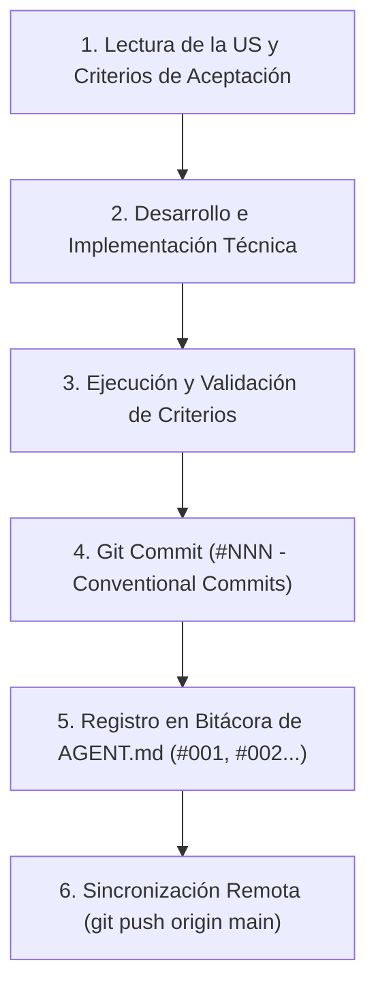

# Guía y Contexto Operativo para Agentes de Inteligencia Artificial (AGENT.md)

> **AVISO PARA EL AGENTE DE IA / COPILOTO:**  
> Este documento contiene el contexto integral del proyecto, la arquitectura metodológica, las reglas de negocio, el backlog de historias de usuario y el **Protocolo Obligatorio de Commits y Trazabilidad**.  
> **Cualquier agente de IA o colaborador debe leer y respetar este archivo antes y durante el desarrollo de cualquier tarea.**

---

## 1. Visión del Proyecto y Contexto de Negocio

### 1.1. Título y Alcance
- **Proyecto:** Sistema Predictivo de Disponibilidad y Precios de Insulina con Asistente Conversacional (Chatbot) para Pacientes Insulinodependientes.
- **Ubicación Geográfica:** Santa Cruz de la Sierra, Bolivia (anillos urbanos 1 al 8).
- **Marco Temporal de Análisis:** Segundo semestre de 2026.
- **Repositorio Remoto Oficial:** [https://github.com/Data-Industry/Desarollo-Proyecto](https://github.com/Data-Industry/Desarollo-Proyecto)
- **Tablero Jira Cloud:** [https://danielmerengue0.atlassian.net/jira/software/projects/SCRUM/boards/1/backlog](https://danielmerengue0.atlassian.net/jira/software/projects/SCRUM/boards/1/backlog)

### 1.2. El Problema y Causas Raíz
Los pacientes jubilados con diabetes insulinodependientes en Santa Cruz de la Sierra enfrentan dificultades críticas para acceder oportunamente a insulina importada debido a la falta de visibilidad del stock disponible en farmacias.
- **Inventarios aislados:** Las farmacias gestionan sus existencias de manera independiente sin una plataforma consolidada.
- **Brecha digital y movilidad reducida:** La población de adultos mayores presenta barreras para navegar portales web complejos, obligándolos a peregrinar físicamente bajo condiciones climáticas adversas (calor extremo) con alto riesgo de interrumpir su tratamiento médico.

### 1.3. Preguntas Clave
- **Pregunta de Investigación:** ¿Cuáles son los factores que permiten predecir la disponibilidad de insulina importada para los pacientes jubilados con diabetes en Santa Cruz de la Sierra durante el segundo semestre de 2026?
- **Pregunta Analítica:** ¿Qué variables temporales, territoriales y de abastecimiento permiten predecir si una farmacia tendrá disponibilidad de insulina importada en un periodo determinado?

### 1.4. Solución Integral y Arquitectura Analítica
1. **Pipeline de Ingesta Dual (Oferta y Demanda):**
   - **Demanda / Stock Inmediato:** Web scraping automatizado periódico de portales de farmacias en Santa Cruz (Farmacorp, Farmacias Chávez, Farmacias Telchi).
   - **Oferta Macro / Importaciones Upstream:** Ingesta y normalización de registros oficiales de comercio exterior (INE / Aduana Nacional de Bolivia) bajo la partida arancelaria NANDINA `3004.31.00.00` (*Medicamentos que contengan insulina*).
2. **Dataset Maestro Analítico:** Normalización estricta de medicamentos de insulina pura en `insulinas_master.csv`, excluyendo descartables (jeringas/agujas) y fármacos ajenos hacia bitácoras de auditoría.
3. **Modelos Predictivos y Semáforo de Alerta Preventiva:**
   - Modelado de desfase temporal (*Lag logístico* entre arribo aduanero y distribución en farmacia).
   - Clasificación supervisada de probabilidad de stock ($P \ge 70\%$) y semaforización predictiva (`VERDE`, `AMARILLO`, `ROJO`).
   - Detección estadística de dispersión y anomalías de precios por 100 UI.
   - Análisis espacial de densidad y cobertura territorial por anillos urbanos (1 al 8).
4. **Chatbot Conversacional Accesible:** Interfaz simple en lenguaje natural para que el adulto mayor o su familiar consulte disponibilidad inmediata, precios y alternativas cercanas sin navegar en sitios web complejos.
5. **Dashboard Analítico:** Visualización interactiva para monitoreo preventivo y tomadores de decisión.

---

## 2. Metodología de Trabajo y Tablero de Control

El proyecto sigue el estándar **CRISP-DM** en 6 fases, sincronizado 1:1 con **Jira Cloud** (Clave `SCRUM`, 18 Historias de Usuario, 94 Story Points en total).

### 2.1. Matriz Oficial del Product Backlog (Sincronizada con Jira Cloud)

| Épica (Fase CRISP-DM) | Clave Jira | Código US | Historia de Usuario | SP | Estado / Asignación |
| :--- | :---: | :---: | :--- | :---: | :--- |
| **Fase 1: Comprensión del Negocio** | `SCRUM-28` | `US-19` | Integración y automatización de repositorio GitHub con directorio local | 7 | **Completada (Sprint 1)** |
| **Fase 1: Comprensión del Negocio** | `SCRUM-15` | `US-11` | Definición del problema de negocio, perfil de actores y pregunta de investigación | 3 | **Completada (Sprint 1)** |
| **Fase 2: Comprensión de los Datos** | `SCRUM-27` | `US-20` | Extracción automatizada (Web Scraping) de stock y precios en portales de farmacias | 7 | **Completada (Sprint 1)** |
| **Fase 2: Comprensión de los Datos** | `SCRUM-23` | `US-21` | Ingesta y normalización de importaciones aduaneras de insulina (Partida 3004.31.00.00) | 7 | **Completada (Sprint 2)** |
| **Fase 2: Comprensión de los Datos** | `SCRUM-20` | `US-16` | Auditoría automatizada de calidad de datos y análisis exploratorio (EDA) | 5 | **Completada (Sprint 2)** |
| **Fase 2: Comprensión de los Datos** | `SCRUM-7` | `US-03` | Script de geolocalización de sucursales farmacéuticas y mapeo por anillos urbanos (1 al 8) | 5 | **Completada (Sprint 2 - Mía)** |
| **Fase 2: Comprensión de los Datos** | `SCRUM-43` | `US-28` | Ingesta automatizada del tipo de cambio oficial del BCB y serie histórica diaria | 3 | **Completada (Sprint 2)** |
| **Fase 3: Preparación de los Datos** | `SCRUM-36` | `US-22` | Pipeline ETL de limpieza, estandarización de precios y normalización de insulinas | 5 | **Completada (Sprint 1)** |
| **Fase 3: Preparación de los Datos** | `SCRUM-42` | `US-27` | Fusión de fuentes (Scraping + Importaciones) y modelado de desfase temporal (Lag) de abastecimiento | 5 | **Completada (Sprint 2 - Mía)** |
| **Fase 3: Preparación de los Datos** | `SCRUM-37` | `US-23` | Script de imputación zonal de valores faltantes y cruce con calendario bancario | 5 | **Completada (Sprint 3 - Mía)** |
| **Fase 3: Preparación de los Datos** | `SCRUM-24` | `US-02` | Ingeniería de características (Feature Engineering) y matriz correlacional de variables | 3 | **Completada (Sprint 3 - Mía)** |
| **Fase 4: Modelado** | `SCRUM-9` | `US-05` | Entrenamiento de modelo supervisado de clasificación de disponibilidad de stock | 8 | **Completada (Sprint 3)** |
| **Fase 6: Despliegue** | `SCRUM-44` | `US-29` | MVP Visualizador Didáctico e Interactivo Local de Precios, Stock y Farmacias por Anillo para Jubilados | 5 | **Completada (Sprint 3 - MVP)** |
| **Fase 5: Evaluación** | `SCRUM-38` | `US-24` | Evaluación de modelos con optimización de Recall (Sensibilidad) y validación cruzada | 5 | Backlog (Sprint 4) |
| **Fase 5: Evaluación** | `SCRUM-39` | `US-25` | Script de generación automatizada de reportes de desempeño y Feature Importance | 3 | Backlog (Sprint 4) |
| **Fase 6: Despliegue** | `SCRUM-10` | `US-06` | Motor lógico del semáforo predictivo conectado a las salidas de los modelos | 5 | Backlog (Sprint 4) |
| **Fase 6: Despliegue** | `SCRUM-41` | `US-26` | Desarrollo e integración del Chatbot conversacional para consulta de stock y precios | 8 | Backlog (Sprint 4) |
| **Fase 6: Despliegue** | `SCRUM-40` | `US-10` | Sistema automatizado de alertas preventivas de compra anticipada vía Chatbot | 5 | Backlog (Sprint 4) |

### 2.2. Distribución y Capacidad por Sprints
- **SCRUM Sprint 1 (Cerrado - 22 SP):** `SCRUM-28` (7 SP) + `SCRUM-15` (3 SP) + `SCRUM-27` (7 SP) + `SCRUM-36` (5 SP) = **22 Story Points**.
- **SCRUM Sprint 2 (Cerrado al 100% - 25 SP):** `SCRUM-23` (7 SP) + `SCRUM-20` (5 SP) + `SCRUM-7` (5 SP) + `SCRUM-42` (5 SP) + `SCRUM-43` (3 SP) = **25 Story Points**.
- **SCRUM Sprint 3 (Cerrado al 100% - 21 SP):** `SCRUM-37` (5 SP) + `SCRUM-24` (3 SP) + `SCRUM-9` (8 SP) + `SCRUM-44` (5 SP) = **21 Story Points**.
- **SCRUM Sprint 4 (Backlog Priorizado: Evaluación y Despliegue - 26 SP):** `SCRUM-38` (5 SP) + `SCRUM-39` (3 SP) + `SCRUM-10` (5 SP) + `SCRUM-41` (8 SP) + `SCRUM-40` (5 SP) = **26 Story Points**.
- **Total Proyecto:** 18 Historias | **94 Story Points**.

---

## 3. Arquitectura del Repositorio y Estándares Técnicos

### 3.1. Estructura de Directorios (CRISP-DM)
```
Proyecto Integrador/
├── data/
│   ├── raw/                  # Datasets crudos (scraping web e importaciones aduaneras INE)
│   └── processed/            # Datasets maestros normalizados (insulinas_master.csv, importaciones_insulina.csv, descartes)
├── docs/                     # Documentación formal por fase CRISP-DM (01_comprension_negocio.md, etc.)
├── src/
│   ├── scraping/             # Scrapers de farmacias (Farmacorp, Chávez, Telchi)
│   ├── etl/                  # Pipelines ETL de insulinas e importaciones aduaneras
│   ├── models/               # Scripts de entrenamiento, inferencia y evaluación ML
│   └── chatbot/              # Backend conversacional y conectores de chat
├── AGENT.md                  # Este documento (Contexto, lineamientos y bitácora obligatoria)
├── tablero_jira.md           # Resumen detallado del backlog de Jira
└── .gitignore                # Reglas de exclusión de git
```

### 3.2. Reglas de Negocio y Calidad de Datos
1. **Foco Estricto en Insulinas Puras:** En `data/processed/insulinas_master.csv` solo deben residir medicamentos de insulina (viales, frascos ampolla, cartuchos, lapiceras). Los descartables (jeringas, agujas) y fármacos ajenos se excluyen y se registran en `descartes_insumos_desechables.csv`.
2. **Partida Arancelaria Oficial de Insulina:** Toda ingesta aduanera debe filtrar y validar exclusivamente la subpartida NANDINA `3004.31.00.00` (*Que contengan insulina*), depurando otras partidas.
3. **Manejo de Errores en Windows:** Siempre considerar que si un archivo `.csv` está abierto en Microsoft Excel, lanzará `PermissionError`. Los scripts deben manejar excepciones y no interrumpir el flujo.
4. **Codificación:** Utilizar siempre `utf-8-sig` en exportaciones `.csv` para compatibilidad universal con Excel y caracteres latinos (acentos, ñ).

---

## 4. PROTOCOLO OBLIGATORIO DE DESARROLLO Y COMMITS PARA EL AGENTE IA

A partir de ahora, **cada agente de IA que colabore en el proyecto debe ejecutar de forma obligatoria el siguiente ciclo de 6 pasos para cada tarea o Historia de Usuario asignada**:



### Detalle de los Pasos:

1. **Lectura y Estructura de Requisitos (Formato Ágil Obligatorio):**
   Toda Historia de Usuario (`US-XX`) creada o actualizada en Jira y en la documentación DEBE estar redactada estrictamente bajo la estructura estándar ágil:
   ```markdown
   **Como** [rol: Jubilado con diabetes en Santa Cruz / Ingeniero de Datos / Científico de Datos / Product Owner],
   **Quiero** [funcionalidad, pipeline, análisis o entrega técnica concreta],
   **Para** [beneficio medible, valor de negocio o impacto clínico/económico en el usuario].

   **Criterios de Aceptación / Validación:**
   - [ ] Criterio 1: [Requisito verificable / prueba unitaria / archivo generado]
   - [ ] Criterio 2: [Métricas de calidad / tolerancias / reglas de negocio]
   - [ ] Criterio 3: [Documentación técnica y reproducibilidad]
   ```
   *Nota:* No se aceptan historias de usuario formuladas como simples tareas técnicas impersonales sin rol ni beneficio explícito.

2. **Implementación:** Crear o modificar el código, scripts o documentación respetando la estructura CRISP-DM.
3. **Validación Técnica:** Ejecutar los scripts en el entorno local y comprobar de forma explícita que se satisfacen todos los criterios de aceptación sin errores (pruebas unitarias automatizadas).
4. **Git Commit:** Crear el commit en la rama `main` siguiendo la convención:
   - Formato: `#NNN - <tipo>(<alcance>): <descripción concisa>` (e.g. `#011 - feat(etl): implement public import pipeline for insulin NANDINA 3004.31.00.00`).
   - Tipos válidos: `feat`, `fix`, `docs`, `refactor`, `test`, `chore`.
5. **Registro Obligatorio en la Bitácora de `AGENT.md`:**  
   Inmediatamente después de realizar el commit, el agente **DEBE** agregar una fila a la **Tabla de Trazabilidad de Commits** (Sección 5 de este archivo), documentando:
   - **N° Commit:** Número secuencial incremental en orden ascendente (`#001`, `#002`, ..., `#010`, `#011`, etc.).
   - **Hash Git:** Short hash de 7 caracteres del commit generado.
   - **Historia de Usuario / Clave Jira.**
   - **Sprint y Fecha.**
   - **Descripción técnica de lo realizado.**
   - **Confirmación explícita de criterios de validación alcanzados.**
6. **Sincronización:** Ejecutar `git push origin main` para asegurar que el repositorio remoto en GitHub quede actualizado y disponible para el resto del equipo.
7. **Reporte al Usuario:** Comunicar en el mensaje final el N° de commit, el hash, los criterios validados y el estado actualizado del proyecto.

---

## 5. Bitácora Oficial de Commits y Trazabilidad de Historias de Usuario

*Esta tabla se mantiene estrictamente en **orden ascendente por N° de commit secuencial**:*

| N° Commit | Hash Git | Historia / Tarea | Sprint | Fecha | Resumen de lo Desarrollado | Criterios de Validación Alcanzados |
| :---: | :---: | :---: | :---: | :---: | :--- | :--- |
| **#001** | `962fe0c` | `US-11` (Inicial) | Sprint 1 | 2026-10-18 | Carga de investigación inicial del problema de desabastecimiento de insulina. | Documento base de contextualización de pacientes con diabetes en Santa Cruz. |
| **#002** | `b74749f` | `US-20` (`SCRUM-27`) | Sprint 1 | 2026-10-19 | Scrapers automatizados para Farmacorp, Farmacias Chávez (Playwright) y Telchi (WooCommerce). | Extracción exitosa de 52 registros brutos en `data/raw/insulina_precios_stock_latest.csv` con precios, stock y URL. |
| **#003** | `e9e863a` | `US-19` (`SCRUM-28`) | Sprint 1 | 2026-10-19 | Limpieza de archivos obsoletos (`investigacion-inicial.md`) y preparación para estandarización. | Repositorio limpio de archivos no conformes a la estructura CRISP-DM. |
| **#004** | `09744b5` | `US-19` (`SCRUM-28`) | Sprint 1 | 2026-10-19 | Creación de directorios estándar CRISP-DM (`data/raw`, `data/processed`, `src/scraping`, `src/etl`, `src/models`, `src/chatbot`, `docs`). | Estructura de carpetas creada, versionada con `.gitkeep` y sincronizada con GitHub `origin/main`. |
| **#005** | `b112494` | `US-11` (`SCRUM-15`) | Sprint 1 | 2026-10-19 | Documentación formal de la Fase 1 CRISP-DM (`docs/01_comprension_negocio.md`). | Problema de negocio, causa raíz (inventarios aislados y brecha digital), actor validado y pregunta analítica delimitados. |
| **#006** | `25a6a4a` | `US-22` (`SCRUM-36`) | Sprint 1 | 2026-10-19 | Pipeline ETL en `src/etl/etl_insulinas.py`, generación de dataset maestro y bitácora de descartes. | 9 descartables/fármacos no insulina excluidos (`descartes_insumos_desechables.csv`); 43 medicamentos de insulina pura normalizados con 25 campos en `insulinas_master.csv` y `.json`. |
| **#007** | `22c8056` | Ops / `US-19` | Sprint 1 | 2026-10-21 | Creación inicial de `AGENT.md` con contexto operativo del proyecto y reglas de trazabilidad. | Guía para agentes de IA integrada y documentada en la raíz del repositorio. |
| **#008** | `addfab6` | Ops / `US-19` | Sprint 1 | 2026-10-21 | Sincronización y ajuste inicial de bitácora en `AGENT.md`. | Trazabilidad alineada con GitHub. |
| **#009** | `7b0c494` | Ops / Refactor | Sprint 1 | 2026-10-21 | Numeración ascendente secuencial (#001-#009), adición de `US-21` (7 SP) y `US-27` (5 SP) al Sprint 2 (22 SP), eliminación de US-08 redundante. | Backlog cuadrado en 96 SP (18 US), Sprint 2 configurado con 22 SP y protocolo de commits ordenado secuencialmente. |
| **#010** | `f6932f1` | Ops / Sync | Sprint 1 | 2026-10-21 | Sincronización y ajuste de hashes git en la bitácora de `AGENT.md`. | Bitácora 100% consistente con la historia de git. |
| **#011** | `a4ae488` | Ops / Jira Sync | Sprint 2 | 2026-10-22 | Limpieza y sincronización directa en Jira Cloud: eliminación de SCRUM-12, creación de SCRUM-42 (US-27), actualización de SCRUM-23 (US-21) a 7 SP y mapeo 1:1 de claves. | Tablero Jira Cloud auditado y 100% cuadrado en 18 US y 96 SP (Sprint 1: 22 SP, Sprint 2: 22 SP, Backlog: 52 SP). |
| **#012** | `2a431fb` | `US-21` (`SCRUM-23`) | Sprint 2 | 2026-10-25 | Pipeline ETL de importaciones aduaneras de insulina en Bolivia (NANDINA 3004.31.00.00), filtro estricto con auditoría de descartes no insulina, métricas financieras/clínicas y semáforo preventivo upstream en data/processed/. | 100% verificado: 70 despachos de insulina pura, 6 descartes auditados, dataset maestro CSV/JSON, resumen mensual con alertas tempranas y 8/8 pruebas unitarias aprobadas. |
| **#013** | `2c34fb8` | `US-21` (`SCRUM-23`) | Sprint 2 | 2026-10-25 | Integración del régimen de Tipo de Cambio Fluctuante (BOB/USD) en el pipeline ETL de importaciones, exportación de matriz histórica de divisas y recálculo de costos de reposición farmacéutica en Bs. | Verificado con 8/8 tests aprobados: sustitución del 6.96 estático por cotización dinámica mensual/diaria, validación matemática de CIF BOB y documentación en docs/02_importaciones_aduaneras.md. |
| **#014** | `dea2604` | `US-16` (`SCRUM-20`) | Sprint 2 | 2026-10-25 | Auditoría automatizada de calidad y EDA multifuente integrando scraping retail de farmacias e importaciones aduaneras con tipo de cambio fluctuante; generación de 5 figuras estadísticas en docs/figures/ y 4 tablas analíticas en data/processed/. | 100% verificado: 5/5 pruebas unitarias aprobadas, análisis de dispersión de precios entre cadenas (hasta 17.4% de brecha en Novolin), transmisión cambiaria (+91.6% en Bs/kg) y documentación formal en docs/03_analisis_exploratorio_datos.md. |
| **#015** | `b8be429` | `US-03` (`SCRUM-7`) | Sprint 2 | 2026-10-26 | Implementación de script de geolocalización de sucursales farmacéuticas y clasificación espacial por anillos urbanos 1 al 8 en Santa Cruz de la Sierra (`farmacias_geolocalizadas.csv`). | Criterios de aceptación verificados: sucursales mapeadas por anillos concéntricos, manejo determinista de direcciones ambiguas y documentación formal en `docs/04_geolocalizacion_farmacias.md`. |
| **#016** | `da5246d` | `US-27` (`SCRUM-42`) | Sprint 2 | 2026-10-26 | Fusión de fuentes de importaciones aduaneras y stock retail con preparación de variables temporales de rezago (`lag_0m` a `lag_3m`), deduplicación de snapshots por SHA-256 y correspondencia de catálogo. | Criterios verificados: snapshots consolidados sin duplicados, matriz de correspondencia de marcas y advertencia metodológica explícita de rezagos preparados en `docs/05_fusion_importaciones_stock_lags.md`. |
| **#017** | `fc9eb9a` | `US-28` / `US-21` / `US-16` | Sprint 2 | 2026-10-27 | Pipeline de ingesta oficial del tipo de cambio del BCB (`Tipo_de_cambio.csv` delimitado por `;`), eliminación de funciones sintéticas de cotización, actualización de costos CIF en importaciones y re-alineación completa del EDA multifuente consumiendo el dataset fusionado de US-27 y geolocalización de US-03. | Criterios 100% alcanzados: suite BCB (4/4 tests), importaciones aduaneras (8/8 tests), EDA multivariable (6/6 tests), 6 figuras estadísticas de alta resolución generadas y documentación sincronizada en docs/03 y docs/06. |
| **#018** | `bba3427` | Refactor / Ops / Jira | Sprint 2 | 2026-10-27 | Reorganización cronológica de scripts en `src/` (`01_` a `05_`), purga de archivos obsoletos en `data/raw` y `data/processed`, regeneración secuencial de 11 datasets limpios y sincronización total en Jira Cloud (creación de SCRUM-43 para US-28, transición a Finalizado de SCRUM-43, SCRUM-23 y SCRUM-20 con comentarios formales y cierre de Sprint 2 con 25/25 SP). | Criterios 100% verificados: 33/33 tests aprobados (27 ETL + 6 EDA), estructura de código ordenada cronológicamente de forma ascendente en cada carpeta, datos depurados y tablero Jira en 25/25 SP Hecho. |
| **#019** | `a788aaa` | Refactor / Cleanup | Sprint 2 | 2026-10-27 | Eliminación total y definitiva de scripts no numerados duplicados en `src/scraping/`, `src/etl/` y `src/models/`, migración de dependencias internas mediante `importlib.import_module` y actualización de documentación técnica (`README.md` y guías en `docs/`). | Criterios 100% verificados: 33/33 pruebas unitarias aprobadas, árbol de código 100% libre de scripts duplicados, conservando exclusivamente la nomenclatura cronológica `01_` a `05_`. |
| **#020** | `c693390` | `US-29` / Jira Ops | Sprint 3 | 2026-10-30 | Sincronización en Jira Cloud: estandarización de historias en formato ágil ("Como... Quiero... Para...") con criterios de validación explícitos (SCRUM-43, SCRUM-23, SCRUM-20, SCRUM-37, SCRUM-24, SCRUM-9), depuración de SCRUM-18 y SCRUM-8, creación de SCRUM-44 (US-29: MVP Local para Jubilados) y configuración del Sprint 3 en 21 SP. | 100% verificado en Jira Cloud: Backlog cuadrado en 18 historias y 94 SP, descripciones actualizadas con criterios verificables, SCRUM Sprint 3 configurado con 21 SP y 33/33 pruebas unitarias locales aprobadas. |
| **#021** | `9829e09` | `US-23` (`SCRUM-37`) | Sprint 3 | 2026-11-01 | Script de imputación zonal de valores faltantes y cruce con calendario oficial del Banco Unión para identificar días pico de pago de rentas a jubilados. | 100% verificado: pipeline de imputación zonal, variables binarias y de proximidad temporal bancaria generadas e integradas. |
| **#022** | `317ece8` | `US-02` (`SCRUM-24`) | Sprint 3 | 2026-11-02 | Construcción de matriz analítica de modelado (`dataset_analitico_modelado.csv`, 43 filas x 69 variables) con Feature Engineering y correlaciones Pearson/Spearman. | 100% verificado: 69 características numéricas y categóricas codificadas, análisis de colinealidad y figuras estadísticas generadas en docs/figures/. |
| **#023** | `43e3bee` | `US-05` / `US-29` | Sprint 3 | 2026-11-03 | Entrenamiento de modelos supervisados de stock (RandomForest, XGBoost, Regresión Logística con StratifiedKFold, PR-AUC, ROC y serialización en models/) y desarrollo de MVP Visualizador Didáctico de Precios para Jubilados v2.0 (24 medicamentos agrupados, comparativa 3 cadenas, zoom A-/A+, filtros y semáforo preventivo). | 100% verificado: 74/74 pruebas unitarias aprobadas (38 ETL + 36 modelos/MVP), ejecutables HTML locales autocontenidos generados, documentación técnica en docs/09 y docs/10, Sprint 3 cerrado al 100% (21/21 SP). |

---

## 6. Próximo Paso en el Flujo de Trabajo

- **SCRUM Sprint 3 (21 Story Points):** **100% CERRADO Y FINALIZADO (21/21 SP)**:
  - `SCRUM-37` (`US-23`, 5 SP): Imputación zonal y cruce calendario Banco Unión. **[Finalizada - Mía]**
  - `SCRUM-24` (`US-02`, 3 SP): Feature Engineering y matriz correlacional analítica. **[Finalizada - Mía]**
  - `SCRUM-9` (`US-05`, 8 SP): Modelos supervisados de clasificación de stock y quiebres. **[Finalizada]**
  - `SCRUM-44` (`US-29`, 5 SP): MVP Visualizador Didáctico e Interactivo Local para Jubilados v2.0. **[Finalizada]**
- **Próximo Sprint a Desarrollar:** **SCRUM Sprint 4 (Fase 5: Evaluación & Fase 6: Despliegue — 26 Story Points)**:
  1. `SCRUM-38` (`US-24`, 5 SP): Evaluación formal de modelos con optimización estricta de Recall (Sensibilidad) y validación cruzada.
  2. `SCRUM-39` (`US-25`, 3 SP): Generación automatizada de reportes de desempeño, curvas de calibración y Feature Importance en PDF/Markdown.
  3. `SCRUM-10` (`US-06`, 5 SP): Motor lógico del semáforo predictivo preventivo conectado a las salidas de los modelos de producción.
  4. `SCRUM-41` (`US-26`, 8 SP): Chatbot conversacional asistencial para WhatsApp / Web con procesamiento de lenguaje natural y respuestas empáticas para adultos mayores.
  5. `SCRUM-40` (`US-17`, 5 SP): Dashboard analítico integral de monitoreo territorial y alertas tempranas de desabastecimiento farmacéutico.
