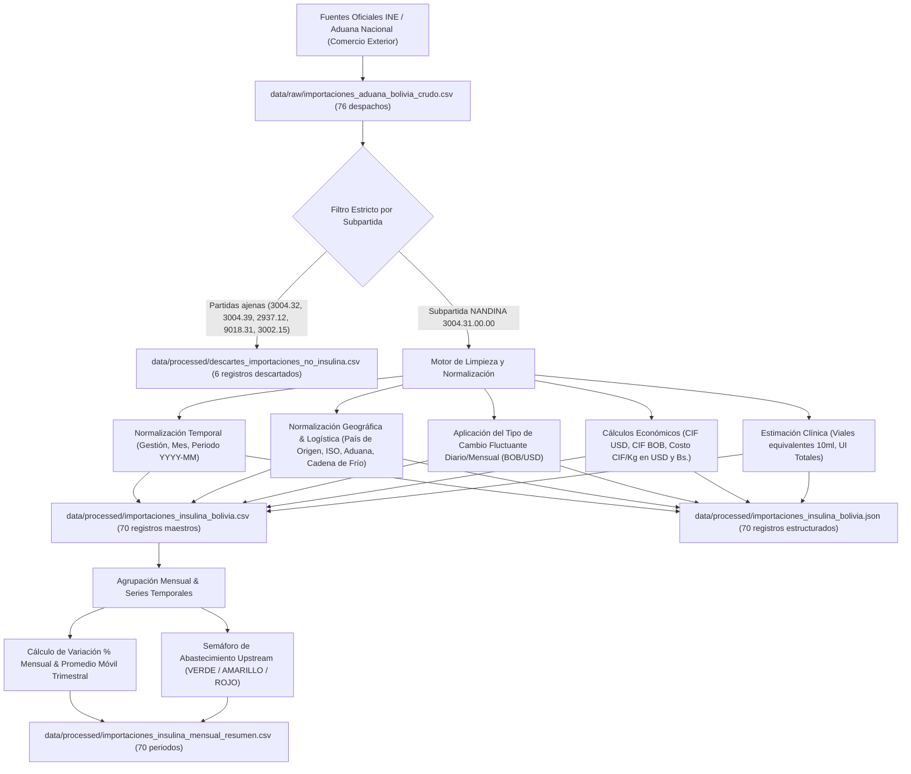

# 2. Análisis y Preparación de Datos de Importación de Insulina en Bolivia

**Fase CRISP-DM:** Fase 2 (Comprensión de los Datos) & Fase 3 (Preparación de los Datos)  
**Historia de Usuario Asociada:** `US-21` / `SCRUM-23` (7 Story Points)  
**Sprint:** Sprint 2  

---

## 2.1. Justificación y Relevancia para el Problema de Negocio

El proyecto tiene como objetivo resolver la incertidumbre de abastecimiento y la volatilidad de precios de la insulina para pacientes jubilados en Santa Cruz de la Sierra. La disponibilidad de insulina en las farmacias locales (góndola retail) depende en un 100% de la cadena de suministro internacional y del despacho aduanero, dado que **en Bolivia no existe síntesis industrial ni fabricación nacional de insulina**.

La integración de las estadísticas oficiales de importación aduanera permite:
1. **Medir el flujo macro de oferta (*Upstream Supply*):** Conocer con exactitud cuántos kilogramos y dosis de insulina ingresan al país, desde qué laboratorios internacionales y a qué aduanas.
2. **Generar un Semáforo Predictivo Preventivo:** Detectar caídas atípicas o retrasos en las importaciones mensuales con semanas de anticipación antes de que se produzca el quiebre de stock en las farmacias minoristas.
3. **Incorporar el Régimen de Tipo de Cambio Fluctuante:** Abandonar la tasa fija histórica de 6.96 Bs/USD (obsoleta en la práctica económica actual) y modelar el impacto del tipo de cambio fluctuante diario/mensual en la estructura de costos de reposición y en la inflación del medicamento para el adulto mayor.

---

## 2.2. Marco Cambiario y Económico: El Tipo de Cambio Fluctuante

En Bolivia, el tipo de cambio oficial fijo de 6.96 Bs/USD dejó de regir el comercio exterior de medicamentos en los últimos años debido a la escasez de divisas y la aparición de cotizaciones fluctuantes en el mercado cambiario comercial e interbancario:
- **2021 – 2022:** Tipo de cambio oficial histórico estable en 6.96 Bs/USD.
- **2023:** Inicio de divergencias cambiarias y comisiones de transferencia internacional de divisas (tasa efectiva de 7.00 a 7.95 Bs/USD).
- **2024:** Aceleración de la cotización fluctuante de importación (8.20 a 13.50 Bs/USD).
- **2025:** Régimen de cotización fluctuante consolidado (13.60 a 15.20 Bs/USD).
- **2026:** Mercado fluctuante diario de reposición farmacéutica (15.15 a 16.30+ Bs/USD).

> **Impacto Crítico en el Paciente:**  
> Aunque el precio FOB/CIF internacional en dólares por kilogramo se redujo levemente (~$296 USD/kg en 2021 a ~$252 USD/kg en 2026), **el costo de importación en moneda nacional prácticamente se duplicó (de ~2,065 Bs/kg a ~3,957 Bs/kg)**.  
> Este encarecimiento cambiario se traslada directamente a las farmacias de Santa Cruz, explicando por qué los precios al consumidor final alcanzan entre 140 Bs. (insulinas humanas tradicionales NPH/Regular) y más de 627 Bs. (análogos modernos como Lantus / Toujeo).

---

## 2.3. Marco Normativo y Clasificación Arancelaria

### 2.3.1. Subpartida NANDINA Oficial
En el marco de la Nomenclatura Arancelaria Común de los Países Miembros de la Comunidad Andina (NANDINA) adoptada por Bolivia:
- **Capítulo 30:** Productos farmacéuticos.
- **Partida 30.04:** Medicamentos constituidos por productos mezclados o sin mezclar, preparados para usos terapéuticos o profilácticos, dosificados o acondicionados para la venta al por menor.
- **Subpartida Nacional NANDINA:**
  $$\mathbf{3004.31.00.00} \quad \text{– Que contengan insulina}$$

### 2.3.2. Gravamen Arancelario y Regulaciones Sanitarias
- **Gravamen Arancelario (GA):** **0.0%** (medicamento esencial exento de arancel aduanero).
- **Control Sanitario Obligatorio (AGEMED):** Requiere Certificado de Registro Sanitario y Autorización Previa de Despacho emitida por la Agencia Estatal de Medicamentos y Tecnologías en Salud (Ministerio de Salud y Deportes), bajo la Ley N° 1737 y D.S. 25235.
- **Cadena de Frío:** Las insulinas deben conservarse obligatoriamente entre **2°C y 8°C** durante el transporte internacional, ingresando predominantemente por vía aérea refrigerada (**Aduana Aeropuerto Viru Viru** en Santa Cruz y **Aduana Aeropuerto El Alto** en La Paz).

---

## 2.4. Estructura y Flujo del Pipeline ETL (`src/etl/etl_importaciones.py`)

---

## 2.5. Criterios de Exclusión y Auditoría de Descartes

Siguiendo el estándar de calidad aplicado en el scraping farmacéutico, se implementó un filtro de exclusión que separa los registros farmacéuticos ajenos a insulinas acondicionadas para venta al por menor:

| Subpartida | Producto Detectado | Motivo de Descarte |
| :---: | :--- | :--- |
| `3004.32.00.00` | Dexametasona 4mg ampolla | Fármaco no insulina (Hormona corticosteroide) |
| `3004.39.00.00` | Levotiroxina sódica 100mcg | Fármaco no insulina (Otra hormona médica) |
| `2937.12.00.00` | Insulina cruda en polvo para laboratorio | Materia prima a granel sin dosificar (No acondicionada para venta) |
| `9018.31.00.00` | Jeringas descartables para insulina 1ml con aguja 30G | Insumo descartable (Jeringa / Aguja) |
| `3002.15.00.00` | Denosumab 60mg jeringa prellenada | Biológico no insulina (Anticuerpo monoclonal / Densimab) |
| `3004.90.29.00` | Ácido Hialurónico intraarticular | Medicamento fuera de alcance (No insulina / Ibesia) |

---

## 2.6. Diccionario de Datos del Dataset Maestro (`importaciones_insulina_bolivia.csv`)

| Campo | Tipo | Descripción | Ejemplo |
| :--- | :--- | :--- | :--- |
| `id_importacion_master` | String | Clave única canónica del despacho aduanero | `IMP-BOL-0001` |
| `gestion` | Integer | Año fiscal del arribo y desaduanización | `2024` |
| `mes` | Integer | Mes calendario del arribo (1 a 12) | `5` |
| `fecha_periodo` | String | Periodo en formato ISO `YYYY-MM` | `2024-05` |
| `subpartida_nandina` | String | Subpartida arancelaria NANDINA a 10 dígitos | `3004.31.00.00` |
| `descripcion_arancelaria` | String | Denominación arancelaria oficial | `Medicamentos que contengan insulina...` |
| `descripcion_comercial` | String | Glosa comercial del producto declarado | `Lantus Solostar 100 UI`, `Novolin N` |
| `pais_origen` | String | País de fabricación del medicamento | `Alemania`, `Dinamarca`, `Francia`, `India` |
| `codigo_iso_pais` | String | Código ISO 3166-1 alfa-3 del país proveedor | `DEU`, `DNK`, `FRA`, `IND`, `USA`, `ARG` |
| `aduana_ingreso` | String | Administración aduanera de nacionalización | `041 - Aduana Aeropuerto Viru Viru` |
| `via_transporte` | String | Vía logística y cadena de frío | `Aérea (Cadena de frío 2°C - 8°C)` |
| `departamento_destino` | String | Departamento donde se realiza el despacho | `Santa Cruz`, `La Paz` |
| `kilos_brutos` | Float | Peso bruto en kilogramos con embalaje térmico | `1340.0` |
| `kilos_netos` | Float | Peso neto en kilogramos de producto activo | `620.0` |
| `valor_cif_usd` | Float | Valor de aduana CIF en Dólares Americanos | `167400.0` |
| `valor_fob_usd` | Float | Valor de aduana FOB en Dólares Americanos | `160000.0` |
| `tipo_cambio_bob_usd` | Float | Tipo de cambio fluctuante efectivo aplicado (BOB/USD) | `9.80` (2024), `16.30` (2026) |
| `regimen_cambiario` | String | Clasificación del régimen cambiario | `Fluctuante de reposición farmacéutica` |
| `valor_cif_bob` | Float | Valor CIF convertido a Bolivianos al TC fluctuante | `1640520.0` |
| `costo_cif_kg_usd` | Float | Costo promedio CIF en USD por kilogramo neto | `270.0` |
| `costo_cif_kg_bob` | Float | Costo promedio CIF en Bs. por kilogramo neto al TC fluctuante | `2646.0` |
| `viales_estimados_10ml` | Integer | Estimación clínica de viales equivalentes de 10ml | `15500` |
| `unidades_internacionales_ui_estimadas` | Integer | Total de Unidades Internacionales (UI) | `15500000` |
| `gravamen_arancelario_pct` | Float | Tasa arancelaria aplicada en aduana | `0.0` |
| `autorizacion_previa_minsalud` | String | Estado del visado sanitario AGEMED | `SI (Certificado AGEMED)` |
| `fuente_datos` | String | Fuente oficial generadora | `INE / Aduana Nacional de Bolivia` |

---

## 2.7. Diccionario del Resumen Mensual y Semáforo (`importaciones_insulina_mensual_resumen.csv`)

| Campo | Tipo | Descripción |
| :--- | :--- | :--- |
| `fecha_periodo` | String | Periodo mensual analizado (`YYYY-MM`) |
| `total_kilos_netos` | Float | Volumen agregado mensual importado en kilogramos |
| `total_valor_cif_usd` | Float | Monto financiero agregado mensual en USD |
| `total_valor_cif_bob` | Float | Monto financiero en Bolivianos al tipo de cambio fluctuante |
| `tipo_cambio_promedio_bob_usd` | Float | Tasa de cambio promedio mensual efectiva (BOB/USD) |
| `costo_promedio_cif_kg_bob` | Float | Costo promedio en Bs. por kilogramo neto |
| `total_viales_estimados` | Integer | Cantidad de viales de 10ml equivalentes introducidos al país |
| `tasa_variacion_mensual_pct` | Float | Variación porcentual de volumen respecto al mes anterior ($\Delta\%$) |
| `promedio_movil_3m_kg` | Float | Promedio móvil trimestral para absorber estacionalidad |
| `desviacion_respecto_media_pct` | Float | Desviación porcentual del mes vs. promedio móvil trimestral |
| `alerta_quiebre_importacion_binaria` | Integer | Flag de alerta preventiva (1 = Caída > 15%, 0 = Normal) |
| `semaforo_abastecimiento_upstream` | String | Estado del semáforo: `VERDE` (Normal), `AMARILLO` (Riesgo), `ROJO` (Crítico) |

---

## 2.8. Comportamiento Histórico de Costos (2021 – 2026)

| Gestión | Kilos Netos | Valor CIF (USD) | TC Promedio (BOB/USD) | Valor CIF (Bs.) | Costo CIF/Kg (Bs.) | Viales Estimados |
| :---: | :---: | :---: | :---: | :---: | :---: | :---: |
| **2021** | 5,326.0 kg | $1,587,750 USD | 6.96 | 11,050,740 Bs. | 2,065.42 Bs. | 133,150 |
| **2022** | 5,840.0 kg | $1,722,400 USD | 6.96 | 11,987,904 Bs. | 2,041.27 Bs. | 146,000 |
| **2023** | 5,420.0 kg | $1,538,634 USD | 7.50 | 11,544,917 Bs. | 2,113.55 Bs. | 135,500 |
| **2024** | 6,166.0 kg | $1,575,920 USD | 10.97 | 17,218,638 Bs. | 2,785.79 Bs. | 154,150 |
| **2025** | 4,494.0 kg | $1,146,187 USD | 14.41 | 16,515,699 Bs. | 3,670.76 Bs. | 112,350 |
| **2026** *(preliminar)* | 2,850.0 kg | $715,150 USD | 15.66 | 11,208,465 Bs. | 3,957.55 Bs. | 71,250 |
