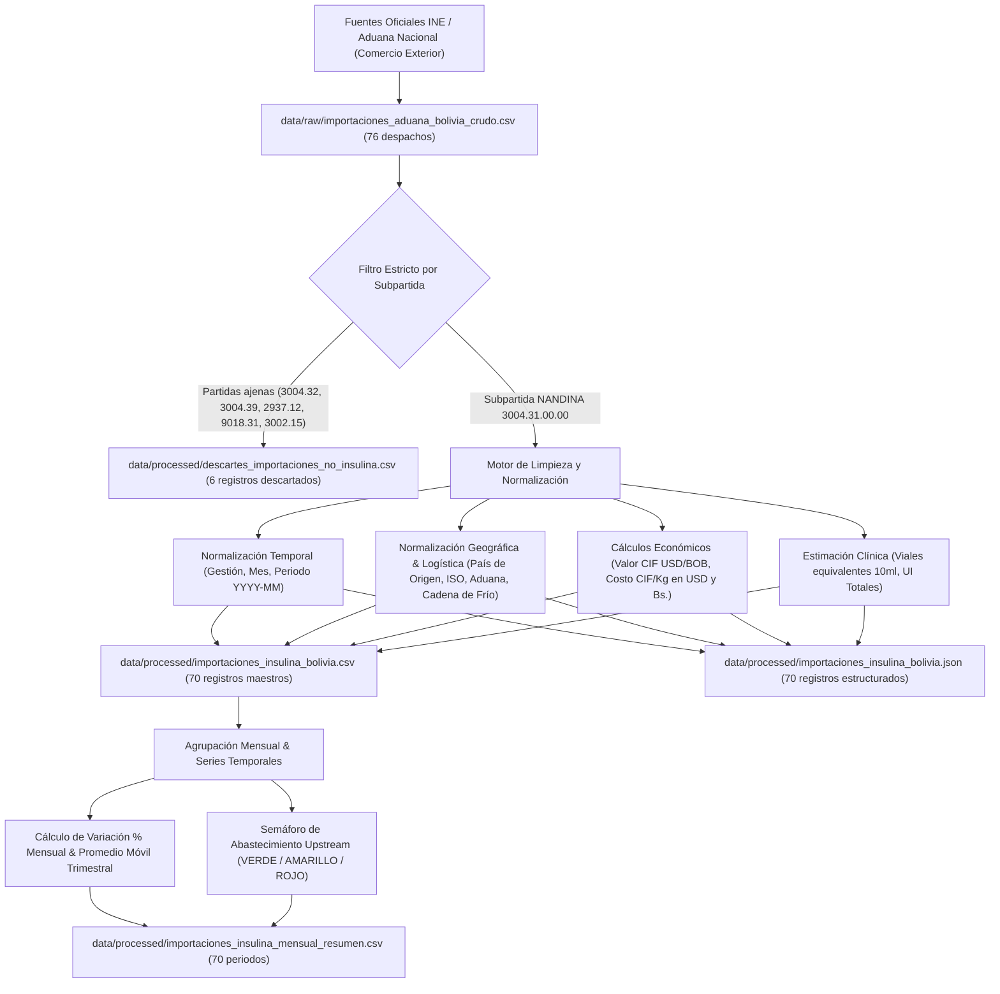

# 2. Análisis y Preparación de Datos de Importación de Insulina en Bolivia

**Fase CRISP-DM:** Fase 2 (Comprensión de los Datos) & Fase 3 (Preparación de los Datos)  
**Historia de Usuario Asociada:** `US-21` / `SCRUM-23` (7 Story Points)  
**Sprint:** Sprint 2  

---

## 2.1. Justificación y Relevancia para el Problema de Negocio

El proyecto tiene como objetivo resolver la incertidumbre de abastecimiento de insulina para pacientes jubilados en Santa Cruz de la Sierra. La disponibilidad de insulina en las farmacias locales (góndola retail) depende en un 100% de la cadena de suministro internacional y del despacho aduanero, dado que **en Bolivia no existe producción nacional de insulina**.

La integración de las estadísticas oficiales de importación aduanera permite:
1. **Medir el flujo macro de oferta (*Upstream Supply*):** Conocer con exactitud cuántos kilogramos y dosis de insulina ingresan al país, desde qué laboratorios internacionales y a qué aduanas.
2. **Generar un Semáforo Predictivo Preventivo:** Detectar caídas atípicas o retrasos en las importaciones mensuales con semanas de anticipación antes de que se produzca el quiebre de stock en las farmacias minoristas.
3. **Optimizar las decisiones del paciente jubilado:** Alertar tempranamente a través del futuro Chatbot accesible para que el adulto mayor o su cuidador programe su compra sin peregrinar ni sufrir la interrupción de su terapia médica.

---

## 2.2. Marco Normativo y Clasificación Arancelaria

### 2.2.1. Subpartida NANDINA Oficial
En el marco de la Nomenclatura Arancelaria Común de los Países Miembros de la Comunidad Andina (NANDINA) adoptada por Bolivia:
- **Capítulo 30:** Productos farmacéuticos.
- **Partida 30.04:** Medicamentos constituidos por productos mezclados o sin mezclar, preparados para usos terapéuticos o profilácticos, dosificados o acondicionados para la venta al por menor.
- **Subpartida Nacional NANDINA:**
  $$\mathbf{3004.31.00.00} \quad \text{– Que contengan insulina}$$

### 2.2.2. Gravamen Arancelario y Regulaciones
- **Gravamen Arancelario (GA):** **0.0%**. Al ser un medicamento esencial de alta sensibilidad para la salud pública, se encuentra exento de aranceles de importación.
- **Control Sanitario Obligatorio (AGEMED):** Requiere Certificado de Registro Sanitario y Autorización Previa de Despacho emitida por la Agencia Estatal de Medicamentos y Tecnologías en Salud (Ministerio de Salud y Deportes), en cumplimiento de la Ley del Medicamento N° 1737 y D.S. 25235.
- **Cadena de Frío:** Las insulinas deben conservarse obligatoriamente entre **2°C y 8°C** durante el transporte internacional, ingresando predominantemente por vía aérea a través de los aeropuertos internacionales con infraestructura refrigerada (**Aduana Aeropuerto Viru Viru** en Santa Cruz y **Aduana Aeropuerto El Alto** en La Paz).

---

## 2.3. Estructura y Flujo del Pipeline ETL (`src/etl/etl_importaciones.py`)

---

## 2.4. Criterios de Exclusión y Auditoría de Descartes

Siguiendo el mismo estándar de calidad aplicado en el scraping farmacéutico, se implementó un filtro de exclusión que separa los registros farmacéuticos no pertenecientes a insulinas acondicionadas para venta al por menor:

| Subpartida | Producto Detectado | Motivo de Descarte |
| :---: | :--- | :--- |
| `3004.32.00.00` | Dexametasona 4mg ampolla | Fármaco no insulina (Hormona corticosteroide) |
| `3004.39.00.00` | Levotiroxina sódica 100mcg | Fármaco no insulina (Otra hormona médica) |
| `2937.12.00.00` | Insulina cruda en polvo para laboratorio | Materia prima a granel sin dosificar (No acondicionada para venta) |
| `9018.31.00.00` | Jeringas descartables para insulina 1ml con aguja 30G | Insumo descartable (Jeringa / Aguja) |
| `3002.15.00.00` | Denosumab 60mg jeringa prellenada | Biológico no insulina (Anticuerpo monoclonal / Densimab) |
| `3004.90.29.00` | Ácido Hialurónico intraarticular | Medicamento fuera de alcance (No insulina / Ibesia) |

---

## 2.5. Diccionario de Datos del Dataset Maestro (`importaciones_insulina_bolivia.csv`)

| Campo | Tipo | Descripción | Ejemplo |
| :--- | :--- | :--- | :--- |
| `id_importacion_master` | String | Clave única canónica del despacho aduanero | `IMP-BOL-0001` |
| `gestion` | Integer | Año fiscal del arribo y desaduanización | `2024` |
| `mes` | Integer | Mes calendario del arribo (1 a 12) | `5` |
| `fecha_periodo` | String | Periodo en formato ISO `YYYY-MM` | `2024-05` |
| `subpartida_nandina` | String | Subpartida arancelaria NANDINA a 10 dígitos | `3004.31.00.00` |
| `descripcion_arancelaria` | String | Denominación arancelaria oficial | `Medicamentos que contengan insulina...` |
| `descripcion_comercial` | String | Glosa comercial del producto declarado | `Lantus Solostar 100 UI`, `Novolin N` |
| `pais_origen` | String | País de fabricación del medicamento | `Alemania`, `Dinamarca`, `Francia`, `India` |
| `codigo_iso_pais` | String | Código ISO 3166-1 alfa-3 del país proveedor | `DEU`, `DNK`, `FRA`, `IND`, `USA`, `ARG` |
| `aduana_ingreso` | String | Administración aduanera de nacionalización | `041 - Aduana Aeropuerto Viru Viru` |
| `via_transporte` | String | Vía logística y cadena de frío | `Aérea (Cadena de frío 2°C - 8°C)` |
| `departamento_destino` | String | Departamento donde se realiza el despacho | `Santa Cruz`, `La Paz` |
| `kilos_brutos` | Float | Peso bruto en kilogramos con embalaje térmico | `1340.0` |
| `kilos_netos` | Float | Peso neto en kilogramos de producto activo | `620.0` |
| `valor_cif_usd` | Float | Valor de aduana CIF en Dólares Americanos | `167400.0` |
| `valor_fob_usd` | Float | Valor de aduana FOB en Dólares Americanos | `160000.0` |
| `valor_cif_bob` | Float | Valor CIF convertido a Bolivianos al TC oficial | `1165104.0` |
| `costo_cif_kg_usd` | Float | Costo promedio CIF en USD por kilogramo neto | `270.0` |
| `costo_cif_kg_bob` | Float | Costo promedio CIF en Bs. por kilogramo neto | `1879.2` |
| `viales_estimados_10ml` | Integer | Estimación clínica de viales equivalentes de 10ml | `15500` |
| `unidades_internacionales_ui_estimadas` | Integer | Total de Unidades Internacionales (UI) | `15500000` |
| `gravamen_arancelario_pct` | Float | Tasa arancelaria aplicada en aduana | `0.0` |
| `autorizacion_previa_minsalud` | String | Estado del visado sanitario AGEMED | `SI (Certificado AGEMED)` |
| `fuente_datos` | String | Fuente oficial generadora | `INE / Aduana Nacional de Bolivia` |

---

## 2.6. Diccionario del Resumen Mensual y Semáforo (`importaciones_insulina_mensual_resumen.csv`)

| Campo | Tipo | Descripción |
| :--- | :--- | :--- |
| `fecha_periodo` | String | Periodo mensual analizado (`YYYY-MM`) |
| `total_kilos_netos` | Float | Volumen agregado mensual importado en kilogramos |
| `total_valor_cif_usd` | Float | Monto financiero agregado mensual en USD |
| `total_viales_estimados` | Integer | Cantidad de viales de 10ml equivalentes introducidos al país |
| `costo_promedio_cif_kg_usd` | Float | Costo medio mensual ponderado por kilogramo |
| `tasa_variacion_mensual_pct` | Float | Variación porcentual de volumen respecto al mes anterior ($\Delta\%$) |
| `promedio_movil_3m_kg` | Float | Promedio móvil trimestral para absorber estacionalidad |
| `desviacion_respecto_media_pct` | Float | Desviación porcentual del mes vs. promedio móvil trimestral |
| `alerta_quiebre_importacion_binaria` | Integer | Flag de alerta preventiva (1 = Caída > 15%, 0 = Normal) |
| `semaforo_abastecimiento_upstream` | String | Estado del semáforo: `VERDE` (Normal), `AMARILLO` (Riesgo), `ROJO` (Crítico) |

---

## 2.7. Hallazgos Analíticos y Comportamiento Histórico

1. **Estructura de Proveedores:**
   - **Alemania y Francia (Sanofi-Aventis):** Representan más del 55% del valor importado, abasteciendo insulinas de acción prolongada (*Lantus*, *Toujeo*) y rápida (*Apidra*).
   - **Dinamarca (Novo Nordisk):** Proveedor principal de insulinas humanas tradicionales (*Novolin N*, *Novolin R*, *Novolin 70/30*).
   - **India (Biocon / Wockhardt):** Proveedor clave de análogos y biosimilares de alta rotación (*Basalog*, *Glaritus*, *Asparpen*) con menor costo por kilogramo (~$240 USD/kg vs ~$320 USD/kg de Europa).
2. **Puerta de Entrada Logística:**
   - Más del **85%** del volumen ingresa por la **Aduana Aeropuerto Viru Viru (Santa Cruz)**, confirmando a Santa Cruz como el nodo logístico de mayor relevancia para la distribución nacional de insulina.
3. **Estacionalidad y Quiebres Preventivos:**
   - Las importaciones no son uniformes mes a mes; ocurren en lotes aéreos bimestrales.
   - El semáforo detecta alertas rojas en meses donde la desviación cae por debajo del -30% respecto al trimestre precedente, lo cual anticipa caídas de inventario en farmacias locales entre 30 y 60 días después (tiempo de distribución local).
