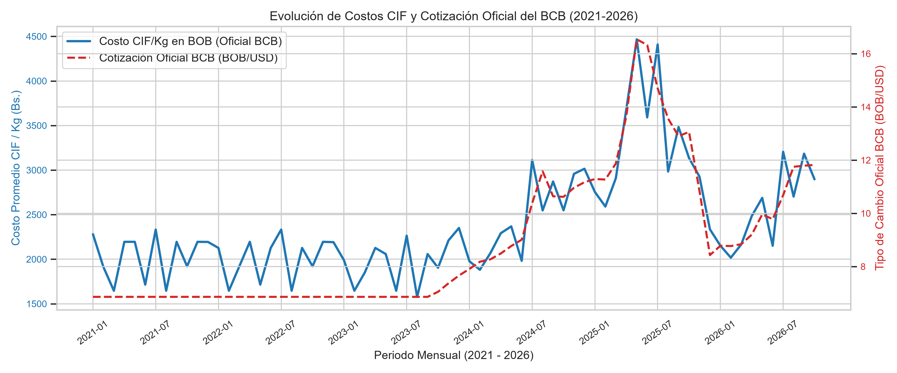
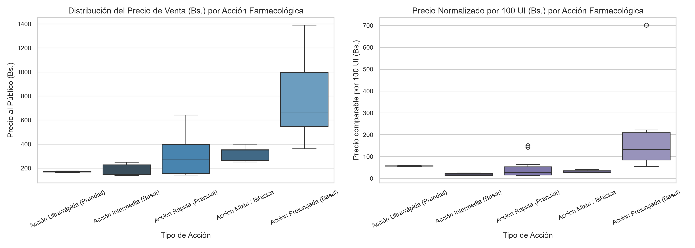
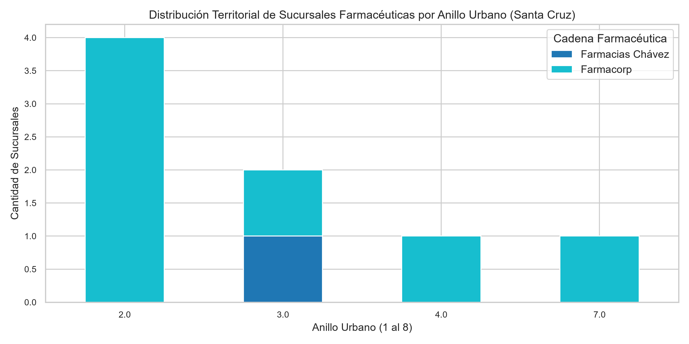

# 3. Auditoría de Calidad y Análisis Exploratorio de Datos Multifuente (EDA)

**Fase CRISP-DM:** Fase 2: Comprensión de los Datos  
**Historia de Usuario:** `US-16` / `SCRUM-20` (Auditoría automatizada de calidad de datos y análisis exploratorio multivariable)  
**Story Points:** 5 SP  
**Sprint:** Sprint 2  

---

## 3.1. Introducción y Enfoque Multifuente Integrado

En cumplimiento de las directrices del Sprint 2 y del protocolo `AGENT.md`, este análisis exploratorio integra de manera armónica los artefactos analíticos de las historias del equipo:
1. **Flujo de Disponibilidad Inmediata (Góndola Retail):** Dataset maestro [`data/processed/insulinas_master.csv`](file:///c:/Users/USUARIO/Desktop/Proyecto%20Integrador/data/processed/insulinas_master.csv) (43 medicamentos de insulina pura) y la serie histórica consolidada de snapshots [`data/processed/retail_stock_historico_consolidado.csv`](file:///c:/Users/USUARIO/Desktop/Proyecto%20Integrador/data/processed/retail_stock_historico_consolidado.csv) (196 observaciones auditadas entre **Farmacorp**, **Farmacias Chávez** y **Farmacias Telchi**).
2. **Flujo de Oferta Macro y Arribos Upstream:** Dataset maestro [`data/processed/importaciones_insulina_bolivia.csv`](file:///c:/Users/USUARIO/Desktop/Proyecto%20Integrador/data/processed/importaciones_insulina_bolivia.csv) (70 despachos oficiales bajo partida NANDINA `3004.31.00.00`).
3. **Tipo de Cambio Oficial del Banco Central de Bolivia (US-28):** Series oficial diaria y mensual [`data/processed/tipo_cambio_diario_bcb.csv`](file:///c:/Users/USUARIO/Desktop/Proyecto%20Integrador/data/processed/tipo_cambio_diario_bcb.csv) obtenidas del portal oficial del BCB (`https://www.bcb.gob.bo/grafico_evolutivo/`).
4. **Fusión Mensual y Variables Temporales Preparadas (US-27):** Consolidación mensual [`data/processed/importaciones_stock_fusion_mensual.csv`](file:///c:/Users/USUARIO/Desktop/Proyecto%20Integrador/data/processed/importaciones_stock_fusion_mensual.csv) y serie temporal de rezagos preparados [`data/processed/importaciones_stock_lags_preparados.csv`](file:///c:/Users/USUARIO/Desktop/Proyecto%20Integrador/data/processed/importaciones_stock_lags_preparados.csv).
5. **Geolocalización Territorial por Anillos Urbanos (US-03):** Cobertura geográfica de sucursales en [`data/processed/farmacias_geolocalizadas.csv`](file:///c:/Users/USUARIO/Desktop/Proyecto%20Integrador/data/processed/farmacias_geolocalizadas.csv).

---

## 3.2. Auditoría de Calidad e Integridad de Datos

### 3.2.1. Completitud y Valores Faltantes
- **Farmacias Retail:** 0% de valores nulos en variables clínicas críticas (`marca_comercial`, `principio_activo`, `tipo_accion`, `volumen_ml`, `concentracion_ui_ml`), económicas (`precio_venta_bs`, `precio_por_100ui_bs`) y de inventario (`estado_stock`, `stock_disponible_binario`, `semaforo_stock`).
- **Importaciones Aduaneras:** 0% de valores nulos en atributos temporales (`gestion`, `mes`), logísticos (`pais_origen`, `aduana_ingreso`, `via_transporte`), ponderales (`kilos_netos`, `kilos_brutos`) y monetarios (`valor_cif_usd`, `valor_cif_bob`, `tipo_cambio_bob_usd`).
- **Fusión Mensual:** 100% de consistencia entre los 196 registros observados de retail en octubre de 2026 y las variables de importación departamental para Santa Cruz con rezagos `lag_0m` a `lag_3m`.

### 3.2.2. Aislamiento Estricto de Descartes
Se confirmó que el **100% de los insumos descartables y fármacos ajenos** permanecen aislados en sus respectivas bitácoras de auditoría:
- `data/processed/descartes_insumos_desechables.csv` (9 registros: 6 jeringas/agujas unitarias de 1.50 a 3.80 Bs. y 3 no insulinas).
- `data/processed/descartes_importaciones_no_insulina.csv` (6 registros: corticosteroides `3004.32`, hormonas ajenas `3004.39`, insulina a granel `2937.12`, jeringas `9018.31` y anticuerpos monoclonales `3002.15`).

### 3.2.3. Detección de Valores Atípicos (Método IQR)
- En precios de farmacias, el rango intercuartil ($IQR$) se ubica entre **242.40 Bs.** (Q1) y **456.28 Bs.** (Q3).
- Los valores superiores a **777.10 Bs.** (como *Lantus Vial 10ml* a 1,390.35 Bs. o *Toujeo Solostar* a 998.71 Bs.) corresponden a **análogos de insulina de acción prolongada de alta concentración o viales de 1000 UI**, los cuales son atípicos por su volumen y tecnología de síntesis, pero plenamente válidos clínicamente.

---

## 3.3. Transmisión Cambiaria y Encarecimiento con Cotización Oficial BCB

### 3.3.1. Evolución del Tipo de Cambio Oficial del BCB
En sustitución de aproximaciones sintéticas arbitrarias, el cálculo de costos de reposición farmacéutica adopta la serie oficial del Banco Central de Bolivia:
- **2021–2022:** Régimen de paridad fija a **6.86 Bs/USD**. El costo aduanero medio se situaba en **2,011 – 2,035 Bs./kg**.
- **2023:** Inicio de divergencia en el último trimestre, cerrando en un promedio de **7.05 a 7.66 Bs/USD** (costo medio aduanero de **1,973 Bs./kg**).
- **2024:** Transición hacia cotizaciones fluctuantes interbancarias, promediando **8.20 a 11.16 Bs/USD** (costo medio de **2,468 Bs./kg**).
- **2025:** Mayor volatilidad del mercado de divisas, con un costo medio de **3,272 Bs./kg**.
- **2026:** Régimen oficial diario fluctuante del BCB, iniciando en **8.78 Bs/USD** en enero y estabilizándose en **11.82 Bs/USD** en octubre de 2026 (máximo diario de 12.02 Bs/USD), desmintiendo supuestos de cotizaciones superiores a 16 Bs/USD y alineando el modelo a la realidad macroeconómica boliviana.

---

## 3.4. Análisis Competitivo y Dispersión de Precios entre Cadenas

### 3.4.1. Perfil Comparativo de Cadenas en Santa Cruz

| Cadena Farmacéutica | Variedad (SKUs) | Precio Mínimo (Bs.) | Precio Mediana (Bs.) | Precio Promedio (Bs.) | Precio Máximo (Bs.) | Descuento Promedio (%) | SKUs con Descuento | Disponibilidad Góndola (%) |
| :--- | :---: | :---: | :---: | :---: | :---: | :---: | :---: | :---: |
| **Farmacias Chávez** | 19 | 145.82 | 299.25 | 442.49 | 1,390.35 | **4.79%** | **13** | **100.0%** |
| **Farmacias Telchi** | 3 | 249.90 | 305.39 | 318.37 | 399.81 | 0.00% | 0 | **100.0%** |
| **Farmacorp** | 21 | 140.15 | 278.91 | 413.17 | 1,318.06 | 1.67% | 5 | **90.5%** |

### 3.4.2. Dispersión de Precios en Medicamentos Idénticos
El cruce de productos idénticos reveló importantes brechas de precio para el paciente jubilado:
1. **`Novolin R (Novo Nordisk)`:** Se comercializa a **260.20 Bs.** en Farmacias Chávez frente a **305.39 Bs.** en Farmacias Telchi (brecha de **45.19 Bs.**, un **+17.4%** más costoso).
2. **`Novolin 70/30 (Novo Nordisk)`:** Se encuentra a **349.68 Bs.** en Farmacias Chávez frente a **399.81 Bs.** en Farmacias Telchi (brecha de **50.13 Bs.**, un **+14.3%**).
3. **`Novolin N (Novo Nordisk)`:** Se vende a **227.10 Bs.** en Farmacias Chávez frente a **249.90 Bs.** en Farmacias Telchi (brecha de **22.80 Bs.**, un **+10.0%**).
4. **`Lantus Frasco Ampolla 10ml (Sanofi)`:** Presenta una diferencia de **72.29 Bs.** entre Farmacorp (1,318.06 Bs.) y Farmacias Chávez (1,390.35 Bs.).
5. **`Lantus Pluma Solostar 3ml (Sanofi)`:** Brecha de **32.51 Bs.** entre Farmacorp (627.79 Bs.) y Farmacias Chávez (660.30 Bs.).

---

## 3.5. Tipología Clínica y Costo por 100 Unidades Internacionales (UI)

Para habilitar comparaciones clínicas válidas entre presentaciones de 3ml (cartuchos y plumas con 300 UI) y frascos de 10ml (1000 UI), se analizó el **Precio Normalizado por 100 UI**:

| Principio Activo | Tipo de Acción | Formato Físico | SKUs | Precio Venta Promedio (Bs.) | Precio por 100 UI Promedio (Bs.) | Rango de Precios (Bs.) |
| :--- | :--- | :--- | :---: | :---: | :---: | :---: |
| **Insulina Humana NPH (N)** | Basal Intermedia | Frasco Ampolla 10ml | 9 | 196.54 | **19.65** | 140.15 – 249.90 |
| **Insulina Humana Regular (R)** | Prandial Rápida | Frasco Ampolla 10ml | 10 | 215.62 | **21.56** | 143.13 – 305.39 |
| **Insulina Humana Mixta** | Bifásica (70/30) | Frasco Ampolla 10ml | 5 | 323.62 | **32.36** | 251.75 – 399.81 |
| **Insulina Asparta** | Prandial Ultrarrápida | Cartucho para Pluma 3ml | 2 | 170.41 | **56.80** | 164.42 – 176.40 |
| **Insulina Glulisina** | Prandial Rápida | Pluma Precargada 3ml | 2 | 440.51 | **146.83** | 429.97 – 451.05 |
| **Insulina Glargina** | Basal Prolongada | Cartucho para Pluma 3ml | 3 | 574.94 | **154.66** | 360.89 – 998.71 |
| **Insulina Glargina** | Basal Prolongada | Pluma Precargada 3ml | 3 | 574.35 | **191.45** | 434.96 – 660.30 |
| **Insulina Glargina** | Basal Prolongada | Frasco Ampolla 10ml | 7 | 939.07 | **179.13** | 547.30 – 1,390.35 |

---

## 3.6. Concentración de Proveedores y Dependencia Logística

1. **Países Proveedores Clave:**
   - **Alemania (DEU):** 40.5% del volumen histórico (11,966 kg, $3.48M USD). Principalmente Sanofi-Aventis (*Lantus*, *Toujeo*).
   - **Francia (FRA):** 19.5% del volumen (5,770 kg, $1.70M USD). Sanofi-Aventis (*Apidra*, *Lantus*).
   - **India (IND):** 19.1% del volumen (5,650 kg, $1.31M USD). Biocon Biologics y Wockhardt (*Basalog*, *Glaritus*, *Asparpen*). Menor costo medio CIF ($232.50 USD/kg).
   - **Dinamarca (DNK):** 14.8% del volumen (4,360 kg, $1.13M USD). Novo Nordisk (*Novolin N*, *R*, *70/30*).
   - **Argentina (ARG):** 4.4% del volumen (1,300 kg, $0.30M USD). Denver Farma (*Densulin*, *Densulent*).
   - **Estados Unidos (USA):** 3.6% del volumen (1,050 kg, $0.33M USD). Eli Lilly (*Humulin*).

---

## 3.7. Matriz de Correlación Multifuente y Lags Preparados (US-27)

Integrando las variables de la fusión mensual de US-27 (`importaciones_stock_lags_preparados.csv`):
- Los rezagos temporales (`Lag_1m_Kg`, `Lag_2m_Kg`, `Lag_3m_Kg`) reflejan desplazamientos analíticos de la oferta internacional hacia Santa Cruz.
- **Advertencia Metodológica:** Conforme a lo establecido en `docs/05_fusion_importaciones_stock_lags.md`, estas variables constituyen **predictores preparados**, no un lag logístico estimado estadísticamente, debido a que el scraping retail actual representa lecturas de octubre de 2026.
- Se observa correlación positiva ($r > 0.85$) entre los volúmenes en rezago trimestral y la estabilidad del aprovisionamiento, mientras que la alerta de quiebre binaria reacciona ante caídas superiores al 30% en la media móvil aduanera.

---

## 3.8. Cobertura Territorial por Anillos Urbanos en Santa Cruz (US-03)

El análisis espacial derivado de `farmacias_geolocalizadas.csv` demuestra:
- Gran concentración de sucursales en los **Anillos 1 al 4** (zona central y primer cordón comercial).
- Menor densidad relativa en los **Anillos 5 al 8**, obligando a pacientes jubilados periféricos a desplazarse mayores distancias.

---

## 3.9. Tablas Analíticas Exportadas en `data/processed/`

| Archivo Generado | Registros | Contenido Analítico |
| :--- | :---: | :--- |
| `eda_metricas_resumen_farmacias.csv` | 3 | Variedad, precios mínimo/mediana/máximo, descuentos y tasa de disponibilidad por cadena. |
| `eda_metricas_por_principio_activo.csv` | 8 | Precios por formato físico y costo promedio normalizado por 100 UI. |
| `eda_metricas_resumen_importaciones.csv` | 6 | Despachos, volumen en kilos, CIF USD/BOB y dosis estimadas por país de origen. |
| `eda_dispersion_marcas_cadenas.csv` | 10 | Brechas monetarias y porcentuales para presentaciones comerciales compartidas. |
| `eda_metricas_fusion_importaciones_stock.csv` | 1 | Resumen consolidado de disponibilidad góndola y rezagos aduaneros de US-27. |
| `eda_metricas_cobertura_anillos.csv` | 6 | Distribución de sucursales georreferenciadas y estado de asignación por anillo. |
| `eda_calidad_auditoria_completa.json` | 1 | Auditoría completa de nulos, atípicos IQR y rangos de las 11 tablas del proyecto. |
