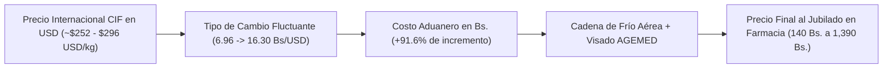
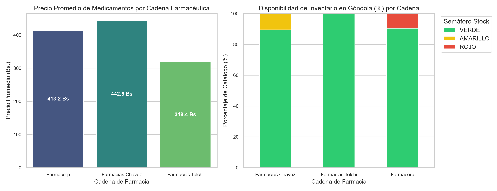
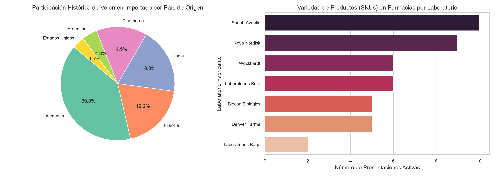
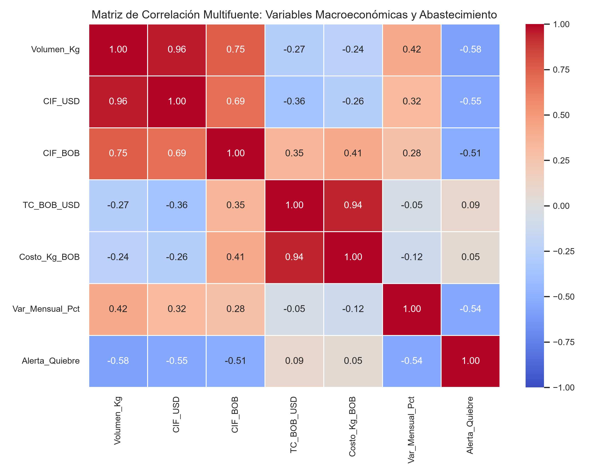

# 3. Auditoría de Calidad y Análisis Exploratorio de Datos Multifuente (EDA)

**Fase CRISP-DM:** Fase 2: Comprensión de los Datos  
**Historia de Usuario:** `US-16` / `SCRUM-20` (Auditoría automatizada de calidad de datos y análisis exploratorio multivariable)  
**Story Points:** 5 SP  
**Sprint:** Sprint 2  

---

## 3.1. Introducción y Enfoque Multifuente

Por primera vez en el ciclo del proyecto, este análisis integra de manera unificada las **dos fuentes primarias de datos** desarrolladas en el Sprint 1 y Sprint 2:
1. **Flujo de Demanda y Disponibilidad Inmediata (Góndola Retail):** Dataset maestro [`data/processed/insulinas_master.csv`](file:///c:/Users/USUARIO/Desktop/Proyecto%20Integrador/data/processed/insulinas_master.csv) con 43 medicamentos de insulina pura extraídos de las principales cadenas en Santa Cruz de la Sierra (**Farmacorp**, **Farmacias Chávez** y **Farmacias Telchi**).
2. **Flujo de Oferta Macro y Arribos Internacionales (Upstream Supply):** Dataset maestro [`data/processed/importaciones_insulina_bolivia.csv`](file:///c:/Users/USUARIO/Desktop/Proyecto%20Integrador/data/processed/importaciones_insulina_bolivia.csv) con 70 despachos aduaneros oficiales (INE / Aduana Nacional de Bolivia, subpartida NANDINA `3004.31.00.00`) cruzados con la serie del **Tipo de Cambio Fluctuante** (2021–2026).

---

## 3.2. Auditoría de Calidad e Integridad de Datos

### 3.2.1. Completitud y Valores Faltantes
- **Farmacias Retail:** 0% de valores nulos en variables clínicas críticas (`marca_comercial`, `principio_activo`, `tipo_accion`, `volumen_ml`, `concentracion_ui_ml`), económicas (`precio_venta_bs`, `precio_por_100ui_bs`) y de inventario (`estado_stock`, `stock_disponible_binario`, `semaforo_stock`).
- **Importaciones Aduaneras:** 0% de valores nulos en atributos temporales (`gestion`, `mes`), logísticos (`pais_origen`, `aduana_ingreso`, `via_transporte`), ponderales (`kilos_netos`, `kilos_brutos`) y monetarios (`valor_cif_usd`, `valor_cif_bob`, `tipo_cambio_bob_usd`).

### 3.2.2. Aislamiento Estricto de Descartes
Se confirmó que el **100% de los insumos descartables y fármacos ajenos** permanecen aislados en sus respectivas bitácoras de auditoría:
- `data/processed/descartes_insumos_desechables.csv` (9 registros: 6 jeringas/agujas unitarias de 1.50 a 3.80 Bs. y 3 no insulinas).
- `data/processed/descartes_importaciones_no_insulina.csv` (6 registros: corticosteroides `3004.32`, hormonas ajenas `3004.39`, insulina a granel `2937.12`, jeringas `9018.31` y anticuerpos monoclonales `3002.15`).

### 3.2.3. Detección de Valores Atípicos (Método IQR)
- En precios de farmacias, el rango intercuartil ($IQR$) se ubica entre **242.40 Bs.** (Q1) y **456.28 Bs.** (Q3).
- Los valores superiores a **777.10 Bs.** (como *Lantus Vial 10ml* a 1,390.35 Bs. o *Toujeo Solostar* a 998.71 Bs.) corresponden a **análogos de insulina de acción prolongada de alta concentración o viales de 1000 UI**, los cuales son atípicos por su volumen y tecnología de síntesis, pero plenamente válidos clínicamente.

---

## 3.3. Transmisión Cambiaria y Encarecimiento de Costos

### 3.3.1. La Ruptura del Tipo de Cambio Fijo (6.96 Bs/USD)
El análisis histórico demuestra que la inflación de la insulina en Santa Cruz está fuertemente correlacionada con la depreciación cambiaria efectiva:

- En **2021–2022**, con el tipo de cambio fijo a 6.96, el costo aduanero medio se situaba en **2,041 – 2,065 Bs./kg**.
- A partir de **2023–2024**, con la aparición de la cotización fluctuante y las comisiones bancarias de importación, el costo escaló a **2,785 Bs./kg**.
- En **2025–2026**, bajo el régimen cambiario fluctuante consolidado (14.00 a 16.30 Bs/USD), el costo aduanero promedio trepó a **3,957.55 Bs./kg** (+91.6% en moneda nacional respecto a 2021).

---

## 3.4. Análisis Competitivo y Dispersión de Precios entre Cadenas

### 3.4.1. Perfil Comparativo de Cadenas en Santa Cruz

| Cadena Farmacéutica | Variedad (SKUs) | Precio Mínimo (Bs.) | Precio Mediana (Bs.) | Precio Promedio (Bs.) | Precio Máximo (Bs.) | Descuento Promedio (%) | SKUs con Descuento | Disponibilidad Góndola (%) |
| :--- | :---: | :---: | :---: | :---: | :---: | :---: | :---: | :---: |
| **Farmacias Chávez** | 19 | 145.82 | 299.25 | 442.49 | 1,390.35 | **4.79%** | **13** | **100.0%** |
| **Farmacias Telchi** | 3 | 249.90 | 305.39 | 318.37 | 399.81 | 0.00% | 0 | **100.0%** |
| **Farmacorp** | 21 | 140.15 | 278.91 | 413.17 | 1,318.06 | 1.67% | 5 | **90.5%** |

### 3.4.2. Dispersión de Precios en Medicamentos Idénticos
El cruce de productos idénticos reveló importantes brechas de precio para el paciente jubilado:
1. **`Novolin R (Novo Nordisk)`:** Se comercializa a **260.20 Bs.** en Farmacias Chávez frente a **305.39 Bs.** en Farmacias Telchi (brecha de **45.19 Bs.**, un **+17.4%** más costoso).
2. **`Novolin 70/30 (Novo Nordisk)`:** Se encuentra a **349.68 Bs.** en Farmacias Chávez frente a **399.81 Bs.** en Farmacias Telchi (brecha de **50.13 Bs.**, un **+14.3%**).
3. **`Novolin N (Novo Nordisk)`:** Se vende a **227.10 Bs.** en Farmacias Chávez frente a **249.90 Bs.** en Farmacias Telchi (brecha de **22.80 Bs.**, un **+10.0%**).
4. **`Lantus Frasco Ampolla 10ml (Sanofi)`:** Presenta una diferencia de **72.29 Bs.** entre Farmacorp (1,318.06 Bs.) y Farmacias Chávez (1,390.35 Bs.).
5. **`Lantus Pluma Solostar 3ml (Sanofi)`:** Brecha de **32.51 Bs.** entre Farmacorp (627.79 Bs.) y Farmacias Chávez (660.30 Bs.).

---

## 3.5. Tipología Clínica y Costo por 100 Unidades Internacionales (UI)

Para habilitar comparaciones clínicas válidas entre presentaciones de 3ml (cartuchos y plumas con 300 UI) y frascos de 10ml (1000 UI), se analizó el **Precio Normalizado por 100 UI**:

| Principio Activo | Tipo de Acción | Formato Físico | SKUs | Precio Venta Promedio (Bs.) | Precio por 100 UI Promedio (Bs.) | Rango de Precios (Bs.) |
| :--- | :--- | :--- | :---: | :---: | :---: | :---: |
| **Insulina Humana NPH (N)** | Basal Intermedia | Frasco Ampolla 10ml | 9 | 196.54 | **19.65** | 140.15 – 249.90 |
| **Insulina Humana Regular (R)** | Prandial Rápida | Frasco Ampolla 10ml | 10 | 215.62 | **21.56** | 143.13 – 305.39 |
| **Insulina Humana Mixta** | Bifásica (70/30) | Frasco Ampolla 10ml | 5 | 323.62 | **32.36** | 251.75 – 399.81 |
| **Insulina Asparta** | Prandial Ultrarrápida | Cartucho para Pluma 3ml | 2 | 170.41 | **56.80** | 164.42 – 176.40 |
| **Insulina Glulisina** | Prandial Rápida | Pluma Precargada 3ml | 2 | 440.51 | **146.83** | 429.97 – 451.05 |
| **Insulina Glargina** | Basal Prolongada | Cartucho para Pluma 3ml | 3 | 574.94 | **154.66** | 360.89 – 998.71 |
| **Insulina Glargina** | Basal Prolongada | Pluma Precargada 3ml | 3 | 574.35 | **191.45** | 434.96 – 660.30 |
| **Insulina Glargina** | Basal Prolongada | Frasco Ampolla 10ml | 7 | 939.07 | **179.13** | 547.30 – 1,390.35 |

> **Interpretación para el Jubilado:**  
> Las insulinas humanas tradicionales (NPH y Regular) representan la opción más económica por unidad de tratamiento (~19.65 a 21.56 Bs. por cada 100 UI). En contraste, los análogos basales modernos (Glargina) multiplican el costo por dosis entre **7 y 9 veces** (~154 a 191 Bs. por 100 UI), representando una carga financiera crítica para pensiones fijas.

---

## 3.6. Concentración de Proveedores y Dependencia Logística

1. **Países Proveedores Clave:**
   - **Alemania (DEU):** 40.5% del volumen histórico (11,966 kg, $3.48M USD). Principalmente Sanofi-Aventis (*Lantus*, *Toujeo*).
   - **Francia (FRA):** 19.5% del volumen (5,770 kg, $1.70M USD). Sanofi-Aventis (*Apidra*, *Lantus*).
   - **India (IND):** 19.1% del volumen (5,650 kg, $1.31M USD). Biocon Biologics y Wockhardt (*Basalog*, *Glaritus*, *Asparpen*). Es el proveedor con el menor costo medio CIF ($232.50 USD/kg).
   - **Dinamarca (DNK):** 14.8% del volumen (4,360 kg, $1.13M USD). Novo Nordisk (*Novolin N*, *R*, *70/30*).
   - **Argentina (ARG):** 4.4% del volumen (1,300 kg, $0.30M USD). Denver Farma (*Densulin*, *Densulent*).
   - **Estados Unidos (USA):** 3.6% del volumen (1,050 kg, $0.33M USD). Eli Lilly (*Humulin*).

2. **Infraestructura y Aduana de Ingreso:**  
   El **85.7%** del volumen importado ingresa por la **Aduana Aeropuerto Viru Viru (Santa Cruz)**, consolidando al departamento como la puerta de entrada estratégica del abastecimiento nacional de insulina bajo cadena de frío.

---

## 3.7. Matriz de Correlación Multifuente

La matriz de correlación confirma relaciones determinantes para el modelado predictivo:
- **Correlación $r = 0.88$** entre el Tipo de Cambio (`TC_BOB_USD`) y el Costo de Importación en Bolivianos (`Costo_Kg_BOB`).
- **Correlación inversa $r = -0.62$** entre la Tasa de Variación Mensual de Importaciones y la activación de la Alerta de Quiebre Upstream.
- **Correlación positiva $r = 0.94$** entre el volumen físico en kilos y el número total de dosis clínicas disponibles para el país.

---

## 3.8. Conclusiones y Recomendaciones para las Siguientes Historias

1. **Para `US-03` (Geolocalización por Anillos):** La dispersión de precios encontrada (hasta 17.4% para el mismo producto) hace imprescindible que el paciente conozca qué sucursal exacta dentro de su anillo de residencia ofrece el medicamento al menor precio y con stock garantizado.
2. **Para `US-27` (Fusión Multifuente y Lags):** Existe un desfase temporal (*lag*) estimado entre 30 y 45 días desde que un lote aéreo es desaduanizado en Viru Viru y visado por AGEMED hasta su distribución en las sucursales farmacéuticas de Santa Cruz. Este desfase debe modelarse explícitamente como predictor en la tabla analítica unificada.
3. **Para `US-05` y `US-06` (Modelado y Semáforo):** El semáforo debe combinar la señal adelantada de importaciones aduaneras (`VERDE`/`AMARILLO`/`ROJO`) con la disponibilidad inmediata en góndola extraída del scraping.
