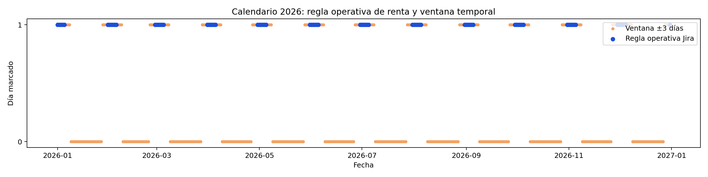
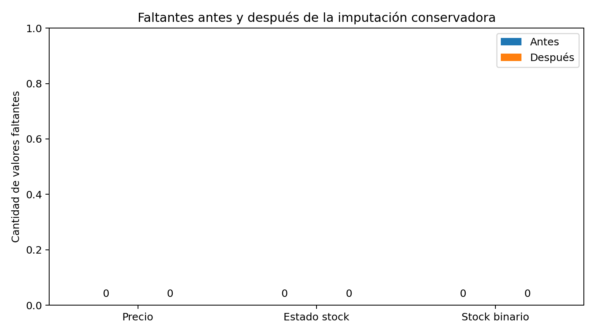

# SCRUM-37 — Calendario bancario e imputación

## 1. ¿Qué se buscó resolver?

Esta historia prepara dos tipos de información que podrían ayudar a estudiar la disponibilidad de insulina en el futuro. Se hizo para que las capturas de farmacia puedan indicar si ocurrieron cerca de fechas relacionadas con el cobro de pensiones y para que futuros faltantes se traten de forma cuidadosa, sin inventar datos:

- un calendario diario relacionado con el cobro de pensiones;
- reglas cuidadosas para completar valores faltantes de precio o disponibilidad, si llegaran a aparecer en nuevas capturas.

El resultado no demuestra que el pago de pensiones cambie el stock o la demanda. Para medir ese efecto se necesitarían observaciones retail de muchos días distintos.

## 2. Datos utilizados

| Archivo | Qué contiene | Para qué se usa |
|---|---|---|
| `data/processed/retail_stock_historico_consolidado.csv` | 196 observaciones de precios y estados de stock de farmacias | Se revisan faltantes y se agrega el calendario según la fecha de extracción. |
| `data/processed/calendario_rentas_2026.csv` | Una fila por cada día de 2026 y reglas de pago trazables | Permite asociar cada observación retail con variables temporales. |
| `data/processed/retail_stock_imputado_calendario.csv` | Retail original, columnas de auditoría y variables de calendario | Es el resultado preparado para análisis posterior. |

Los dos últimos archivos son salidas del script. Las gráficas de apoyo se guardan en `docs/figures/`.

## 3. ¿Qué significa imputación?

La **imputación** es completar un valor faltante usando evidencia de datos parecidos. No equivale a conocer el valor verdadero; por eso se aplica sólo cuando hay suficientes observaciones comparables y se guarda una columna que indica el método usado.

En los datos actuales no había faltantes en `precio_bs`, `estado_stock` ni `stock_disponible_binario`. Por esa razón no se cambiaron precios, estados ni disponibilidades: las columnas de trazabilidad indican que no se imputó ninguna observación.

## 4. Calendario de pagos

### Regla operativa solicitada por Jira

La variable `dia_pago_renta` vale 1 en los días 1 al 5 de cada mes y en el último día calendario del mes. Se conserva porque fue solicitada por Jira, pero no se presenta como un calendario oficial de Banco Unión.

Su fuente queda registrada exactamente como:

`REGLA_OPERATIVA_JIRA_NO_VALIDADA_COMO_CALENDARIO_OFICIAL`

### Evidencia oficial disponible

La variable `dia_pago_pension_oficial` vale 1 para los días 1 al 7 de cada mes. Representa una ventana diaria analítica basada en el plazo de disponibilidad mensual indicado por la normativa de pensiones. La fuente normativa señala que las pensiones deben habilitarse, como máximo, hasta el día 7 del mes siguiente; la variable no identifica la fecha exacta de abono o retiro de cada persona.

Esta ventana no significa que cada persona jubilada retire su dinero exactamente esos días. También es distinta de la regla operativa 1--5 más fin de mes; ambas se guardan para que el análisis posterior no mezcle una solicitud de Jira con evidencia oficial.

### Fuentes verificables consultadas

- **Autoridad de Fiscalización y Control de Pensiones y Seguros (APS):** [documento sobre fecha de pago de pensiones](https://sireci.aps.gob.bo/api/cartas_resoluciones/descarga/12282). Indica que las pensiones se pagan mensualmente a mes vencido y deben habilitarse hasta el día 7 del mes siguiente.
- **APS:** [Normativa de Pensiones](https://www.aps.gob.bo/normativa-de-pensiones/). Repositorio institucional para contrastar el marco regulatorio del Sistema Integral de Pensiones.
- **Banco Unión S.A.:** [noticia institucional sobre pago de Renta Dignidad](https://www.bancounion.com.bo/Noticias/Index?noticia=966). Confirma que el banco presta este servicio de pago a personas adultas mayores, pero no publica allí una regla fija de días 1--5 más fin de mes.

No se encontró una fuente oficial que establezca la regla “días 1--5 más fin de mes” como calendario de Banco Unión. Por eso se mantiene únicamente porque Jira la solicita y se etiqueta como regla operativa no validada. La variable oficial 1--7 permanece separada para no confundir ambos conceptos.

## 5. Ventana de impacto ±3 días

`ventana_pago_renta_3d` vale 1 cuando la fecha se encuentra hasta tres días antes, el mismo día o hasta tres días después de una fecha con `dia_pago_renta = 1`.

`distancia_dias_pago_renta` indica cuántos días separan la observación del pago operativo más cercano:

- `0`: coincide con el día de pago;
- `-1` a `-3`: ocurre antes del pago;
- `+1` a `+3`: ocurre después del pago.

La distancia se calcula contra el pago con menor distancia absoluta. Si hubiera empate, se elige la fecha de pago más temprana; así el resultado siempre puede reproducirse.

Por ejemplo, el 8 de enero está a `+3` días del pago del 5 de enero. El 28 de enero está a `-3` días del pago del 31 de enero.

## 6. Reglas de imputación

Para un precio faltante, el orden de búsqueda es:

1. mediana de `farmacia + marca_comercial`;
2. mediana de `farmacia + principio_activo`;
3. conservar el faltante si ninguno de los dos grupos reúne evidencia suficiente.

La **mediana** es el valor central de un grupo ordenado. Se prefiere al promedio porque un precio extremadamente alto o bajo tiene menor influencia sobre el resultado.

Para un `estado_stock` faltante, se aplica la misma jerarquía, pero se usa la **moda**. La moda es el valor que aparece con mayor frecuencia. Sólo se usa si hay al menos tres observaciones y un valor claramente más frecuente; un empate o un grupo pequeño se mantiene faltante.

No se imputan anillos, coordenadas ni lags históricos estructuralmente faltantes. Esos campos necesitan evidencia geográfica o temporal que no se puede deducir sólo a partir de otros valores.

No se usa un promedio global: mezclar productos, cadenas y presentaciones distintas podría ocultar diferencias reales de precios.

## 7. Resultados

| Indicador | Resultado observado |
|---|---:|
| Días del calendario 2026 | 365 |
| Días con `dia_pago_renta = 1` | 72 |
| Días dentro de `ventana_pago_renta_3d = 1` | 144 |
| Días con `dia_pago_pension_oficial = 1` | 84 |
| Observaciones retail cruzadas | 196 |
| Faltantes de precio antes / después | 0 / 0 |
| Faltantes de estado de stock antes / después | 0 / 0 |
| Faltantes de disponibilidad binaria antes / después | 0 / 0 |
| Precios efectivamente imputados | 0 |
| Estados de stock efectivamente imputados | 0 |

Todas las observaciones retail actuales corresponden al 19 de octubre de 2026. El cruce añade variables de calendario a esa fecha, pero no crea observaciones nuevas ni permite afirmar un efecto estacional.

Que haya **0 imputaciones** no significa que el script no funcione. Significa que los datos actuales estaban completos en precio y disponibilidad; por integridad, el proceso los conservó sin cambios. Las reglas quedan listas para actuar únicamente si futuras capturas presentan faltantes con evidencia suficiente.

## 8. Gráficas

### Calendario de pagos y ventana temporal

La figura `docs/figures/calendario_pago_rentas_2026.png` marca en azul los días de la regla operativa de Jira y en naranja los días incluidos en la ventana de tres días antes o después. Sirve para comprobar visualmente que las fechas y sus días cercanos fueron etiquetados de forma consistente durante 2026. No demuestra que haya aumentado la demanda, que exista desabastecimiento ni que Banco Unión use la regla de Jira como calendario oficial.

### Faltantes antes y después

La figura `docs/figures/faltantes_imputacion_scrum37.png` compara los faltantes de precio, estado de stock y disponibilidad binaria antes y después del proceso. Los tres conteos son cero, por lo que muestra que se conservaron los datos completos sin cambios artificiales. No debe interpretarse como una reducción de faltantes lograda por imputación: en esta ejecución no había valores que completar.

## 9. Limitaciones

- El retail disponible corresponde sólo al 19/10/2026, aunque existan varias capturas dentro de ese día.
- Todavía no se puede medir estacionalidad, demanda ni un efecto de pagos sobre el stock.
- No hay un vínculo verificable entre cada producto retail y una sucursal física con anillo urbano.
- La regla de Jira de días 1--5 más fin de mes no está validada como calendario oficial.
- No hubo faltantes actuales de precio o stock; las reglas de imputación quedan preparadas para futuras capturas.

## 10. ¿Cómo ayuda al modelo?

Estas variables permitirán que, cuando exista una serie diaria más amplia, un modelo pueda reconocer si una observación ocurrió cerca de una fecha potencialmente asociada al cobro de pensiones. Será necesario contrastar esa posible relación con datos nuevos antes de usarla como conclusión sobre demanda o riesgo de desabastecimiento.

## ¿Cómo explicar este SCRUM?

En este Scrum se creó un calendario diario para 2026 y se agregaron variables que señalan fechas relacionadas con posibles cobros de pensiones: una regla operativa solicitada por Jira y una ventana normativa separada. También se prepararon reglas para completar futuros precios o estados de stock faltantes usando datos parecidos, pero los datos actuales estaban completos y no fue necesario cambiar ninguno. Más adelante, cuando existan capturas de muchos días, estas variables podrán incorporarse al modelo predictivo para evaluar si estar cerca de esas fechas aporta información útil.
