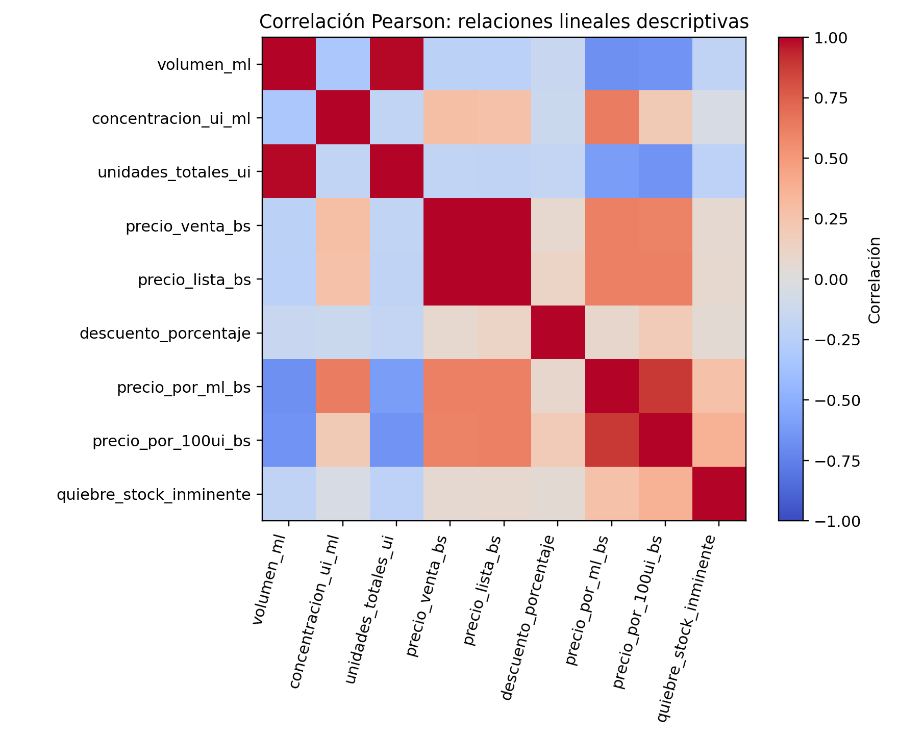
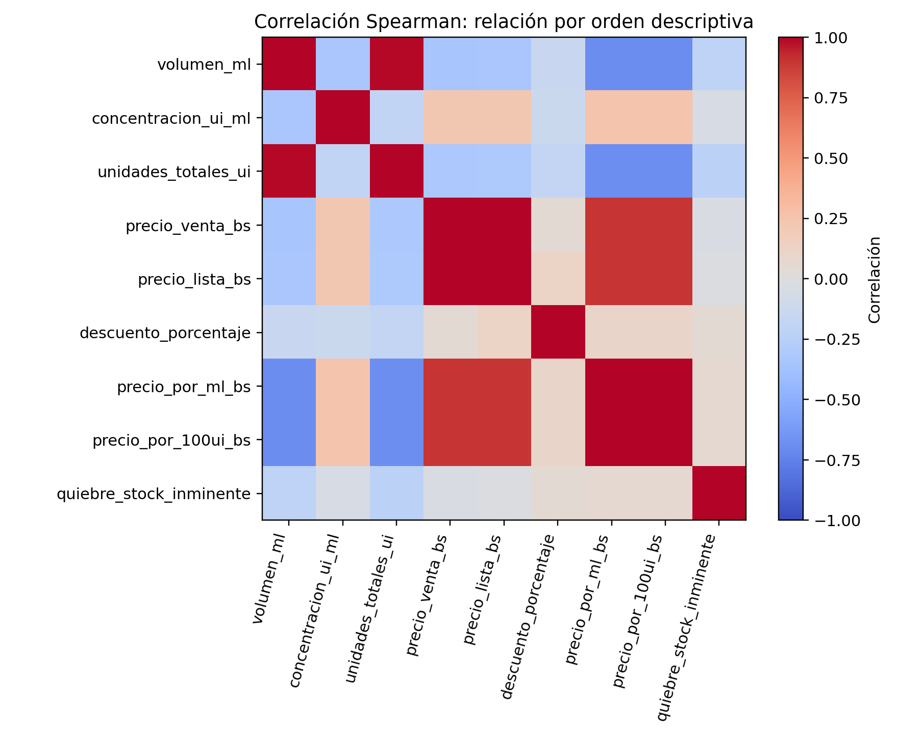
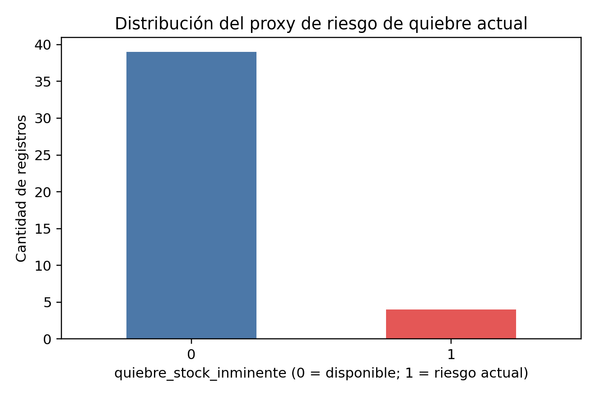
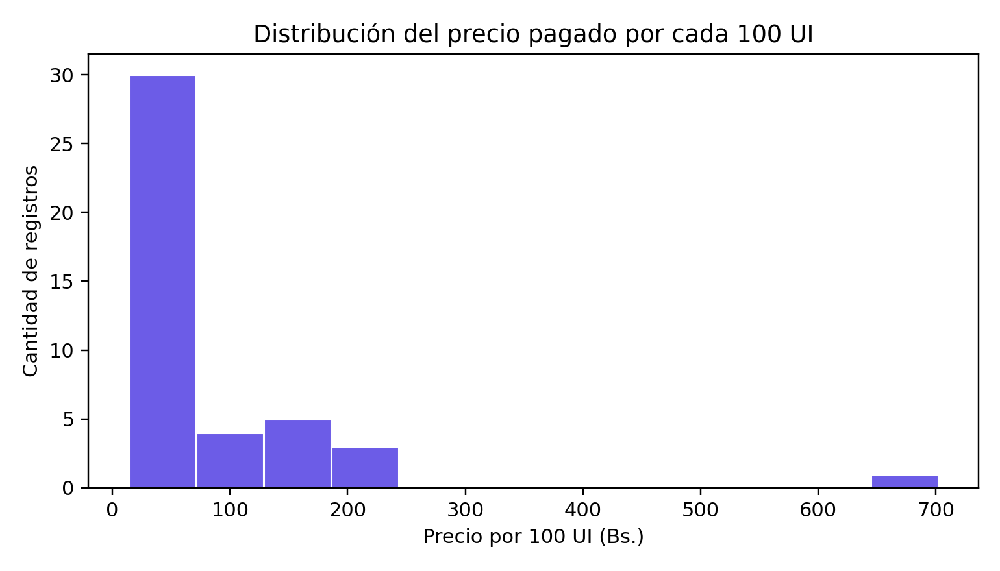
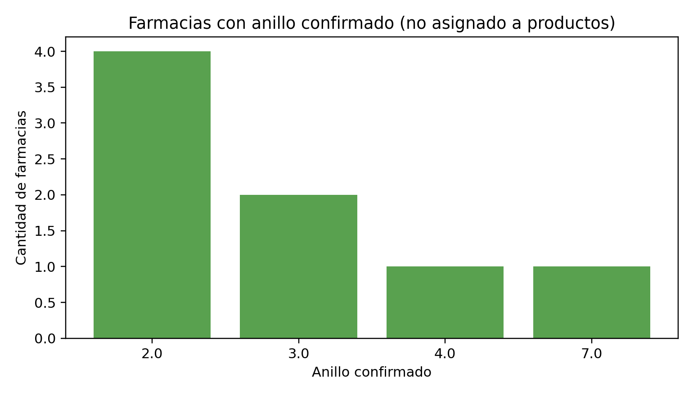

# SCRUM-24 — Ingeniería de características y matriz analítica

## 1. ¿Qué se buscó hacer?

Feature Engineering significa **crear o transformar variables para que los modelos puedan utilizar mejor la información disponible**. Se construyó una matriz preparada para futuras etapas; no se entrenó ni se validó un modelo predictivo en esta historia.

## 2. Datos utilizados

| archivo | información que aporta | cómo se utiliza |
|---|---|---|
| insulinas_master.csv | Producto, precio, presentación y estado retail | Base: una fila por producto/farmacia. |
| importaciones_stock_lags_preparados.csv | Importaciones mensuales y valores de meses anteriores | Join por fecha_periodo; no son demoras logísticas. |
| tipo_cambio_mensual_bcb.csv | Cotizaciones oficiales mensuales BCB | Join por fecha_periodo. |
| retail_stock_imputado_calendario.csv | Indicadores bancarios por producto y día | Join seguro por id_origen + fecha. |
| farmacias_geolocalizadas.csv | Anillos confirmados de sucursales | Resumen separado; sin asignación a productos. |

## 3. Nivel de observación

Cada fila representa un producto de insulina observado en una cadena de farmacia en la fecha de extracción. Se mantienen los identificadores y metadatos (`id_origen`, farmacia, marca, principio activo, laboratorio, fecha y período), pero no se usan como correlaciones numéricas.

## ¿Qué contiene `dataset_analitico_modelado.csv`?

Actualmente contiene **43 observaciones y 69 columnas**. Reúne información de precio, presentación de la insulina, importaciones, lags de 1 a 3 meses, tipo de cambio, calendario bancario, el target e indicadores de calidad de datos. Es una única tabla preparada para que una etapa posterior pueda seleccionar variables y entrenar modelos.

`densidad_farmacias_anillo` está vacía actualmente y `densidad_anillo_disponible` es falso. Esto **no es un error del pipeline**: no existe una relación verificable producto retail → sucursal física → anillo. El pipeline conserva esa limitación en lugar de inventar una asignación territorial.

## 4. Variables creadas y utilizadas

### Precio

`precio_venta_bs`, `precio_lista_bs`, `descuento_porcentaje`, `precio_por_ml_bs` y `precio_por_100ui_bs` se conservan del ETL. `precio_por_100ui_bs` es el **precio pagado por cada 100 unidades internacionales de insulina**; permite comparar presentaciones diferentes.

### Presentación

`volumen_ml`, `concentracion_ui_ml` y `unidades_totales_ui` describen tamaño y concentración del producto. Pueden ayudar a distinguir presentaciones que tienen precios totales distintos.

### Importaciones y lags

Se añadieron los campos disponibles `kilos_netos_lag_0m` a `kilos_netos_lag_3m`, `valor_cif_usd_lag_0m` a `valor_cif_usd_lag_3m`, `viales_estimados_lag_0m` a `viales_estimados_lag_3m` y `ui_estimadas_lag_0m` a `ui_estimadas_lag_3m`. Un **lag** es el valor registrado en un mes anterior; por ejemplo, `lag_1m` representa el mes previo. Son posibles predictores, **no una demora logística estimada**.

### Tipo de cambio

Se incorporaron los nombres reales de la fuente: `tipo_cambio_promedio_bob_usd`, `tipo_cambio_cierre_bob_usd`, `tipo_cambio_minimo_bob_usd`, `tipo_cambio_maximo_bob_usd` y `variacion_intermensual_pct`. Describen el período mensual observado, no una cotización individual por producto.

### Calendario bancario

`dia_pago_renta`, `ventana_pago_renta_3d`, `distancia_dias_pago_renta` y `dia_pago_pension_oficial` se vincularon por producto y fecha verificables. Podrían servir para estudiar temporalidad, pero no prueban compras reales de pacientes.

### Geografía

`densidad_farmacias_anillo` quedó en nulo y `densidad_anillo_disponible` en falso para cada producto. La tabla territorial está preparada, pero no se puede usar a nivel producto: no existe una relación verificable producto retail → sucursal física → anillo.

### Calidad de datos

`tiene_lags_importacion`, `tiene_tipo_cambio`, `tiene_calendario` y `densidad_anillo_disponible` indican si la información quedó disponible por fila.

## 5. Target

`quiebre_stock_inminente` es actualmente un **proxy de riesgo de quiebre actual**, no un quiebre futuro realmente observado. Un proxy es una medida aproximada que usamos temporalmente porque todavía no podemos observar directamente el evento futuro.

| estado observado | quiebre_stock_inminente |
|---|---:|
| AGOTADO o ULTIMAS_UNIDADES | 1 |
| DISPONIBLE | 0 |

Por ejemplo, si una insulina aparece como `AGOTADO`, su `quiebre_stock_inminente` vale `1`. Si aparece como `DISPONIBLE`, vale `0`. **El target actual es un PROXY de riesgo presente. No significa que el sistema ya esté prediciendo un quiebre futuro.**

En este corte hay 39 registros con target 0 y 4 con target 1 (9.3% positivos). Es un conjunto desbalanceado: un **dataset desbalanceado** tiene muchos más casos de una clase que de la otra. Aquí hay muchos más productos disponibles que casos con riesgo actual.

También se incluyen `target_es_proxy = True` y `definicion_target = AGOTADO_O_ULTIMAS_UNIDADES` para dejar esta limitación explícita.

## 6. Fuga de información

La **fuga de información** ocurre cuando el modelo recibe una variable que prácticamente le revela la respuesta que queremos predecir. Por ejemplo, si usamos `estado_stock` para predecir un target creado a partir de `estado_stock`, el modelo prácticamente estaría recibiendo la respuesta. Por eso se excluyeron de predictores y correlaciones: `estado_stock`, `stock_disponible_binario`, `alerta_quiebre_stock` y `semaforo_stock`.

## 7. Normalización

Se mantuvieron los valores originales y se añadieron Z-scores cuando hubo variación. Z-score es una transformación que expresa cuánto se aleja un valor del promedio del grupo, medido en desviaciones estándar. No se generó Z-score para variables constantes, porque no aportan información para correlación en este conjunto.

Una **variable constante** toma el mismo valor en todas las filas actuales. Los lags de importación, el tipo de cambio y el calendario bancario están presentes en el dataset, pero son constantes entre las 43 filas porque todas pertenecen al mismo período y fecha. Se conservan para futuras observaciones; sin embargo, no se interpretan en las correlaciones actuales ni reciben Z-score cuando no existe variación.

## 8. Densidad por anillo

Solo se contaron sucursales con anillo `ASIGNADO` y número conocido:

| anillo | farmacias | proporción |
|---|---|---|
| 2.0 | 4 | 50.0% |
| 3.0 | 2 | 25.0% |
| 4.0 | 1 | 12.5% |
| 7.0 | 1 | 12.5% |

No se asigna esta densidad a cada producto, porque las observaciones retail actuales no identifican una sucursal física relacionable con certeza.

## 9. Pearson y Spearman

Una **correlación** es una medida de qué tanto dos variables tienden a cambiar juntas. Pearson mide principalmente relación lineal entre variables. Spearman mide si las variables tienden a subir o bajar juntas según su orden y es menos sensible a valores extremos. Un valor positivo indica que ambas variables tienden a aumentar juntas; uno negativo indica que, cuando una aumenta, la otra tiende a disminuir. Ambos son descriptivos: **correlación no implica causalidad**.

| método | variable | correlación con el target | lectura breve |
|---|---|---:|---|
| Pearson | `precio_por_100ui_bs` | 0.365 | Asociación positiva descriptiva. |
| Pearson | `precio_por_ml_bs` | 0.267 | Asociación positiva descriptiva. |
| Pearson | `unidades_totales_ui` | -0.217 | Asociación negativa descriptiva. |
| Pearson | `volumen_ml` | -0.202 | Asociación negativa descriptiva. |
| Spearman | `unidades_totales_ui` | -0.220 | Asociación negativa por orden. |
| Spearman | `volumen_ml` | -0.208 | Asociación negativa por orden. |

La muestra es pequeña y estas cifras no permiten afirmar que precio, volumen o unidades **causen** un quiebre.

## 10. Resultados

| indicador | resultado |
|---|---:|
| filas del dataset final | 43 |
| columnas totales | 69 |
| target 0 | 39 |
| target 1 | 4 |
| porcentaje positivo | 9.3% |
| variables con variación para correlación (sin target) | 8 |
| variables numéricas constantes | 25 |
| valores faltantes finales | 43 |
| cobertura de lags | 100.0% |
| cobertura de tipo de cambio | 100.0% |
| cobertura de calendario | 100.0% |
| cobertura geográfica a nivel producto | 0.0% |

Variables constantes actuales: kilos_netos_lag_0m, kilos_netos_lag_1m, kilos_netos_lag_2m, kilos_netos_lag_3m, valor_cif_usd_lag_0m, valor_cif_usd_lag_1m, valor_cif_usd_lag_2m, valor_cif_usd_lag_3m, viales_estimados_lag_0m, viales_estimados_lag_1m, viales_estimados_lag_2m, viales_estimados_lag_3m, ui_estimadas_lag_0m, ui_estimadas_lag_1m, ui_estimadas_lag_2m, ui_estimadas_lag_3m, tipo_cambio_promedio_bob_usd, tipo_cambio_cierre_bob_usd, tipo_cambio_minimo_bob_usd, tipo_cambio_maximo_bob_usd, variacion_intermensual_pct, dia_pago_renta, ventana_pago_renta_3d, distancia_dias_pago_renta, dia_pago_pension_oficial.

## 11. Gráficas

Muestra relaciones lineales de las variables que sí varían. Se lee cruzando una fila y una columna: colores cercanos a 1 o -1 representan una asociación descriptiva mayor. El resultado principal actual es que `precio_por_100ui_bs` tiene la asociación Pearson positiva más alta con el target (≈ 0.365). No permite concluir causa ni rendimiento predictivo.

Muestra asociación por orden: observa si los valores tienden a subir o bajar en el mismo orden, aunque la relación no sea lineal. El resultado principal es una asociación negativa pequeña de `unidades_totales_ui` (≈ -0.220). No demuestra causalidad ni permite asegurar que un modelo funcionará bien.

Muestra cuántos registros tienen 0 y 1. Se lee comparando las alturas: hay 39 casos disponibles (0) y 4 de riesgo actual (1), por lo que evidencia el desbalance. No mide desempeño de un modelo ni representa quiebres futuros.

Muestra cómo se distribuye el precio comparable entre presentaciones. Cada barra reúne registros en un rango de precio por 100 UI; sirve para observar concentración o dispersión de precios. No prueba que un precio cause falta de stock.

Muestra sucursales con anillo confirmado. Se lee por altura de barra: el anillo 2 tiene 4 sucursales confirmadas, la mayor cantidad en esta fuente. No representa la distribución de productos retail ni permite comparar riesgo por anillo, pues no hay vínculo seguro a sucursal.

## 12. Limitaciones

- Hay pocos registros y el target está muy desbalanceado.
- El target es un proxy de riesgo actual, no un evento futuro observado.
- El retail corresponde a un solo día.
- Los lags mensuales son constantes dentro del mismo período retail.
- No existe relación producto–sucursal–anillo verificable.
- Las correlaciones son descriptivas, no causales.
- El dataset todavía no es suficiente para afirmar desempeño predictivo real.

## 13. ¿Cómo ayuda esto al modelo?

El resultado es una matriz estructurada que conserva trazabilidad, evita fuga de información y declara la disponibilidad de cada fuente. Esto permite que una siguiente etapa seleccione variables y valide un modelo sin confundir un proxy actual con una predicción de futuro.

## 14. ¿Cómo explicar este SCRUM?

En este SCRUM tomamos la información que ya se había preparado en etapas anteriores y la transformamos en una única tabla para análisis. Integramos datos de precio y presentación de la insulina con variables mensuales de importación, tipo de cambio y calendario bancario, pero solamente cuando la relación podía comprobarse. También dejamos separada la información territorial porque todavía no existe un vínculo seguro entre cada producto y una sucursal física.

Creamos un target provisional de riesgo actual: vale 1 para productos agotados o con últimas unidades y 0 para productos disponibles. Después calculamos las correlaciones Pearson y Spearman como una descripción inicial de las relaciones observadas. El resultado principal es `dataset_analitico_modelado.csv`, una matriz ordenada y documentada que los modelos posteriores podrán utilizar, sin presentar el proxy actual como si fuera una predicción futura.
