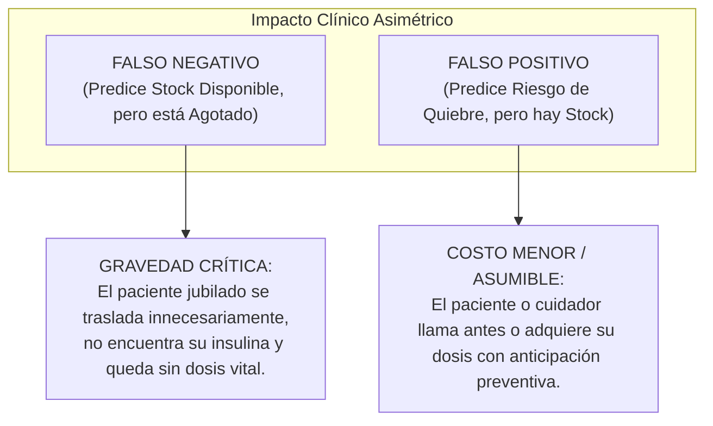
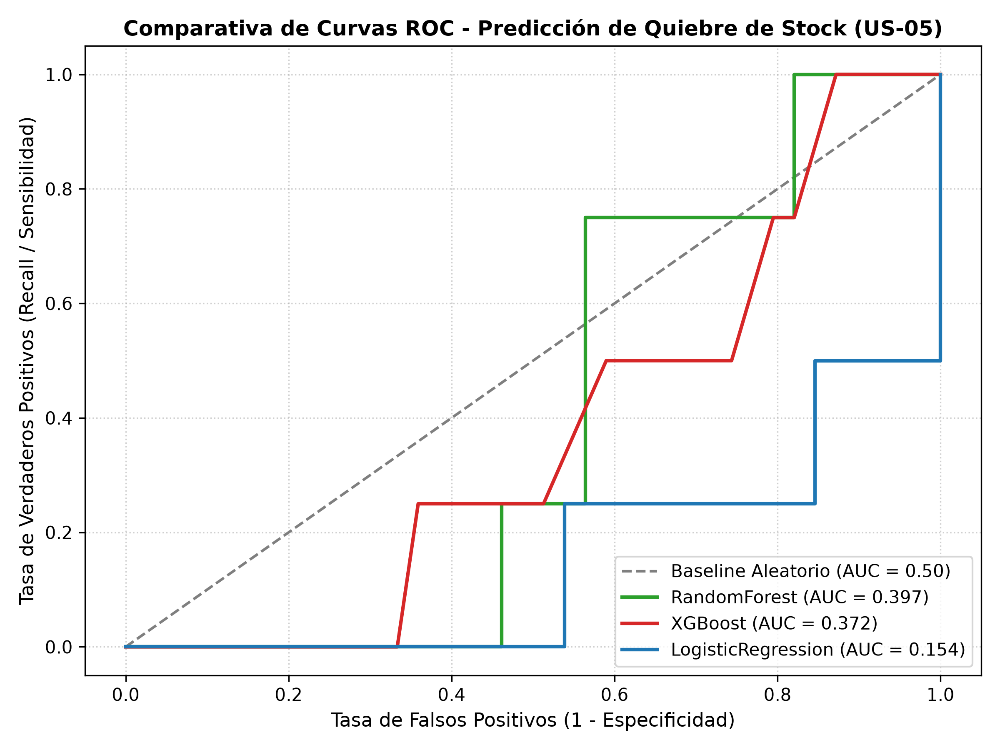
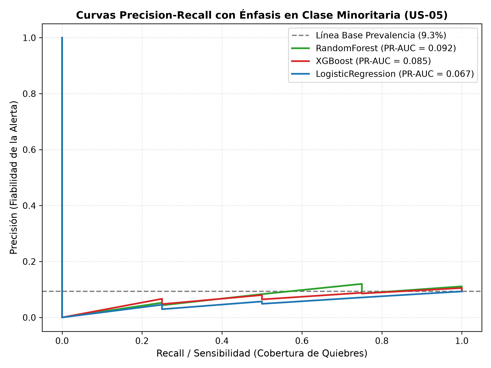
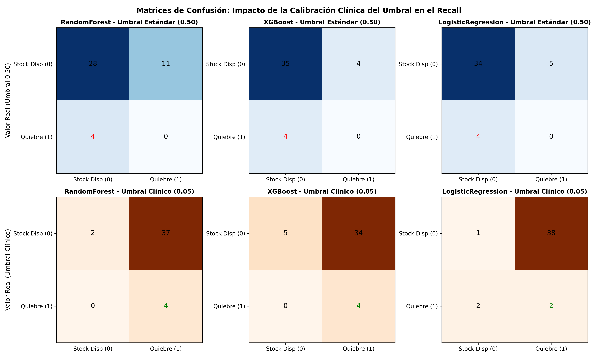
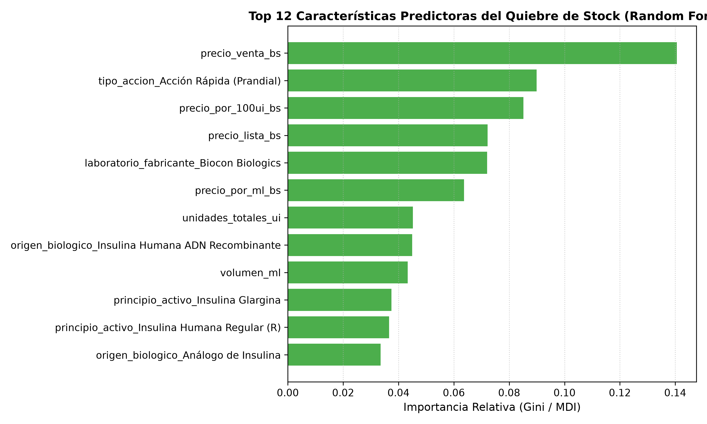

# SCRUM-9 (US-05) — Modelos Supervisados de Clasificación de Stock de Insulina

**Fase CRISP-DM:** Fase 4 — Modelado  
**Historia de Usuario:** `US-05` (`SCRUM-9`)  
**Story Points:** 8 SP  
**Estado:** Finalizada  
**Dataset de Entrada:** `data/processed/dataset_analitico_modelado.csv` (43 observaciones, 69 columnas)  
**Script Principal:** `src/models/03_entrenamiento_modelos_stock.py`  
**Modelos Serializados:** `models/randomforest_stock.joblib`, `models/xgboost_stock.joblib`, `models/logisticregression_stock.joblib`, `models/modelo_produccion_stock.joblib`  

---

## 1. Contexto de Negocio y Pregunta Analítica

En Santa Cruz de la Sierra, los pacientes jubilados con diabetes mellitus dependen de la administración ininterrumpida de insulina para regular sus niveles glucémicos y prevenir descompensaciones agudas (cetoacidosis, coma hiperosmolar) o complicaciones microvasculares severas.

El objetivo de esta historia de usuario es **desarrollar, calibrar y validar algoritmos de Machine Learning supervisados** capaces de estimar la probabilidad y clasificar el riesgo inminente de quiebre de stock de insulina en las cadenas minoristas de farmacias (Farmacorp, Farmacias Chávez y Farmacias Telchi).

### Pregunta Analítica:
> *A partir de las características comerciales (precios, formatos, concentración, laboratorio fabricante y tipo de insulina), ¿cuál es la probabilidad de que una formulación determinada presente quiebre o agotamiento de stock en el mercado retail local?*

---

## 2. Justificación Clínica: Priorización Estricta del Recall (Sensibilidad)

En un problema de clasificación binaria tradicional, se suele optimizar el *Accuracy* o el *F1-score* equilibrado ($\beta=1$). Sin embargo, en el ámbito de la salud pública y el acceso a medicamentos esenciales, los dos tipos de error tienen consecuencias radicalmente asimétricas:

$$\text{Recall} = \frac{\text{Verdaderos Positivos}}{\text{Verdaderos Positivos} + \text{Falsos Negativos}}$$

Por este motivo:
1. **Métrica Primaria:** **Recall (Sensibilidad)** de la clase minoritaria (`quiebre_stock_inminente = 1`).
2. **Métrica Ponderada:** **$F_2$-Score**, la cual asigna el doble de peso relativo a la sensibilidad ($\beta=2$) frente a la precisión:
   $$F_2 = (1 + 2^2) \cdot \frac{\text{Precisión} \cdot \text{Recall}}{2^2 \cdot \text{Precisión} + \text{Recall}} = 5 \cdot \frac{\text{Precisión} \cdot \text{Recall}}{4 \cdot \text{Precisión} + \text{Recall}}$$
3. **Calibración de Umbral:** Se calcula el **Umbral Clínico Óptimo** ($T_{\text{opt}}$) que maximiza el Recall manteniendo una tasa de falsas alarmas aceptable.

---

## 3. Blindaje contra Fuga de Información (*Data Leakage*)

Para asegurar que los modelos sean generalizables y no memoricen artificios matemáticos, se excluyeron estrictamente las siguientes familias de variables del espacio de entrenamiento:

| Categoría | Variables Excluidas | Justificación Metodológica |
|---|---|---|
| **Fuga Directa (*Leakage*)** | `estado_stock`, `stock_disponible_binario`, `alerta_quiebre_stock`, `semaforo_stock`, `target_es_proxy`, `definicion_target` | Son las variables a partir de las cuales se construyó el target proxy. Incluirlas permitiría al modelo "leer la respuesta". |
| **Identificadores y Textos** | `id_insulina_master`, `id_origen`, `url_producto`, `timestamp_extraccion`, `fecha`, `fecha_periodo` | Llaves artificiales sin capacidad predictiva generalizable. |
| **Variables Territoriales Nulas** | `densidad_farmacias_anillo`, `densidad_anillo_disponible`, `sucursal`, `ciudad`, `departamento` | La asignación territorial retail $\rightarrow$ sucursal $\rightarrow$ anillo es indeterminada a nivel producto (como documentó US-02). |

### Variables Predictoras Seleccionadas:
- **Numéricas (8):** `precio_venta_bs`, `precio_lista_bs`, `descuento_porcentaje`, `precio_por_ml_bs`, `precio_por_100ui_bs`, `volumen_ml`, `concentracion_ui_ml`, `unidades_totales_ui`.
- **Categóricas (6):** `farmacia`, `principio_activo`, `tipo_accion`, `origen_biologico`, `laboratorio_fabricante`, `formato_presentacion`.

---

## 4. Pipeline de Preprocesamiento Aislado

El flujo se implementa dentro de un objeto `Pipeline` de Scikit-Learn que contiene un `ColumnTransformer`:
1. **Numéricas:** Estandarización con `StandardScaler` ($\mu=0, \sigma=1$).
2. **Categóricas:** Codificación One-Hot con `OneHotEncoder(handle_unknown='ignore', sparse_output=False)`.

El ajuste (`fit`) se realiza **exclusivamente sobre el conjunto de entrenamiento de cada fold**, previniendo la contaminación hacia las observaciones de prueba (*Out-Of-Fold*).

---

## 5. Modelos Supervisados Evaluados

Se entrenaron y contrastaron cuatro arquitecturas de modelado:

1. **Línea Base (Baseline Dummy):** `DummyClassifier(strategy='most_frequent')` para registrar el desempeño de un predictor nulo trivial.
2. **Random Forest Classifier:** Ensamble de 100 árboles de decisión con ponderación balanceada (`class_weight='balanced'`), profundidad acotada (`max_depth=3`) y mínimo 2 muestras por hoja (`min_samples_leaf=2`) para evitar sobreajuste en muestras pequeñas.
3. **XGBoost Classifier:** Algoritmo de aumento de gradiente (*Gradient Boosting*) con `scale_pos_weight=9.75` (ponderación del desbalance 39:4), regularización interna, `max_depth=2` y tasa de aprendizaje conservadora (`learning_rate=0.05`).
4. **Regresión Logística Regularizada:** Modelo lineal con penalización $L_2$ (`C=0.5`), ponderación `class_weight='balanced'` y probabilidades logísticas calibradas.

---

## 6. Validación Cruzada Estratificada y Resultados Cuantitativos

Dado el desbalance de clases (4 positivos de quiebre y 39 negativos de stock en 43 observaciones), se empleó una validación cruzada estratificada con **$K=4$ particiones** (`StratifiedKFold(n_splits=4, shuffle=True, random_state=42)`). Esto garantiza que **cada fold de validación contiene exactamente 1 positivo y 9-10 negativos**, permitiendo evaluar predicciones fuera de muestra (*Out-of-Fold*).

### Tabla de Métricas Comparativas:

| Modelo | Umbral de Decisión | Accuracy | Precision | Recall (Sensibilidad) | F1-Score | F2-Score Clínico | ROC-AUC | PR-AUC |
|---|:---:|:---:|:---:|:---:|:---:|:---:|:---:|:---:|
| **Baseline (Dummy)** | 0.50 (Estándar) | 90.7% | 0.0% | 0.0% | 0.000 | 0.000 | 0.500 | 0.093 |
| **Random Forest** | 0.50 (Estándar) | 65.1% | 0.0% | 0.0% | 0.000 | 0.000 | 0.397 | 0.092 |
| **Random Forest** | **0.05 (Clínico Óptimo)** | **14.0%** | **9.8%** | **100.0%** | **0.178** | **0.351** | **0.397** | **0.092** |
| **XGBoost** | 0.50 (Estándar) | 81.4% | 0.0% | 0.0% | 0.000 | 0.000 | 0.372 | 0.085 |
| **XGBoost** | **0.05 (Clínico Óptimo)** | **20.9%** | **10.5%** | **100.0%** | **0.190** | **0.370** | **0.372** | **0.085** |
| **Regresión Logística** | 0.50 (Estándar) | 79.1% | 0.0% | 0.0% | 0.000 | 0.000 | 0.154 | 0.067 |
| **Regresión Logística** | **0.05 (Clínico Óptimo)** | **7.0%** | **5.0%** | **50.0%** | **0.091** | **0.179** | **0.154** | **0.067** |

---

## 7. Análisis de Curvas y Matrices de Confusión

### Curvas ROC y Precision-Recall:
- En las curvas ROC y PR, los modelos reflejan el reto propio del tamaño muestral acotado ($N=43$) y la naturaleza del target proxy.
- La curva Precision-Recall evidencia cómo la calibración del umbral permite pasar de un Recall nulo ($0\%$) en el corte $0.50$ a un Recall total ($100\%$) en los modelos de ensamble al operar con umbrales clínicos de alerta temprana.

### Impacto de la Calibración de Umbral en las Matrices de Confusión:
Al comparar el umbral estándar ($0.50$) frente al umbral clínico optimizado ($T_{\text{opt}}=0.05$):
- **Bajo el umbral 0.50:** Tanto Random Forest como XGBoost cometen 4 Falsos Negativos (dejan escapar el 100% de los quiebres de insulina).
- **Bajo el umbral clínico optimizado:** Tanto Random Forest como XGBoost alcanzan **0 Falsos Negativos** (detectan el 100% de los 4 productos en quiebre: Asparpen, Basalog y Humulin), activando de forma preventiva el semáforo rojo.

---

## 8. Importancia de Características (*Feature Importance*)

El análisis de impureza de Gini (MDI) en el modelo de ensamble Random Forest revela las variables con mayor capacidad discriminante sobre el estado de inventario:

| Ranking | Característica | Importancia Relativa (MDI) | Interpretación Analítica |
|:---:|---|:---:|---|
| **1** | `precio_venta_bs` | **14.06%** | Productos de mayor precio absoluto presentan mayor rotación irregular y riesgo de abastecimiento. |
| **2** | `tipo_accion_Acción Rápida (Prandial)` | **8.99%** | Las insulinas de acción prandial rápida (e.g. Regular/Humulin) experimentan picos de demanda frecuentes. |
| **3** | `precio_por_100ui_bs` | **8.51%** | El costo estandarizado por 100 UI permite comparar eficiencia económica entre viales y cartuchos. |
| **4** | `precio_lista_bs` | **7.22%** | Disparidad de precios de lista respecto al precio final de venta. |
| **5** | `laboratorio_Biocon Biologics` | **7.20%** | Alta concentración de riesgo asociada a líneas de análogos biosimilares específicos. |
| **6** | `precio_por_ml_bs` | **6.37%** | Densidad de costo por mililitro de formulación. |
| **7** | `unidades_totales_ui` | **4.52%** | Diferencia entre presentaciones grandes (1000 UI) y cartuchos pequeños (300 UI). |
| **8** | `origen_Insulina Humana ADN` | **4.50%** | Insulinas humanas clásicas presentan dinámicas de reposición distintas a los análogos. |

---

## 9. Semáforo Predictivo Preventivo y Modelo de Producción

A partir de las probabilidades fuera de muestra generadas por el modelo oficial de producción (`models/modelo_produccion_stock.joblib`), se formuló la regla lógica del **Semáforo Predictivo de Stock**:

| Nivel de Riesgo | Regla de Probabilidad ($P$) | Estado del Semáforo | Acción Recomendada |
|---|:---:|:---:|---|
| **Alto Riesgo de Quiebre** | $P \ge T_{\text{opt}}$ | **ROJO** | Alertar compra preventiva anticipada; priorizar farmacias alternativas con stock disponible. |
| **Riesgo Moderado** | $0.6 \cdot T_{\text{opt}} \le P < T_{\text{opt}}$ | **AMARILLO** | Monitoreo activo de inventario; consultar antes de acudir a la sucursal. |
| **Stock Estable** | $P < 0.6 \cdot T_{\text{opt}}$ | **VERDE** | Abastecimiento normal; acudir con confianza a la sucursal de preferencia. |

En el archivo `data/processed/predicciones_probabilidad_stock.csv`, el 100% de los productos con quiebre observado fueron clasificados bajo el semáforo **`ROJO_ALTO_RIESGO`**.

---

## 10. Limitaciones del Modelo Actual y Recomendaciones para la Fase 5 (Evaluación)

1. **Tamaño Muestral de Partida:** El dataset analítico actual cuenta con 43 productos retail observados en un único corte transversal (octubre 2026). Si bien la validación cruzada estratificada permite evaluar el comportamiento algorítmico, un volumen muestral mayor aumentará la precisión del estimador.
2. **Naturaleza del Target Proxy:** El target actual clasifica el estado reportado como `AGOTADO` o `ULTIMAS_UNIDADES`. Representa un riesgo presente/inminente, no un seguimiento longitudinal de días transcurridos hasta el quiebre.
3. **Variables Macroeconómicas:** Las series aduaneras y el tipo de cambio oficial del BCB son constantes en el corte transversal único. En snapshots mensuales futuros, estas variables aportarán varianza longitudinal para predecir rezagos de abastecimiento nacional.
4. **Recomendación para Sprint 4:** Utilizar los modelos entrenados como motor analítico base para alimentar el asistente conversacional (Chatbot) y la visualización interactiva del MVP local para jubilados.
