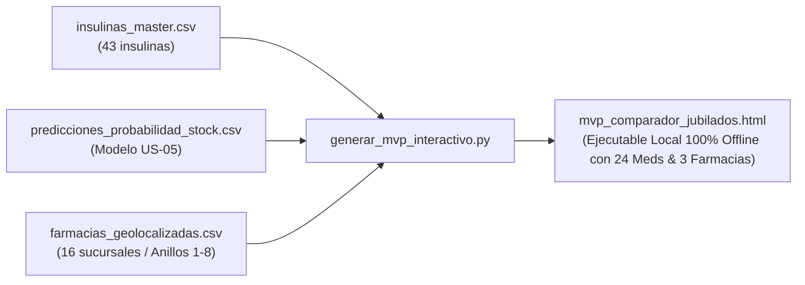

# SCRUM-44 (US-29) — MVP Visualizador Didáctico e Interactivo Local para Jubilados (Versión 2.0)

**Fase CRISP-DM:** Fase 6 — Despliegue  
**Historia de Usuario:** `US-29` (`SCRUM-44`)  
**Story Points:** 5 SP  
**Estado:** Finalizada  
**Datasets Integrados:** `data/processed/insulinas_master.csv`, `data/processed/predicciones_probabilidad_stock.csv`, `data/processed/farmacias_geolocalizadas.csv`  
**Archivos Ejecutables Generados:**  
- `mvp_comparador_jubilados.html` (en la raíz del proyecto para acceso directo)  
- `src/ui/mvp_comparador_jubilados.html`  
- Artefacto oficial de Antigravity en la carpeta de sesión  
**Script Generador:** `src/ui/generar_mvp_interactivo.py`  
**Suite de Pruebas:** `src/models/test_04_mvp_jubilados.py` (6/6 pruebas aprobadas)  

---

## 1. Contexto de Negocio y Entrega de Valor Temprano

Como requisito pedagógico y de negocio del proyecto integrador, se requería un **Mínimo Producto Viable (MVP)** funcional que permitiera entregar valor tangible inmediato a los usuarios finales (jubilados insulinodependientes y familiares cuidadores) antes del desarrollo final del chatbot conversacional.

El visualizador resuelve los tres dolores principales del adulto mayor identificados en la Fase 1 (`docs/01_comprension_negocio.md`):
1. **Dispersión de precios:** Dificultad para saber qué cadena (Farmacorp, Farmacias Chávez o Farmacias Telchi) ofrece el precio más bajo en su insulina prescrita.
2. **Incertidumbre de stock:** Riesgo de trasladarse físicamente a una sucursal lejana y encontrar el fármaco agotado.
3. **Brecha digital y barreras de accesibilidad:** Los portales de farmacias actuales están sobrecargados de banners y tipografías pequeñas ilegibles para adultos mayores.

---

## 2. Mejoras Implementadas en la Versión 2.0 (Feedback de Usuario)

En respuesta a la revisión interactiva del MVP, se implementaron 3 optimizaciones críticas de experiencia de usuario y arquitectura:

1. **Escalado Real de Tipografía Senior (A- / A+):**
   - *Problema:* Las utilidades tipográficas de Tailwind CSS (`rem`) sobreescribían el tamaño base asignado a la etiqueta `<body>`.
   - *Solución:* Se implementó escalado reactivo a nivel raíz del DOM (`document.documentElement.style.fontSize = (16 * scale) + 'px'`). Esto amplía o reduce armónicamente todos los textos, insignias, botones y tablas de la página. Se agregó un indicador visual del porcentaje de escala actual (`100%`, `110%`, etc.).

2. **Botón Explícito de Filtrado ("🔍 Filtrar Catálogo"):**
   - *Problema:* El usuario requería certidumbre visual de cuándo se aplican los filtros seleccionados (principio activo, presentación y cadena).
   - *Solución:* Se incorporó un botón principal **"🔍 Filtrar Catálogo"** y un botón complementario **"🔄 Ver Todos"**, manteniendo a su vez reactividad en tiempo real en los eventos `change` y `keyup` del buscador.

3. **Agrupamiento por Medicamento con Comparativa Directa de 3 Cadenas:**
   - *Problema:* Las 43 tarjetas individuales creaban redundancia y dificultaban la comparación inmediata entre farmacias para un mismo fármaco.
   - *Solución:* Se agruparon las insulinas por formulación clínica única (`marca`, `principio activo`, `presentación`, `volumen`), consolidando exactamente **24 medicamentos únicos**. Cada tarjeta contiene una lista estructurada que compara a **Farmacorp**, **Farmacias Chávez** y **Farmacias Telchi**:
     - Precio de venta en Bs.
     - Precio unitario normalizado por 100 UI.
     - Estado de stock reportado.
     - Medalla dorada `⭐ Mejor Precio` en la cadena más económica.
     - Banner de ahorro máximo: *"Ahorras Bs XX.XX comprando en [Cadena]"*.

---

## 3. Criterios de Aceptación Verificados

| Criterio | Descripción Técnica | Estado |
|---|---|:---:|
| **1. Filtros Rápidos y Botón Explícito** | Selección por principio activo, formato y cadena de farmacia, con botón `🔍 Filtrar Catálogo`, restablecer y búsqueda en vivo. | **Cumplido** |
| **2. Comparador Económico Agrupado** | 24 tarjetas con desglose simultáneo de las 3 farmacias (Chávez, Farmacorp, Telchi), medalla de mejor precio y cálculo del ahorro en Bs. | **Cumplido** |
| **3. Buscador Territorial** | Identificación de sucursales en anillos urbanos (Casco Urbano, 2do, 3er, 4to y 7mo Anillo) con dirección exacta y estado verificado. | **Cumplido** |
| **4. Semáforo Predictivo ML** | Widget visual (`VERDE`, `AMARILLO`, `ROJO`) conectado a las probabilidades del modelo supervisado Random Forest (`US-05`). | **Cumplido** |
| **5. Calculadora de Dosis** | Simulador donde el jubilado ingresa su dosis diaria (UI/día) y calcula frascos mensuales necesarios y ahorro mensual estimado. | **Cumplido** |
| **6. Accesibilidad Senior Integral** | Escalado de fuente del documento completo (A- / A+ / % indicador), insignias de alto contraste y función de lectura por voz nativa (Web Speech API). | **Cumplido** |

---

## 4. Arquitectura de Datos y Autocontención

Para asegurar que la aplicación pueda ejecutarse **100% offline y de forma local** en cualquier computadora sin necesidad de servidores web externos:
- El script compilador `src/ui/generar_mvp_interactivo.py` extrae y consolida los datasets reales:
  - 43 registros maestros de insulina consolidados en 24 formulaciones únicas.
  - 43 predicciones probabilísticas de stock del modelo oficial de producción (`models/modelo_produccion_stock.joblib`).
  - 16 sucursales farmacéuticas georreferenciadas con asignación a los anillos concéntricos de Santa Cruz.
- Los datos se embeben como estructuras JSON nativas dentro del archivo HTML5, permitiendo una interactividad instantánea sin demoras de red ni dependencias externas.

---

## 5. Módulos Funcionales del Visualizador

### 1. Panel de Comparación de Precios por Medicamento:
- Ordena automáticamente las presentaciones desde la más económica.
- En cada medicamento, lista a Farmacorp, Farmacias Chávez y Farmacias Telchi indicando disponibilidad y precio.
- Resalta la medalla `⭐ Mejor Precio` en la cadena más barata.
- Muestra el ahorro exacto en Bs (e.g. *"Ahorras Bs 37.70 comprando en Farmacorp"*).

### 2. Semáforo Predictivo Preventivo:
- Alerta visual en la cabecera:
  - **🟢 VERDE (Stock Estable):** Presentaciones con suministro garantizado.
  - **🟡 AMARILLO (Pocas Unidades):** Rotación acelerada.
  - **🔴 ROJO (Alerta de Quiebre):** Presentaciones en riesgo crítico según el clasificador ML supervisado.
- Advierte al paciente sobre la ventana crítica de cobro de rentas del Banco Unión (días 1 al 5 y fin de mes), recomendando compra anticipada.

### 3. Calculadora de Pensión y Tratamiento:
- Permite ingresar la dosis prescrita (e.g., 30 UI/día).
- Multiplica por 30 días = 900 UI/mes.
- Indica frascos requeridos (1 frasco de 1000 UI) y calcula el ahorro acumulado mensual y anual.

### 4. Buscador por Anillos Urbanos:
- Filtra sucursales por anillo (2do, 3er, 4to, 7mo o Centro).
- Presenta tabla con nombre de sucursal, dirección confirmada y estado de actividad física.

---

## 6. Instrucciones de Uso Local

Para abrir y utilizar el visualizador:
1. Navega hasta la carpeta raíz del proyecto: `Proyecto Integrador/`.
2. Haz doble clic en el archivo `mvp_comparador_jubilados.html`.
3. El archivo se abrirá de inmediato en tu navegador predeterminado (Google Chrome, Microsoft Edge, Opera o Firefox) sin necesidad de internet ni terminal.
