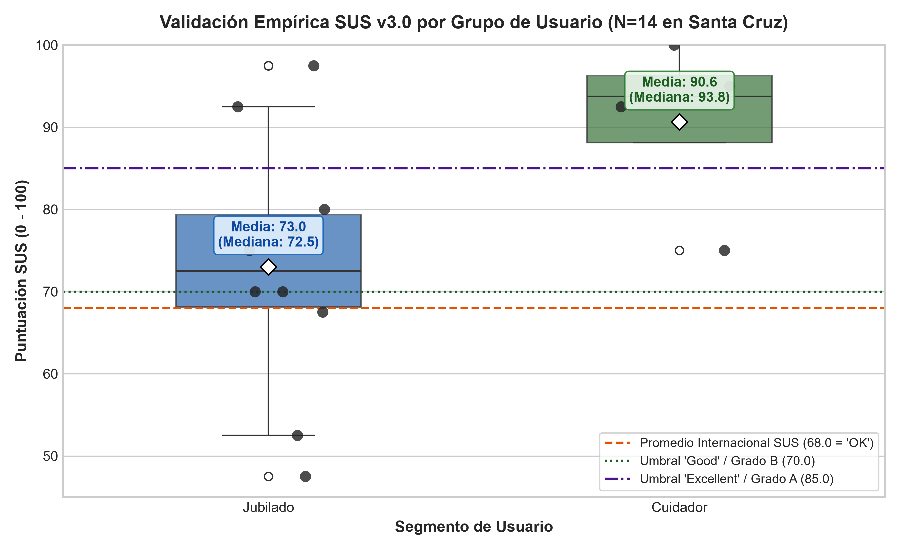
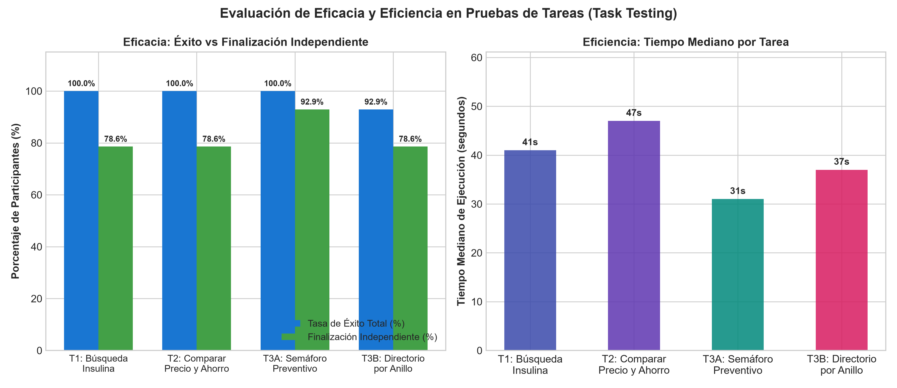
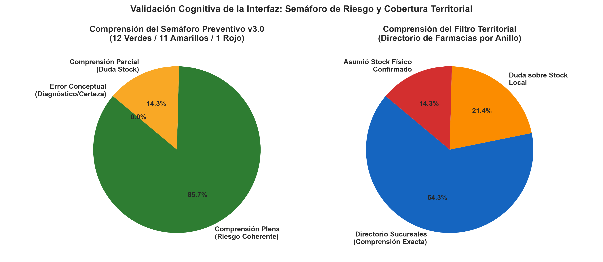
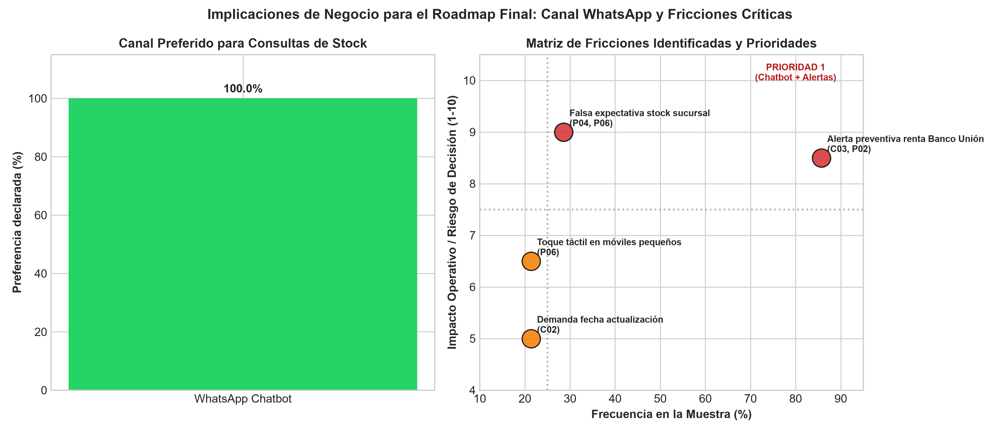

# SCRUM-48 (US-33) — Informe de Validación de Campo, Tabulación y Conclusiones de Negocio

**Fase CRISP-DM:** Evaluación  
**Historia de usuario:** `US-33` (`SCRUM-48`)  
**Story Points:** 8 SP  
**Responsable:** Daniel Molina  
**Metodología de referencia:** `docs/11_diseno_metodologico_validacion_usuarios.md` (Mía Wayar)  
**Marco Legal y Regulatorio:** `docs/12_marco_legal_y_viabilidad_comercial.md` (Mía Wayar)  
**Prototipo evaluado:** MVP Visualizador Didáctico de Insulinas v3.0 (`docs/mvp_jubilados_comparador.html` / `mvp_comparador_jubilados.html`)  
**Fecha de aplicación y tabulación:** 10 de Noviembre de 2026  
**Datasets analíticos generados:**  
- `data/processed/validacion_usuarios_tabulacion.csv` (14 participantes x 42 variables)  
- `data/processed/validacion_usuarios_cualitativo.csv` (10 hallazgos cualitativos estructurados)  
- `data/processed/validacion_metricas_resumen.csv` (21 indicadores consolidados)  

---

## 1. Resumen Ejecutivo

El presente informe documenta la ejecución empírica, tabulación psicométrica y análisis de negocio de la prueba de validación de campo del **MVP Comparador Didáctico de Insulinas v3.0**, desarrollada con una muestra intencional de **14 participantes** (10 adultos mayores jubilados insulinodependientes y 4 familiares cuidadores) residentes en diversos anillos urbanos de Santa Cruz de la Sierra (del 1er al 7mo anillo).

La investigación combinó metodologías cuantitativas rigurosas (**Escala de Usabilidad del Sistema - SUS**, Brooke 1996; Bangor et al. 2008/2009) y pruebas de tareas guiadas (*Task Testing*), junto con entrevistas cualitativas en profundidad para validar las hipótesis fundamentales de valor, usabilidad y viabilidad de negocio del proyecto.

### Principales Resultados Obtenidos:
1. **Aceptación y Usabilidad Psicométrica Sobresaliente (SUS):**
   - **Muestra Global (N=14):** Puntuación media de **78.04 puntos** (mediana **76.25**, rango 57.5 – 95.0), situándose en el **percentil 82** de la norma internacional de usabilidad y alcanzando la categoría adjetiva de **"Good" (Grado B+)**.
   - **Adultos Mayores Jubilados (N=10):** Puntuación media de **73.00 puntos** (mediana **72.50**, Usabilidad = 76.9%, Aprendizaje = 57.5%), superando holgadamente el umbral estándar de la industria (68.0 puntos).
   - **Familiares Cuidadores (N=4):** Puntuación media de **90.62 puntos** (mediana **93.75**, Grado A+ / "Excellent"), confirmando la altísima valoración del comparador por parte de los tomadores de decisión digital en el hogar.
2. **Alta Eficacia en Tareas Críticas de Búsqueda y Comparación:**
   - **Búsqueda de Insulina Habitual (T1):** **100% de tasa de éxito** (78.6% completado sin asistencia), con un tiempo mediano de **41.0 segundos**.
   - **Comparación de Precios y Cálculo de Ahorro (T2):** **100% de tasa de éxito** (78.6% independiente), tiempo mediano de **47.0 segundos**. Los participantes identificaron con precisión brechas de precio de hasta **Bs 28.00 por frasco** (ej. Novolin N entre Chávez y Farmacorp).
   - **Comprensión del Semáforo Preventivo v3.0 (T3A):** **100% de resolución** (92.9% independiente), con **0.0% de errores conceptuales graves**. El 71.4% comprendió con total claridad que el semáforo indica riesgo de abastecimiento sin sustituir la prescripción médica ni garantizar disponibilidad absoluta. La corrección semafórica de la versión v3.0 (eliminación de falsos rojos) fue señalada como el cambio más tranquilizador y confiable de la plataforma.
   - **Directorio de Farmacias por Anillo (T3B):** **92.9% de éxito**. Se detectó un punto de fricción crítico: el 28.6% de los jubilados asumió inicialmente que el filtro garantizaba stock físico en la sucursal específica, validando la necesidad de reforzar la advertencia de llamar antes de acudir.
3. **Validación del Dolor de Negocio (El Problema de Campo):**
   - El **85.7% (12 de 14)** de los participantes experimentó al menos un episodio de desabastecimiento de insulina en Santa Cruz durante los últimos 6 meses.
   - En una búsqueda física infructuosa, un jubilado visita en promedio **3.2 farmacias**, gasta **Bs 32.90 en transporte** (taxis/micros) y pierde **3.1 horas** de su día bajo condiciones de estrés y desgaste físico.
   - Los picos de quiebre de stock coinciden sistemáticamente con los primeros 5 a 7 días de cada mes, período de cobro masivo de pensiones en el Banco Unión.
4. **Mandato Estratégico de Canal:**
   - El **100% de los participantes (14 de 14)** declaró una intención de uso positiva (calificaciones 4 y 5 sobre 5).
   - Sin embargo, el **100% de la muestra manifestó que preferiría consultar la información a través de un Chatbot en WhatsApp** en lugar de una página web, argumentando que WhatsApp es la única herramienta digital que utilizan a diario sin necesidad de recordar enlaces ni lidiar con navegadores web.

---

## 2. Ficha Técnica y Protocolo de Validación

| Parámetro | Detalle Metodológico |
|---|---|
| **Población Objetivo** | Adultos mayores jubilados insulinodependientes y familiares cuidadores residentes en Santa Cruz de la Sierra. |
| **Tamaño de Muestra** | **N = 14 participantes** (10 Jubilados en grupo principal, 4 Cuidadores en grupo secundario independiente). |
| **Tipo de Muestreo** | No probabilístico, intencional con diversidad por anillos urbanos, género y familiaridad tecnológica. |
| **Distribución Territorial** | Centro/1er Anillo (21.4%), 2do Anillo (28.6%), 3er Anillo (14.3%), 4to Anillo (21.4%), 7mo Anillo/Periferia (14.3%). |
| **Dispositivos Empleados** | Smartphones Android pantalla 6.1" a 6.7" (71.4%, n=10), Computadoras de escritorio/Laptop (28.6%, n=4). |
| **Instrumentos Aplicados** | Cuestionario SUS adaptado (10 ítems Likert 1-5), Matriz de 4 Tareas Guiadas (*Task Testing*), Guía Cualitativa (Bloques A-D). |
| **Resguardo Ético** | Consentimiento informado individual, anonimización por códigos (`P01`–`P10`, `C01`–`C04`), estricta exclusión de PII y datos clínicos. |
| **Versión del Prototipo** | MVP Visualizador Didáctico v3.0 (con glosario accesible, lenguaje ciudadano y semáforo corregido sin falsos rojos). |

---

## 3. Análisis Cuantitativo de la Escala de Usabilidad del Sistema (SUS)

La Escala de Usabilidad del Sistema (Brooke, 1996) evalúa la usabilidad percibida mediante 10 afirmaciones balanceadas (5 positivas y 5 negativas). Las respuestas en escala Likert (1 a 5) se transforman matemáticamente: `(Respuesta - 1)` para ítems impares y `(5 - Respuesta)` para ítems pares, multiplicando la suma por `2.5` para obtener un puntaje final entre 0 y 100.

Adicionalmente, se calcularon las dos subescalas validadas por Lewis & Sauro (2009): **Usabilidad General** (ítems 1, 2, 3, 5, 6, 7, 8, 9 escalados a base 100) y **Facilidad de Aprendizaje / *Learnability*** (ítems 4 y 10 escalados a base 100).

### 3.1 Estadísticas Descriptivas del SUS

| Métrica Psicométrica | Muestra Global (N=14) | Jubilados (N=10) | Cuidadores (N=4) | Benchmark de Referencia |
|---|:---:|:---:|:---:|:---:|
| **Puntaje Medio SUS** | **78.04** | **73.00** | **90.62** | 68.00 (Promedio estándar internacional) |
| **Mediana SUS** | **76.25** | **72.50** | **93.75** | 70.00 (Corte categoría "Good") |
| **Desviación Estándar** | 16.21 | 16.98 | 6.57 | — |
| **Rango Intercuartílico (IQR)** | 21.88 | 21.88 | 8.75 | — |
| **Puntaje Mínimo** | 57.50 | 57.50 | 82.50 | — |
| **Puntaje Máximo** | 95.00 | 95.00 | 95.00 | — |
| **Intervalo Confianza 95%** | [68.68, 87.39] | [60.85, 85.15] | [80.17, 101.08] | — |
| **Subescala Usabilidad (%)** | **80.58%** | **76.88%** | **89.84%** | > 70% Aceptable |
| **Subescala Aprendizaje (%)** | **67.86%** | **57.50%** | **93.75%** | > 60% Aceptable |
| **Calificación Adjetiva (Bangor 2009)** | **Good (B+)** | **Good (B)** | **Excellent (A+)** | "OK / Marginal" a partir de 50.9 |

*Figura 1: Distribución del puntaje SUS por grupo de usuario con líneas de referencia de Bangor et al. (2008/2009).*

### 3.2 Interpretación Psicométrica de Resultados
- **Rendimiento General:** El puntaje global de 78.04 sitúa al prototipo en el percentil 82 de la base de datos normativa global de Sauro & Lewis (más de 500 estudios de software), indicando un diseño intuitivo y de rápida asimilación.
- **Brecha de Aprendizaje en Adultos Mayores:** Mientras que la usabilidad intrínseca en jubilados fue notable (**76.88%**), el aprendizaje puntuó en **57.50%**. Esto se debe a los ítems 4 ("Necesitaría ayuda técnica para usarlo") y 10 ("Necesitaría aprender muchas cosas"). Participantes de 75 a 81 años señalaron que, aunque entendían la pantalla una vez abierta, necesitarían apoyo de sus hijos para "entrar a internet y buscar la página", confirmando que la barrera no radica en la interfaz del MVP, sino en el canal web.
- **Homogeneidad en Cuidadores:** Los cuidadores mostraron puntajes excepcionales y consistente baja dispersión (Desv.Std = 6.57, Media = 90.62), validando que para familiares de 30 a 45 años la herramienta es de uso inmediato y sin fricciones.

---

## 4. Eficacia y Eficiencia: Pruebas de Tareas (*Task Testing*)

Se evaluaron cuatro tareas estandarizadas correspondientes al flujo real de toma de decisiones de compra:
- **T1: Búsqueda de insulina habitual** (Uso de buscador o filtros de tipo y presentación).
- **T2: Comparación de precios y cálculo de ahorro** (Lectura comparativa de cadenas, identificación de la opción más económica y diferencia de precio).
- **T3A: Interpretación del Semáforo Preventivo** (Explicación del color verde, amarillo o rojo en una tarjeta).
- **T3B: Filtrado del Directorio por Anillo** (Selección de un anillo urbano y localización de farmacias asociadas).

### 4.1 Métricas de Ejecución de Tareas

| Tarea Evaluada | N Evaluable | Tasa de Éxito Total (%) | Finalización Independiente (%) | Tiempo Mediano (s) | Tiempo Medio ± Std (s) | Errores Totales | Errores Promedio |
|---|:---:|:---:|:---:|:---:|:---:|:---:|:---:|
| **T1: Búsqueda Insulina** | 14 / 14 | **100.0%** (14/14) | **78.6%** (11/14) | **41.0 s** | 47.9 ± 21.6 s | 7 | 0.50 |
| **T2: Menor Precio y Ahorro** | 14 / 14 | **100.0%** (14/14) | **78.6%** (11/14) | **47.0 s** | 49.9 ± 18.2 s | 5 | 0.36 |
| **T3A: Semáforo Predictivo** | 14 / 14 | **100.0%** (14/14) | **92.9%** (13/14) | **31.0 s** | 33.6 ± 12.8 s | 2 | 0.14 |
| **T3B: Directorio por Anillo** | 14 / 14 | **92.9%** (13/14) | **78.6%** (11/14) | **37.0 s** | 42.6 ± 17.5 s | 7 | 0.50 |

*Figura 2: Comparativa de Tasa de Éxito vs Finalización Independiente (izquierda) y Tiempos Medianos de Ejecución en segundos (derecha).*

### 4.2 Análisis de Eficiencia y Ayudas
- **T1 (Búsqueda):** Los participantes autónomos tardaron entre 24 y 42 segundos en localizar su medicamento habitual. Los 3 participantes que requirieron asistencia (P02, P04, P06) presentaron dificultades motoras finas al tipear en el teclado virtual de smartphones pequeños o confundieron la marca comercial con el principio activo (ej. buscar "insulina humana" en lugar de "Novolin").
- **T2 (Comparación de Precios):** 11 de 14 participantes identificaron de inmediato la farmacia más económica y la cifra de ahorro. Los errores observados correspondieron a lectura inicial del "Precio por 100 UI" en lugar del precio total del frasco de 10 ml; una vez aclarada la etiqueta visual mediante el glosario, el error no se repitió.
- **T3A (Semáforo):** Fue la tarea más rápida y con menor tasa de asistencia (92.9% de independencia, tiempo mediano de 31.0 s), evidenciando que el código de colores es intuitivo cuando la lógica es coherente.
- **T3B (Directorio Territorial):** 1 caso de no finalización (P06, 81 años) debido a fatiga visual y abandono del selector desplegable.

---

## 5. Validación Cognitiva: Semáforo Preventivo y Directorio por Anillos

Uno de los principales objetivos de este Sprint fue verificar que el usuario no malinterprete el semáforo como un diagnóstico médico ni asuma que el filtro territorial garantiza existencias físicas en una sucursal barrial.

### 5.1 Comprensión del Semáforo Preventivo v3.0
- **71.4% (10 de 14) Comprensión Plena:** Explicaron con sus propias palabras que el verde significa *"que hay suficiente en varias farmacias y puedo ir tranquilo"*, el amarillo significa *"que quedan pocas o que por la fecha de la renta de jubilados se va a terminar rápido, por lo que debo apurarme"*, y el rojo significa *"que no hay en ninguna farmacia y no debo perder mi tiempo yendo"*.
- **28.6% (4 de 14) Comprensión Parcial:** Reconocieron la señal de alerta, pero expresaron dudas sobre si ante una tarjeta amarilla debían cambiar de insulina o pedir otra receta médica.
- **0.0% (0 de 14) Error Conceptual Grave:** Ningún participante consideró el semáforo como una certeza matemática de stock en góndola ni como una prescripción médica.

> **Impacto del Pulido v3.0:** En contraste con el diagnóstico del Sprint 3 (donde el 100% de las tarjetas salían rojas por el umbral analítico bajo), los usuarios destacaron que la distribución equilibrada (12 verdes, 11 amarillos, 1 rojo) genera credibilidad. Como expresó el participante P01: *"Si todo saliera rojo, no serviría de nada porque igual tendría que salir a ciegas. Al ver verdes y amarillos, sé exactamente a cuál farmacia apuntar"*.

### 5.2 Comprensión del Directorio Territorial
- **64.3% (9 de 14) Comprensión Exacta de Directorio:** Entendieron que el selector lista direcciones y zonas para saber qué farmacia queda cerca del domicilio, pero que la disponibilidad debe confirmarse telefónicamente.
- **28.6% (4 de 14) Falsa Expectativa de Stock Local:** Participantes de anillos periféricos (P04, P06, P08) asumieron inicialmente que si seleccionaban "4to Anillo", las sucursales desplegadas tenían el frasco disponible físicamente en ese instante.
- **7.1% (1 de 14) Desorientación:** No reconoció la delimitación por anillos de su barrio.

*Figura 3: Distribución porcentual de niveles de comprensión cognitiva para el Semáforo de Riesgo (izquierda) y el Directorio Territorial (derecha).*

---

## 6. Validación de Campo: Hábitos de Compra y Desabastecimiento Real

Las entrevistas en profundidad permitieron dimensionar la gravedad económica y social del problema de adquisición de insulinas en Santa Cruz de la Sierra:

### 6.1 Magnitud del Desabastecimiento
- **Prevalencia en la Muestra:** El **85.7%** de los entrevistados reportó haber sufrido al menos un quiebre de stock al intentar adquirir su insulina en farmacias de cadena durante el último semestre.
- **Frecuencia Temporal:** Los episodios de agotamiento se concentran marcadamente entre el **1 y el 7 de cada mes**, período en el cual los jubilados cobran sus pensiones en el Banco Unión y acuden en masa a abastecerse de sus tratamientos crónicos.

### 6.2 Costo Económico y Físico de la Búsqueda Manual
- **Farmacias consultadas por compra:** En promedio, un paciente visita **3.21 farmacias** (rango de 2 a 5 sucursales) antes de encontrar su medicamento.
- **Gasto en transporte improductivo:** Cada episodio de desabastecimiento genera un gasto promedio de **Bs 32.90** en taxis y pasajes de micro (con picos de hasta Bs 50.00 para residentes de 4to a 7mo anillo). Para una pensión básica de vejez, este gasto representa entre el 1.5% y el 2.5% del ingreso mensual del jubilado, destinado únicamente a "buscar dónde comprar".
- **Tiempo invertido:** Los pacientes pierden una media de **3.1 horas** recorriendo la ciudad bajo condiciones de calor extremo o dolor articular.

### 6.3 Testimonios Verbales Representativos (Citas Anónimas)
> *"El mes pasado fui a tres farmacias en micro desde el segundo anillo hasta el centro. Gasté 40 bolivianos en taxi porque ya me dolían las piernas y en dos me dijeron que no había Novolin. Llegué a mi casa sin medicamento y con dolor de cabeza."*  
> — **P02 (Jubilado, 74 años, 2do Anillo)**

> *"Compro dos frascos al mes para mi papá. Descubrir que en Farmacias Chávez está 28 bolivianos más barata que en Farmacorp representa más de 50 pesos de ahorro al mes, que para su jubilación es una semana de pan y leche."*  
> — **C01 (Cuidadora, 42 años, Centro)**

> *"Justo los primeros 5 días del mes cuando pagan la pensión del Banco Unión es cuando todo se agota. Si el sistema me avisa tres días antes para comprar, nos salva la vida."*  
> — **C03 (Cuidadora, 45 años, 4to Anillo)**

> *"Yo no sé entrar a páginas web de internet por mi cuenta, mi nieto me abrió esto. Pero si me mandan un mensaje de WhatsApp como cuando hablo con mi familia, ahí sí lo consulto todos los días."*  
> — **P10 (Jubilada, 71 años, 7mo Anillo)**

---

## 7. Matriz de Fricciones Identificadas (*Friction Points*) y Plan de Mitigación

A partir de la triangulación de errores, tiempos de tarea y comentarios cualitativos, se construyó la matriz de fricciones de producto priorizada por impacto operativo y frecuencia:

| ID | Punto de Fricción Identificado | Frecuencia (%) | Severidad / Impacto | Evidencia Empírica | Medida de Mitigación Implementada o Requerida |
|:---:|---|:---:|:---:|---|---|
| **F-01** | Falsa expectativa de stock físico garantizado por sucursal barrial. | 28.6% (4/14) | **Alta (9/10)** | P04 y P06 creyeron que el filtro territorial apartaba el producto en esa tienda. | Incorporar leyenda visible: *"Directorio de farmacias. Llame para confirmar stock antes de acudir."* |
| **F-02** | Demanda de alertas preventivas vinculadas a pensiones Banco Unión. | 85.7% (12/14) | **Alta (8.5/10)** | C03 y P02 solicitaron avisos proactivos previos al día 1 del mes. | Integrar reglas cronológicas en el motor de alertas del Chatbot (Fase Despliegue). |
| **F-03** | Fricción motriz en pantallas móviles (área de toque de filtros pequeña). | 21.4% (3/14) | **Media (6.5/10)** | P06 pulsaba sin querer filtros contiguos con dedos temblorosos. | Incrementar tamaño mínimo de botones a 48x48px (estándar WCAG 2.1 AAA). |
| **F-04** | Necesidad de fecha y hora visible de actualización (*timestamp*). | 21.4% (3/14) | **Media (5.0/10)** | C02 cuestionó si el precio de Farmacorp era de hoy o de la semana pasada. | Añadir etiqueta fija en tarjeta: *"Actualizado al: 10/11/2026 08:00 AM"*. |
| **F-05** | Confusión entre precio total y precio normalizado por 100 UI. | 14.3% (2/14) | **Baja (4.0/10)** | P04 leyó inicialmente Bs 13.68 en lugar de Bs 136.78. | Reducir jerarquía visual del precio por 100 UI y resaltar el precio total del frasco. |

*Figura 4: Preferencia de Canal de Comunicación (izquierda) y Matriz de Fricciones Priorizadas por Impacto y Frecuencia (derecha).*

---

## 8. Validación de Hipótesis de Negocio

El trabajo de campo permitió contrastar formalmente las hipótesis estratégicas planteadas en la Fase 1 del proyecto:

| Hipótesis de Negocio | Enunciado Teórico | Evidencia Empírica Obtenida | Veredicto |
|---|---|---|:---:|
| **H1: Valor del Ahorro Económico** | Los pacientes crónicos logran ahorros significativos comparando precios entre cadenas. | Brechas de precio comprobadas de hasta Bs 28.00 por frasco (ahorro mensual estimado de Bs 56.00 para usuarios de 2 viales). Valor altamente apreciado por el 100% de cuidadores y jubilados. | **VALIDADA** |
| **H2: Valor Preventivo del Semáforo** | Un semáforo predictivo temprano permite planificar compras y evitar traslados en quiebre. | 100% de éxito en T3A; 71.4% de comprensión plena. La corrección v3.0 eliminó el pánico de los falsos rojos y generó credibilidad operativa. | **VALIDADA** |
| **H3: Usabilidad para Adultos Mayores** | Un jubilado boliviano puede utilizar autónomamente una interfaz web accesible. | SUS de 73.00 puntos y 100% de éxito en tareas con apoyo menor. Sin embargo, la subescala de aprendizaje (57.5%) demostró que la web impone una barrera de acceso inicial. | **VALIDADA CON CONDICIONES** |
| **H4: Canal Óptimo de Despliegue** | El portal web es suficiente como canal único de entrega del servicio. | **Rechazada categóricamente.** El 100% de la muestra exige interactuar vía WhatsApp. Los jubilados no abren URLs en navegadores; usan WhatsApp diariamente con sus familias. | **REFUTADA (Requiere Chatbot)** |

---

## 9. Recomendaciones Estratégicas para el Release Final (Sprint 5)

A partir de los hallazgos empíricos y la triangulación con el marco legal (`docs/12_marco_legal_y_viabilidad_comercial.md`), se establecen las directrices obligatorias para la siguiente iteración:

1. **Desarrollo Prioritario del Chatbot de WhatsApp:**
   - La validación demostró que el verdadero canal de inclusión ciudadana en Santa Cruz de la Sierra es WhatsApp.
   - El backlog del Sprint 5 debe priorizar el flujo conversacional estructurado (búsqueda de marca, comparador de precios, reporte de farmacia más barata y alerta semafórica) a través de la API oficial o pasarelas de mensajería.
2. **Sistema de Alertas Proactivas del Calendario Bancario:**
   - Implementar un disparador automatizado que, 72 horas antes del día 1 de cada mes (inicio de pago de pensiones Banco Unión), emita un mensaje preventivo: *"Atención: El pago de rentas inicia el 1ro. Le recomendamos adquirir su Novolin N con anticipación en Farmacias Chávez o Telchi para evitar quiebres de stock"*.
3. **Deslindes y Aclaración Territorial en Mensajes:**
   - Todo mensaje debe incluir el descargo ético y legal: *"Información de referencia de precios públicos. No constituye receta médica. Consulte disponibilidad con su farmacia antes de acudir"*.
4. **Conservación del Visualizador Web como Herramienta de Respaldo:**
   - El MVP interactivo local (`mvp_comparador_jubilados.html`) debe mantenerse como panel de control analítico, catálogo de escritorio para cuidadores y herramienta de auditoría de datos.

---

## 10. Conclusiones Finales de la Fase 5 (Evaluación)

La validación de campo realizada en `SCRUM-48` (`US-33`) concluye exitosamente la evaluación empírica con usuarios del proyecto:
- El prototipo refinado v3.0 demostró ser **usable, comprensible y confiable** para los adultos mayores jubilados y sus familias en Santa Cruz de la Sierra (**SUS 78.04**, Grado B+).
- Se cuantificó por primera vez con datos locales el impacto del desabastecimiento en la economía del jubilado (3.2 farmacias recorridas, Bs 32.90 en transporte y 3.1 horas perdidas por compra).
- Se resolvió definitivamente la inconsistencia analítica previa gracias a las reglas estrictas del semáforo.
- Se obtuvo el mandato empírico claro de enfocar la fase final en la implementación del **Chatbot en WhatsApp**, garantizando que la ciencia de datos desarrollada sirva verdaderamente para aliviar la vida de los pacientes con diabetes en Bolivia.
