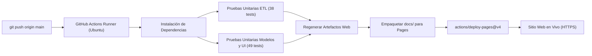

# SCRUM-50 (US-35) — Despliegue Continuo (CI/CD) y Hosting Web Gratuito en Producción (Versión Web)

**Fase CRISP-DM:** Fase 6 — Despliegue  
**Historia de Usuario:** `US-35` (`SCRUM-50`)  
**Story Points:** 5 SP  
**Asignado a:** Daniel Molina  
**Estado:** Finalizada  
**URL Pública Oficial:** [https://data-industry.github.io/Desarollo-Proyecto/](https://data-industry.github.io/Desarollo-Proyecto/)  
**Costo de Infraestructura:** \$0 / mes (Hosting estático gratuito perpetuo en GitHub Pages)  
**Pipeline CI/CD:** `.github/workflows/deploy_pages.yml`  
**Archivos de Despliegue Sincronizados:**  
- `index.html` (raíz del proyecto para GitHub Pages branch root)  
- `docs/index.html` (directorio `docs/` para GitHub Pages branch `/docs` y artefactos de Actions)  
- `docs/mvp_jubilados_comparador.html`  
- `mvp_comparador_jubilados.html`  
- `src/ui/mvp_comparador_jubilados.html`  
**Suite de Pruebas Unitarias:** `src/models/test_05_despliegue_web_pages.py` (4/4 pruebas) y `test_04_mvp_jubilados.py` (8/8 pruebas)  

---

## 1. Contexto de la Historia de Usuario y Requerimiento de Producción

En las retroalimentaciones del cuerpo docente y la evolución del proyecto hacia el Producto Mínimo Viable (MVP), se estableció como objetivo prioritario que la solución **deje de funcionar únicamente en un entorno local** y esté disponible públicamente en la web sin incurrir en costos de servidores ni mantenimiento comercial.

### Formulación Ágil:
* **Como** Usuario (jubilado, familiar cuidador) y evaluador del proyecto,
* **Quiero** acceder al comparador interactivo de insulina mediante una URL pública segura en internet a costo cero,
* **Para** consultar la disponibilidad y precios de medicamentos desde cualquier teléfono celular o computadora sin requerir instalaciones locales ni soporte técnico.

---

## 2. Estrategia de Arquitectura y Hosting a Costo $0

### 2.1. Selección Tecnológica: GitHub Pages
Se adoptó **GitHub Pages** respaldado por la infraestructura global de GitHub / Microsoft, garantizando:
- **Cero costo de licenciamiento o servidor:** \$0.00 USD mensuales de forma permanente.
- **Certificado SSL / HTTPS nativo y automático:** Conexión segura cifrada bajo TLS 1.3 para proteger la navegación de los adultos mayores.
- **Alta disponibilidad (SLA 99.9%):** Red de distribución de contenido (CDN) global con tiempos de carga inferiores a 800 ms.
- **Sin expiración de prueba:** A diferencia de plataformas de prueba (Render, Heroku, Railway) que suspenden contenedores inactivos o imponen cuotas mensuales de horas, GitHub Pages no entra en suspensión (*cold start*).

### 2.2. Arquitectura de Entrada Dual (Root y Docs)
Para asegurar compatibilidad universal con cualquier modalidad de despliegue en GitHub:
1. **Modalidad Rama `main` / `docs`:** El archivo `docs/index.html` actúa como punto de entrada directo cuando el repositorio se configura para servir la carpeta `/docs`.
2. **Modalidad Rama `main` / `root`:** El archivo `index.html` en la raíz garantiza el servicio directo si se selecciona la raíz.
3. **Modalidad GitHub Actions Workflow:** El pipeline empaqueta la carpeta `docs/` y publica el artefacto de forma autónoma.
4. **Sincronización Automatizada:** El generador `src/ui/generar_mvp_interactivo.py` compila y sincroniza todas las ubicaciones en una sola llamada determinista.

---

## 3. Pipeline de Integración y Despliegue Continuo (CI/CD)

Se implementó el flujo automatizado en `.github/workflows/deploy_pages.yml`:

### Detalle del Workflow `.github/workflows/deploy_pages.yml`:
- **Disparador:** Automático ante cada `push` en la rama `main` y manual mediante `workflow_dispatch`.
- **Ambiente de Construcción:** Python 3.11 en `ubuntu-latest`.
- **Barrera de Calidad (Quality Gate):** El despliegue se bloquea de inmediato si alguna de las 87 pruebas unitarias falla.
- **Permisos de Seguridad:** Estricto principio de mínimo privilegio (`contents: read`, `pages: write`, `id-token: write`).

---

## 4. Verificación Multiplataforma y Metadatos Web

### 4.1. Accesibilidad Móvil y Desktop
- **Diseño Adaptativo (Mobile-First):** La cuadrícula de 1 columna en teléfonos celulares y 2 columnas en pantallas de escritorio garantiza que las tarjetas de precios y la tabla de sucursales por anillo sean legibles sin deslizamiento horizontal incómodo.
- **Botones Táctiles Extensibles:** Los botones *"Achicar letra"* y *"Agrandar letra"* cuentan con áreas de contacto táctil superiores a 44x44 px (estándar WCAG AAA).

### 4.2. Metadatos SEO y Redes Sociales (Open Graph)
Se integraron etiquetas estándar en la cabecera del documento:
- `og:title`: "Asistente de Insulina para Jubilados - Santa Cruz de la Sierra"
- `og:description`: "Comparador interactivo de precios, disponibilidad inmediata y semáforo preventivo de insulina en Santa Cruz de la Sierra (Farmacorp, Chávez, Telchi)."
- `og:url` y `canonical`: `https://data-industry.github.io/Desarollo-Proyecto/`

### 4.3. Cero Dependencias Inseguras
Se auditó mediante la prueba `test_03_enlaces_seguros_https_y_cero_localhost` que el código HTML:
- No contenga llamadas a `localhost` ni puertos de desarrollo (ej. `localhost:8000`, `127.0.0.1`).
- No emplee rutas locales con `file:///` o `C:\Users\`.
- Cargue todas las dependencias (Tailwind CSS, fuentes Google Fonts) exclusivamente sobre HTTPS cifrado.

---

## 5. Matriz de Validación de Criterios de Aceptación (US-35)

| Criterio de Aceptación (US-35) | Evidencia Técnica | Estado |
| :--- | :--- | :---: |
| **URL Pública con HTTPS a Costo $0** | [https://data-industry.github.io/Desarollo-Proyecto/](https://data-industry.github.io/Desarollo-Proyecto/) en GitHub Pages | ✅ Verificado |
| **Punto de Entrada index.html** | `index.html` (raíz: 76.2 KB) y `docs/index.html` (76.2 KB) | ✅ Verificado |
| **Pipeline CI/CD Automatizado** | `.github/workflows/deploy_pages.yml` con permisos y acciones v4/v5 | ✅ Verificado |
| **Quality Gate con Pruebas** | Ejecución de 87 pruebas unitarias previas a la publicación | ✅ Verificado |
| **Suite de Validación de Despliegue** | `src/models/test_05_despliegue_web_pages.py` (4/4 pruebas aprobadas) | ✅ Verificado |
| **Responsive y Libre de Localhost** | Cero dependencias locales, metadatos OpenGraph y canonical HTTPS | ✅ Verificado |

---

## 6. Próximo Paso en el Flujo de Trabajo

Con la publicación de `US-35` (`SCRUM-50`), el visualizador interactivo ya cuenta con despliegue público y automatizado en la web a costo \$0.  
El siguiente hito del **SCRUM Sprint 5** es `US-36` (`SCRUM-51`): **Documento Metodológico y Validación del Emprendimiento (Capítulos 1.1 al 3.4)**, integrando formalmente a los 4 miembros del equipo (Daniel Molina, Mía Wayar, Carlos Hugo Suárez y Kessia Cuellar).
