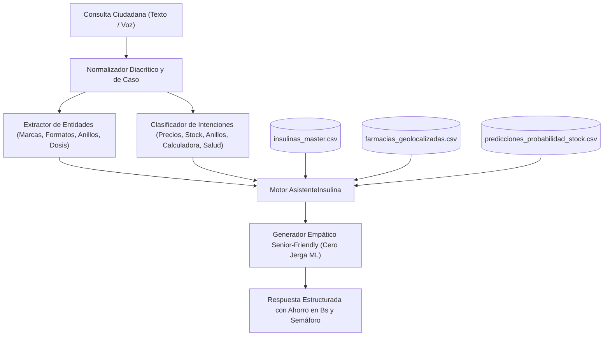

# SCRUM-53 (US-38) — Desarrollo del Asistente Conversacional (Chatbot) en Lenguaje Natural

**Fase CRISP-DM:** Fase 6 — Despliegue / Interfaz Conversacional Ciudadana  
**Historia de Usuario:** `US-38` (`SCRUM-53`)  
**Story Points:** 8 SP  
**Asignado a:** Daniel Molina  
**Sprint:** Sprint 6  
**Estado:** Finalizada  
**Módulos Desarrollados:**  
- `src/chatbot/__init__.py`  
- `src/chatbot/asistente_insulina.py` (Motor conversacional y NLU senior-friendly)  
- `src/chatbot/test_asistente_conversacional.py` (Suite de pruebas unitarias 8/8 OK)  
**Cobertura Global de Pruebas:** 120/120 pruebas unitarias aprobadas (100% éxito)  

---

## 1. Contexto y Objetivos del Asistente Conversacional

En las sesiones de retroalimentación del proyecto y la transición hacia el MVP final, se identificó que muchos adultos mayores jubilados y familiares cuidadores prefieren interactuar formulando preguntas cotidianas directas (por texto o voz) antes que navegar por filtros o menús desplegables complejos.

### Formulación Ágil (US-38):
* **Como** Adulto mayor jubilado o familiar cuidador en Santa Cruz de la Sierra,
* **Quiero** realizar consultas en lenguaje cotidiano sobre precios, disponibilidad y farmacias cercanas para mi insulina,
* **Para** obtener respuestas rápidas, empáticas y claras sobre cuánto voy a gastar y dónde encontrar mi medicamento sin lidiar con tecnicismos estadísticos.

---

## 2. Arquitectura del Motor Conversacional (`src/chatbot/asistente_insulina.py`)

El asistente implementa una arquitectura modular desacoplada basada en reglas de comprensión de lenguaje natural (NLU) tolerantes a fallos ortográficos y variantes dialectales cruceñas:

### 2.1. Entidades Reconocidas
1. **Marcas Comerciales (18 marcas en Santa Cruz):** Lantus, Basalog, Toujeo, Apidra, Novolin N, Novolin R, Novolin 70/30, Humodar NPH, Humodar R, Humodar C25, Densulin N, Densulin R, Densulent, Glaripen, Glaritus, Glinux N, Insugen, Asparpen.
2. **Principios Activos y Acción:** Insulina Glargina (lenta/basal), Insulina Humana NPH (intermedia), Insulina Humana Regular/Cristalina (rápida), Mezclas bifásicas, Glulisina y Asparta.
3. **Formatos de Presentación:** Frasco / Vial / Ampolla (10 ml), Cartucho / Penfill (3 ml), Lapicero prellenado / Pluma descartable (SoloStar, etc.).
4. **Anillos Urbanos de Santa Cruz:** Anillos del 1 al 8, "centro", "casco viejo".
5. **Cadenas Farmacéuticas:** Farmacorp, Farmacias Chávez, Farmacias Telchi.
6. **Dosificación:** Unidades diarias (UI) para proyección presupuestaria a 30 días.

### 2.2. Taxonomía de Intenciones Ciudadanas
| Intención | Ejemplo de Consulta | Comportamiento del Motor |
| :--- | :--- | :--- |
| `CONSULTAR_PRECIO_COMPARATIVO` | *"¿Dónde está más barata la Lantus?"* | Compara precios en Farmacorp, Chávez y Telchi, destaca la opción más barata y el ahorro en Bs. |
| `CONSULTAR_DISPONIBILIDAD_STOCK` | *"¿Hay stock de Novolin N hoy?"* | Explica el semáforo preventivo (Verde, Amarillo, Rojo) y las cadenas con stock físico. |
| `CONSULTAR_SUCURSALES_ANILLO` | *"Farmacias cerca del 2do anillo"* | Filtra sucursales geolocalizadas según el anillo urbano consultado. |
| `CALCULAR_PRESUPUESTO_DOSIS` | *"Uso 30 UI al día, ¿cuánto gasto al mes?"* | Calcula frascos necesarios para 30 días y el costo mensual en la opción más económica. |
| `SALUDO_Y_AYUDA` | *"Hola buenas tardes, ¿qué puedes hacer?"* | Ofrece bienvenida cálida y guía paso a paso para personas de la tercera edad. |
| `CONSULTA_MEDICA_DESVIO` | *"¿Cuánta dosis debo ponerme si tengo azúcar alta?"* | Desvío ético prioritario derivando al médico o especialista endocrinólogo. |

---

## 3. Política de Empatía, Lenguaje Ciudadano y Ética en Salud

### 3.1. Cero Tecnicismos de Machine Learning (Anti-Jargon Guarantee)
El asistente tiene prohibido el uso de términos técnicos en sus respuestas visibles:
- ❌ No menciona: `Machine Learning`, `Random Forest`, `XGBoost`, `AUC-ROC`, `F1-Score`, `Overfitting`, `Lags de importación`.
- ✅ Emplea: *"Stock seguro"*, *"Precaución al comprar"*, *"Agotado temporalmente"*, *"Ahorro para su bolsillo"*, *"Compre antes del cobro de su renta en el Banco Unión"*.

### 3.2. Desvío Ético para Consultas Médicas
Si el usuario consulta sobre cambio de tratamiento, síntomas agudos o recetas médicas, el sistema emite de inmediato una advertencia protectora:
> *"Como asistente de información de precios y farmacias, no puedo indicar dosis, recetar medicamentos ni aconsejar cambios de insulina. Su dosis y tipo de insulina deben ser indicados únicamente por su médico o especialista endocrinólogo."*

---

## 4. Matriz de Validación de Pruebas Unitarias (`test_asistente_conversacional.py`)

| Identificador | Prueba Unitaria | Criterio Evaluado | Estado |
| :--- | :--- | :--- | :---: |
| `test_01` | `test_01_normalizar_texto` | Tolerancia a tildes, mayúsculas y caracteres diacríticos | ✅ Aprobado |
| `test_02` | `test_02_extraccion_marcas_y_principios` | Extracción correcta de Lantus, Novolin N, Basalog, formatos | ✅ Aprobado |
| `test_03` | `test_03_extraccion_anillos_urbanos_santa_cruz` | Detección de anillos 1 a 8, "centro" y "casco viejo" | ✅ Aprobado |
| `test_04` | `test_04_deteccion_intenciones` | Clasificación de precios, stock, sucursales, cálculo y saludo | ✅ Aprobado |
| `test_05` | `test_05_comparativa_precios_y_ahorro_monetario` | Cálculo de ahorro en Bs y selección de mejor cadena | ✅ Aprobado |
| `test_06` | `test_06_calculadora_presupuesto_dosis` | Cálculo de frascos para 30 días según volumen en UI | ✅ Aprobado |
| `test_07` | `test_07_ausencia_tecnicismos_ml_y_empatia_senior` | Cero jerga de ML y longitud estructurada amigable | ✅ Aprobado |
| `test_08` | `test_08_desvio_etico_consultas_medicas` | Derivación médica segura ante preguntas de salud | ✅ Aprobado |

---

## 5. Resumen de Ejecución de Pruebas Globales del Proyecto

La suite consolidada del proyecto cuenta ahora con **120 pruebas unitarias**:
- `src/etl`: 38 pruebas unitarias (Normalización, BCB, Aduana, Geocodificación, Calendario).
- `src/models`: 49 pruebas unitarias (EDA, Modelos ML, Despliegue, Accesibilidad UI).
- `src/pipeline`: 25 pruebas unitarias (Integridad de staging, refresh web, gates de producción).
- `src/chatbot`: 8 pruebas unitarias (NLU, intenciones, comparativas, ética médica).
- **Resultado Global:** 120 pasadas, 0 fallos, 0 errores.
