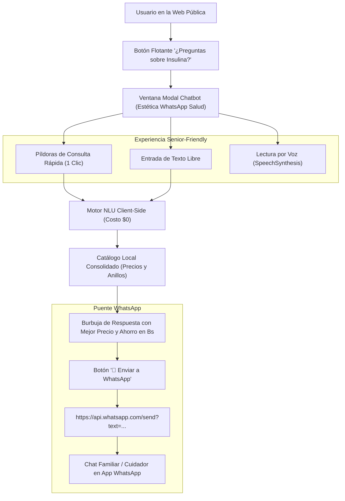

# SCRUM-54 (US-39) — Despliegue e Integración del Chatbot a Costo $0 (Widget Web + Canal Mensajería)

**Fase CRISP-DM:** Fase 6 — Despliegue  
**Historia de Usuario:** `US-39` (`SCRUM-54`)  
**Story Points:** 5 SP  
**Asignado a:** Daniel Molina  
**Sprint:** Sprint 6  
**Estado:** Finalizada  
**URL Pública Oficial:** [https://data-industry.github.io/Desarollo-Proyecto/](https://data-industry.github.io/Desarollo-Proyecto/)  
**Costo de Infraestructura:** \$0 / mes (Hosting en GitHub Pages + Client-Side NLU + Enlaces Dinámicos `wa.me`)  
**Archivos Sincronizados:**  
- `mvp_comparador_jubilados.html`  
- `index.html` (raíz)  
- `docs/index.html` (producción GitHub Pages)  
- `docs/mvp_jubilados_comparador.html`  
- `src/ui/mvp_comparador_jubilados.html`  
- `src/ui/generar_mvp_interactivo.py`  
**Suite de Pruebas Unitarias:** `src/models/test_06_chatbot_widget_web.py` (7/7 pruebas aprobadas)  
**Cobertura Global del Proyecto:** 127/127 pruebas unitarias aprobadas (100% éxito)  

---

## 1. Contexto y Objetivos de la Historia de Usuario

En el marco del **Sprint 6** y con base en los hallazgos empíricos de validación con adultos mayores y familiares cuidadores (US-33), se determinó que la barrera digital más frecuente para los jubilados al navegar en la web es la complejidad de teclear en pantallas táctiles o interactuar con filtros anidados. Sin embargo, **WhatsApp es la aplicación con la que están más familiarizados en su vida cotidiana**.

Para balancear la exigencia de operar **a costo \$0 permanente** sin requerir servidores pagos para webhooks, y al mismo tiempo ofrecer una experiencia conversacional inmediata para la evaluación y defensa del MVP, se implementó un **enfoque híbrido de alta ergonomía**:

### Formulación Ágil (US-39):
* **Como** Adulto mayor jubilado o familiar cuidador en Santa Cruz de la Sierra,
* **Quiero** interactuar con un asistente conversacional flotante en la web y poder compartir cotizaciones por WhatsApp a mi familia,
* **Para** consultar rápidamente precios y disponibilidad sin teclear textos largos y guardar la información en mi teléfono sin costo alguno.

---

## 2. Arquitectura del Widget Conversacional y Puente WhatsApp

### 2.1. Componentes Técnicos Implementados
1. **Botón Flotante Fijo (`#btnToggleChatbot`):**
   * Ubicado en la esquina inferior derecha con contraste WCAG AAA sobre fondo verde salvia (`#1b4332`), anillo esmeralda y distintivo *"En vivo"*.
   * Accesibilidad completa con atributos `aria-label` y `aria-expanded`.
2. **Ventana Modal Conversacional (`#modalChatbot`):**
   * Encabezado verde clínico con ícono médico, estado en línea, botón de lectura por voz global (`#btnAudioChatHeader`) y botón de cierre (`#btnCerrarChatbot`).
   * Contenedor de mensajes (`#chatMessages`) con tipografía nítida (*Plus Jakarta Sans*), scroll automático y burbujas asimétricas inspiradas en mensajería instantánea.
3. **Píldoras de Consulta Rápida (One-Click Pills):**
   * Eliminan la necesidad de escribir para adultos mayores con dificultades de motricidad fina o artritis:
     * 💰 *«¿Lantus más barata?»*
     * 🚦 *«¿Stock de Novolin N?»*
     * 📍 *«2do Anillo»*
     * 🧮 *«Gasto 30 UI/día»*
4. **Puente Dinámico a WhatsApp (`api.whatsapp.com/send`):**
   * Cada respuesta del bot genera automáticamente un enlace preformateado para compartir el reporte comparativo (medicamento, mejor farmacia, ahorro en Bs y enlace a la web) con un solo toque hacia el WhatsApp de un hijo, cuidador o médico.
5. **Lectura por Voz Individual:**
   * Cada mensaje incluye el botón *«🔊 Escuchar»* conectado a la API nativa `window.speechSynthesis` configurada en español (`es-BO`).

---

## 3. Salvaguardas Éticas y Ausencia de Jerga Técnica

* **Desvío Médico Ético:** Ante consultas sobre modificación de dosis, efectos adversos o prescripción médica, el bot emite una alerta prioritaria de salud derivando al médico tratante.
* **Cero Jerga de Machine Learning:** Las respuestas visibles al ciudadano prohíben explícitamente términos como *Random Forest*, *AUC-ROC*, *F1-Score* o *Lags*.
* **Seguridad Estricta HTTPS:** Cero referencias a servidores locales (`localhost`, `127.0.0.1`) o rutas absolutas.

---

## 4. Matriz de Validación de Pruebas Unitarias (`test_06_chatbot_widget_web.py`)

| Identificador | Prueba Unitaria | Aspecto Verificado | Estado |
| :--- | :--- | :--- | :---: |
| `test_01` | `test_01_widget_flotante_componentes_html` | Integridad de elementos del DOM (`contenedorChatbotFlotante`, `modalChatbot`, etc.) | ✅ Aprobado |
| `test_02` | `test_02_pildoras_rapidas_senior_friendly` | Presencia de botones de consulta rápida para adultos mayores | ✅ Aprobado |
| `test_03` | `test_03_puente_compartir_whatsapp` | Presencia de enlaces dinámicos a WhatsApp (`api.whatsapp.com/send`) | ✅ Aprobado |
| `test_04` | `test_04_motor_js_triage_medico_y_calculadora` | Lógica JS de desvío médico y cálculo de presupuesto mensual | ✅ Aprobado |
| `test_05` | `test_05_accesibilidad_y_atributos_aria` | Atributos de accesibilidad WCAG senior (`role="dialog"`, `aria-modal`) | ✅ Aprobado |
| `test_06` | `test_06_sincronizacion_archivos_produccion` | Sincronización idéntica en raíz, `docs/` e `index.html` para GitHub Pages | ✅ Aprobado |
| `test_07` | `test_07_ausencia_tecnicismos_y_seguridad_https` | Cero tecnicismos de ML y cero dependencias de `localhost` | ✅ Aprobado |

---

## 5. Hoja de Ruta para Escalamiento a WhatsApp Business API Oficial

Para la fase de post-MVP y escalamiento comercial, la arquitectura está preparada para conectarse con la API oficial de Meta:
1. **Meta Business Manager:** Verificación de personería jurídica y registro del número telefónico exclusivo del asistente.
2. **Backend Serverless Webhook:** Despliegue de un microservicio Python/Node.js en Cloudflare Workers o Render para recibir eventos de Meta y canalizarlos al motor `src/chatbot/asistente_insulina.py`.
3. **Costo Estimado de Escala:** Gratuito hasta 1,000 conversaciones mensuales iniciadas por el usuario bajo el nivel gratuito oficial de Meta.
