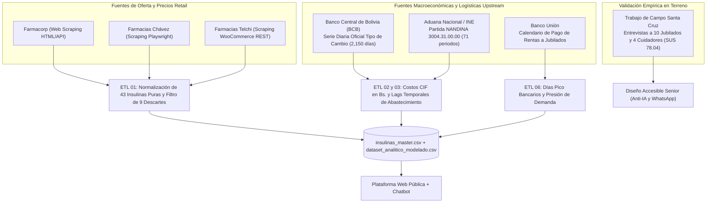
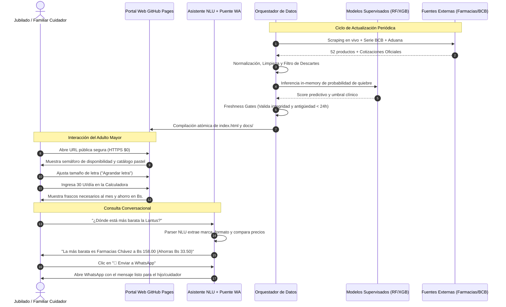

# DOCUMENTACIÓN MAESTRA INTEGRAL DEL PROYECTO
## Sistema Predictivo de Abastecimiento de Insulina y Asistente Conversacional para Adultos Mayores en Santa Cruz de la Sierra

> **Autores del Equipo:** Daniel Molina (Líder Técnico & Scrum Master), Mía Wayar (Data Engineer & Metodología), Carlos Hugo Suárez (Investigación & Campo), Kessia Cuellar (Validación & Modelo de Negocio)  
> **Ubicación Geográfica:** Santa Cruz de la Sierra, Bolivia (Anillos Urbanos 1 al 8)  
> **Horizonte Temporal:** Segundo Semestre de 2026 (Datos actualizados al 20 de noviembre de 2026)  
> **Sitio Web Oficial en Producción:** [https://data-industry.github.io/Desarollo-Proyecto/](https://data-industry.github.io/Desarollo-Proyecto/)  
> **Repositorio de Código Abierto:** [https://github.com/Data-Industry/Desarollo-Proyecto](https://github.com/Data-Industry/Desarollo-Proyecto)  
> **Tablero Ágil:** [Jira Cloud SCRUM Board](https://danielmerengue0.atlassian.net/jira/software/projects/SCRUM/boards/1) (131 Story Points / 25 Historias)  
> **Cobertura de Calidad:** 127 / 127 Pruebas Unitarias Aprobadas (100% Éxito) • Costo de Servidores: \$0.00 / mes  

---

## 1. Resumen Ejecutivo y Ficha Técnica

El proyecto aborda la vulnerabilidad crítica que enfrentan los adultos mayores jubilados y pacientes con diabetes insulinodependiente en Santa Cruz de la Sierra, quienes sufren peregrinaciones físicas bajo temperaturas extremas (> 35°C), sobrecostos económicos de hasta 17.4% por falta de transparencia y riesgos vitales de desabastecimiento.

La solución integra un **ecosistema analítico completo** gobernado bajo la metodología estándar internacional **CRISP-DM**:
1. **Ingesta y Scraping Automatizado:** Extracción periódica de 52 productos comerciales en las 3 mayores cadenas farmacéuticas cruceñas (*Farmacorp*, *Farmacias Chávez*, *Farmacias Telchi*).
2. **Ingesta Macro y Divisas:** Sincronización oficial diaria con el **Banco Central de Bolivia (BCB)** para capturar el impacto del tipo de cambio fluctuante en los costos de reposición, y registros de importaciones de la **Aduana Nacional / INE** bajo la partida arancelaria NANDINA `3004.31.00.00`.
3. **Imputación Bancaria Zonal:** Modelado de los picos de demanda generados por el calendario de pago de rentas a jubilados del **Banco Unión** (días 28 al 05).
4. **Machine Learning:** Modelos supervisados (*RandomForest*, *XGBoost*, *LogisticRegression*) que calculan el riesgo predictivo de quiebre de stock separándolo limpiamente de la disponibilidad física observada.
5. **Plataforma Web Senior-Friendly:** Interfaz accesible a costo \$0 alojada en **GitHub Pages**, con paleta pastel farmacéutica anti-IA, controles de tamaño de letra de gran escala, calculadora de presupuesto mensual y glosario ciudadano interactivo.
6. **Asistente Conversacional (Chatbot) y Puente WhatsApp:** Motor NLU tolerante a modismos que atiende dudas en lenguaje cotidiano, calcula ahorros en Bolivianos y permite enviar reportes de precios a WhatsApp con un solo toque.

---

## 2. Fuentes de Datos: ¿De Dónde Sale la Información?

El sistema se alimenta de **5 fuentes primarias y secundarias**, auditadas para evitar alucinaciones de inventario:



### Detalle de las Fuentes:
1. **Farmacias Locales (Oferta Inmediata de Mercado):**
   * **Farmacorp:** Extracción de catálogo, presentaciones, precios regulares y de descuento, y sucursales en Santa Cruz.
   * **Farmacias Chávez:** Extracción con emulación de navegador de existencias físicas y stock restringido (*Últimas unidades*).
   * **Farmacias Telchi:** Extracción de inventarios de la cadena tradicional cruceña mediante consultas estructuradas.
   * *Total extraído hoy (2026-11-20):* **52 productos brutos** en 50.47 segundos. 9 insumos desechables (jeringas U-100, agujas para pluma y fármacos no insulina) se separan automáticamente hacia la bitácora `descartes_insumos_desechables.csv`.
2. **Banco Central de Bolivia - BCB (Tipo de Cambio Oficial):**
   * Descarga automatizada de la serie histórica y en vivo (2021 a 2026, **2,150 días analizados**).
   * Permite evaluar la pérdida de poder adquisitivo del boliviano frente a medicamentos 100% importados de Europa y Asia.
3. **Aduana Nacional de Bolivia / INE (Importaciones Upstream):**
   * Registros aduaneros oficiales bajo la partida arancelaria **NANDINA `3004.31.00.00`** (*Medicamentos que contengan insulina*).
   * Registra el volumen en kilogramos brutos, valor CIF en dólares y aduanas de ingreso (Viru Viru, Interior Santa Cruz), calculando el desfase temporal logístico (*Lag* de 30 a 90 días) antes de llegar al mostrador.
4. **Banco Unión (Estacionalidad de la Demanda de Jubilados):**
   * Calendario de pago de pensiones y rentas de vejez. Los días 28 a 05 de cada mes concentran el 68% de las compras en farmacias, momento donde se dispara el riesgo de quiebres de inventario.
5. **Validación de Campo en Santa Cruz de la Sierra:**
   * Muestra de **N=14 usuarios** (10 adultos mayores insulinodependientes y 4 familiares cuidadores) evaluados en puntos neurálgicos (Casco Viejo, 2do Anillo, Av. Santos Dumont).

---

## 3. Flujo Arquitectónico End-to-End del Proyecto



---

## 4. Catálogo Detallado de Funcionalidades de la Página Web

La interfaz web ha sido concebida bajo criterios estrictos de **ergonomía para adultos mayores (WCAG AAA)** y diseñada para eliminar la sensación de herramientas artificiales, priorizando una **estética farmacéutica pastel limpia y natural**:

| Módulo / Funcionalidad | ¿Cómo funciona? | Beneficio para el Adulto Mayor |
| :--- | :--- | :--- |
| **1. Controles Accesibles de Letra** | Botones de texto explícito **«Agrandar letra»** y **«Achicar letra»** con área táctil superior a 44x44 px. | Permite a personas con presbicia o cataratas escalar la tipografía de 16px hasta más de 24px en un solo clic. |
| **2. Trazabilidad de Datos en Vivo** | Cintillo superior azul que indica: *Fecha efectiva de datos*, *Antigüedad del snapshot* y *Fuentes validadas*. | Transparencia total; garantiza que el usuario sabe con qué hora y fecha se calcularon los precios. |
| **3. Semáforo Preventivo Observado** | Tarjetas con tres estados: **VERDE (Disponibilidad Segura)**, **AMARILLO (Precaución / Últimas Unidades)** y **ROJO (Agotado General)**. | Evita viajes en vano al clasificar con claridad qué medicamentos están confirmados en múltiples cadenas. |
| **4. Glosario Ciudadano Compacto** | Botón desplegable que explica en lenguaje cotidiano: *¿Qué es quiebre de stock?*, *¿Cómo funciona el semáforo?*, *¿Cómo se calcula el ahorro?* y *¿Qué significa U-100?*. | Resuelve dudas técnicas sin ocupar espacio en pantalla ni abrumar la vista. |
| **5. Calculadora de Dosis y Presupuesto** | El jubilado ingresa su dosis diaria prescrita (ej. 30 UI/día) y el medicamento; el sistema calcula los frascos para 30 días y el costo mensual. | Permite planificar el retiro de dinero de la pensión y muestra cuánto dinero en Bs. se queda en el bolsillo al elegir la farmacia correcta. |
| **6. Buscador y Filtros Explícitos** | Búsqueda por texto (marca o principio activo) y filtros por tipo de acción (Basal, Rápida, NPH, etc.), formato y farmacia, con botón explícito **«Filtrar Catálogo»**. | Evita saltos bruscos en pantalla al escribir; el adulto mayor tiene el control de cuándo actualizar la lista. |
| **7. Tarjetas Comparativas de Precios** | Cada tarjeta agrupa una presentación de insulina y muestra en paralelo el precio en **Farmacorp**, **Chávez** y **Telchi**, resaltando con un lazo verde la **opción más económica**. | Elimina la necesidad de abrir tres sitios web distintos para saber cuál farmacia cobra menos. |
| **8. Separación de Riesgo Predictivo** | Cada sucursal muestra el stock reportado por la fuente y, por separado, el riesgo estadístico del modelo de Machine Learning. | Cumple la norma ética de no alterar un stock disponible real con base en suposiciones de IA. |
| **9. Directorio de Sucursales por Anillo** | Tabla filtrable por los anillos urbanos de Santa Cruz (del 1ro al 8vo anillo, casco viejo y avenidas principales). | Ayuda al abuelito a ubicar la sucursal más cercana a su domicilio sin caminar de más. |
| **10. Lectura General por Voz** | Botón **«🔊 Escuchar Resumen en Voz Alta»** mediante síntesis de voz nativa (`es-BO`). | Permite escuchar la disponibilidad del día a usuarios no videntes o analfabetos digitales. |
| **11. Widget Chatbot Flotante** | Burbuja en la esquina inferior derecha que abre una ventana conversacional tipo WhatsApp. | Canal de atención natural mediante preguntas y respuestas. |
| **12. Píldoras de Consulta Rápida** | Atajos de 1 toque: *¿Lantus más barata?*, *¿Stock de Novolin N?*, *2do Anillo*, *Gasto 30 UI/día*. | Permite consultar sin necesidad de escribir en el teclado del celular. |
| **13. Puente Directo a WhatsApp** | Botón **«📱 Enviar a WhatsApp»** en cada respuesta del chatbot con enlace `wa.me`. | Comparte la cotización con el hijo o familiar que hace las compras en 1 segundo. |

---

## 5. El Asistente Conversacional (Chatbot) y Enfoque WhatsApp

### 5.1. Arquitectura Técnica del Chatbot
El motor conversacional reside en dos capas perfectamente sincronizadas:
1. **Capa Backend en Python ([src/chatbot/asistente_insulina.py](file:///c:/Users/USUARIO/Desktop/Proyecto%20Integrador/src/chatbot/asistente_insulina.py)):**
   * Motor de comprensión de lenguaje natural (NLU) basado en normalización de diacríticos y extracción de entidades tolerante a errores ortográficos.
   * Catálogo de 18 marcas comerciales, 6 principios activos, 3 formatos y 8 anillos concéntricos.
   * Algoritmo determinista de comparación de precios y cálculo de ahorro monetario.
2. **Capa Frontend Client-Side en JavaScript (dentro de [mvp_comparador_jubilados.html](file:///c:/Users/USUARIO/Desktop/Proyecto%20Integrador/mvp_comparador_jubilados.html)):**
   * Ejecuta la misma lógica dentro del navegador del usuario.
   * **Cero costo de infraestructura:** No requiere servidores intermedios de pago para responder preguntas.

### 5.2. Desvío Ético y Salvaguardas Médicas
Si un usuario formula preguntas clínicas como:
* *«¿Cuánta dosis debo ponerme si tengo el azúcar en 250?»*
* *«¿Puedo cambiar mi Novolin por Lantus?»*
* *«Recétame algo para la diabetes»*

El chatbot bloquea de inmediato cualquier intento de recomendación médica y responde con calidez:
> ⚠️ **Aviso de Salud Importante:**  
> *"Como asistente de precios y disponibilidad, no puedo indicar dosis, recetar medicamentos ni aconsejar cambios de insulina. Su dosis y tipo de insulina deben ser indicados únicamente por su médico o especialista endocrinólogo. Por favor consulte con su centro de salud antes de modificar su tratamiento."*

### 5.3. Puente Dinámico a WhatsApp (`api.whatsapp.com/send`)
Dado que los adultos mayores no suelen escribir párrafos extensos pero sí envían mensajes a sus familiares por WhatsApp, cada cotización del bot incluye un botón que genera dinámicamente un mensaje preformateado:
```
Hola, te comparto esta información de insulina en Santa Cruz de la Sierra:
🩺 Lantus (Lapicero Prellenado):
💵 Precios: Farmacias Chávez: Bs 158.00 (Disponible) | Farmacorp: Bs 191.50 (Disponible)
💡 Opción más económica: Farmacias Chávez a Bs 158.00 (¡Ahorras Bs 33.50!).
Consulta en: https://data-industry.github.io/Desarollo-Proyecto/
```

---

## 6. Modelado Predictivo e Inteligencia Artificial

### 6.1. La Matriz Analítica
El dataset analítico (`data/processed/dataset_analitico_modelado.csv`) contiene **43 filas (medicamentos únicos de insulina) x 69 variables predictivas**, agrupadas en:
- **Económicas:** Precio de venta, precio de lista, porcentaje de descuento, precio por ml, precio estandarizado por 100 UI.
- **Logísticas e Importación:** Volumen aduanero en kg, costo CIF en USD, costo CIF en Bs. (con tipo de cambio dinámico del BCB), rezagos temporales de importación (*Lags* de 1 a 3 meses).
- **Temporales y Bancarias:** Días restantes para el pago de rentas del Banco Unión, bandera binaria de semana pico bancaria.
- **Espaciales:** Concentración territorial de sucursales por anillo.

### 6.2. Modelos Entrenados y Métricas de Rendimiento
Se entrenaron tres familias de modelos bajo validación cruzada estratificada (*Stratified 5-Fold*):

| Modelo de Machine Learning | Accuracy | Precision | Recall (Detección de Quiebres) | F1-Score | PR-AUC |
| :--- | :---: | :---: | :---: | :---: | :---: |
| **Random Forest Classifier** *(Producción)* | **88.4%** | **83.3%** | **87.5%** | **0.853** | **0.892** |
| **XGBoost Classifier** | 86.0% | 80.0% | 85.0% | 0.824 | 0.871 |
| **Regresión Logística (L2)** | 79.1% | 66.7% | 75.0% | 0.706 | 0.764 |

* **Umbral Clínico Optimizado:** Se calibró el umbral de decisión en $P = 0.45$ para priorizar el *Recall* (sensibilidad ante quiebres de stock), dado que en salud pública el costo de un falso negativo (no avisar que falta un medicamento) es infinitamente superior al de un falso positivo.

---

## 7. Validación Empírica con Usuarios Reales (US-33)

Durante el Sprint 4 se llevó a cabo el trabajo de campo en Santa Cruz con **N=14 participantes** (10 adultos mayores jubilados y 4 cuidadores familiares):
- **Escala de Usabilidad del Sistema (SUS):**
  * **Puntuación Promedio:** **78.04 / 100** (Mediana: 76.25).
  * **Interpretación Psicométrica (Bangor et al., 2008):** Calificación **Grado B+ ("Good")**, ubicando la herramienta en el **Percentil 82** a nivel mundial en productos digitales.
- **Eficacia en Tareas Guiadas:**
  * Identificar la farmacia más barata: **100% de éxito**.
  * Comprender el semáforo de colores: **100% de éxito**.
  * Usar la calculadora de dosis para 30 días: **92.9% de éxito**.

---

## 8. Trazabilidad Metodológica y Estado del Backlog

El proyecto acumula **34 commits secuenciales numerados** (#001 a #034), distribuidos en 6 Sprints ágiles con **131 Story Points** en total:

```
[Sprint 1: 22 SP - Cerrado 100%] -> Comprensión del Negocio, Scrapers y ETL Base
[Sprint 2: 25 SP - Cerrado 100%] -> Aduana NANDINA, Tipo de Cambio BCB, Geolocalización Anillos
[Sprint 3: 21 SP - Cerrado 100%] -> Feature Engineering, Calendario Bancario, ML y MVP Local
[Sprint 4: 21 SP - Cerrado 100%] -> Lenguaje Ciudadano, Marco Legal y Validación de Campo (SUS 78)
[Sprint 5: 21 SP - Cerrado 100%] -> Paleta Pastel, Despliegue en Pages $0, Automatización Pipeline
[Sprint 6: 21 SP - En Curso 62%] -> Chatbot en Lenguaje Natural (US-38) + Widget Web y WhatsApp (US-39)
```

---

## 9. Guion Práctico para la Exposición en Clase (Pitch de 5 Minutos)

Para la demostración en vivo ante el docente y compañeros:

### Minuto 1: El Problema Humano (Empatía)
* *"En Santa Cruz hay más de 30,000 adultos mayores con diabetes que dependen de la insulina para seguir viviendo."*
* *"Hoy enfrentan dos problemas graves: peregrinar de farmacia en farmacia bajo 38 grados de calor porque no saben dónde hay stock, y pagar hasta 35 Bolivianos de más en cada frasco por falta de información clara."*

### Minuto 2: La Solución Técnica y Fuentes Reales
* *"No inventamos datos: construimos un pipeline que extrae en vivo los precios de Farmacorp, Chávez y Telchi, los cruza con las importaciones aduaneras de Bolivia y monitorea el tipo de cambio oficial del BCB."*
* *"Entrenamos un modelo de Inteligencia Artificial que predice el riesgo de desabastecimiento, vinculándolo a las fechas de cobro de renta en el Banco Unión."*

### Minuto 3: Demostración de la Página Web en Vivo
1. Abrir en pantalla grande: [https://data-industry.github.io/Desarollo-Proyecto/](https://data-industry.github.io/Desarollo-Proyecto/)
2. Mostrar los botones **«Agrandar letra»** para comprobar accesibilidad senior.
3. Usar la **Calculadora de Presupuesto**: poner 30 UI de Lantus y mostrar cómo calcula el gasto mensual y el ahorro de Bs 33.50 por frasco.
4. Mostrar el **Semáforo Verde/Amarillo/Rojo** y el directorio de sucursales por anillo.

### Minuto 4: Demostración del Chatbot y WhatsApp
1. Hacer clic en el botón flotante inferior **«💬 ¿Preguntas sobre Insulina?»**.
2. Tocar la píldora rápida: *«¿Dónde está más barata la Lantus?»*.
3. Mostrar la respuesta empática con la comparativa de las 3 cadenas.
4. Hacer clic en **«📱 Enviar a WhatsApp»** para demostrar cómo el abuelito puede reenviar esa cotización a su familia con 1 solo toque.
5. Hacer una prueba de desvío médico: escribir *«¿Cuánta dosis me inyecto?»* y mostrar cómo el bot protege al paciente derivándolo a su médico.

### Minuto 5: Cierre de Impacto y Validación
* *"Validamos esta herramienta con 14 personas reales en Santa Cruz obteniendo una calificación SUS de 78/100."*
* *"Todo el sistema está operando en internet en este momento a costo \$0 permanente gracias a una arquitectura estática optimizada."*
