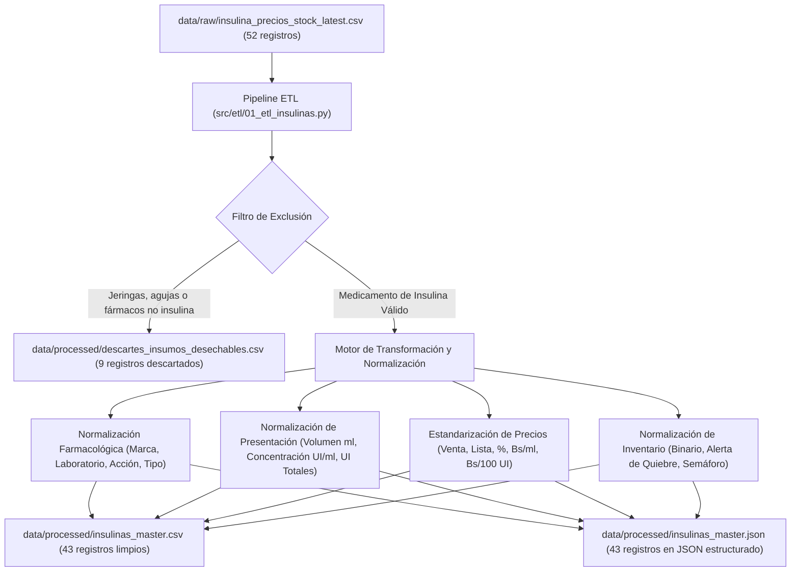

# Módulo ETL: Limpieza, Estandarización y Normalización de Insulinas

**Historia de Usuario:** `US-22` (Pipeline ETL de limpieza, estandarización de precios y normalización de insulinas)  
**Épica Jira:** Fase 3: Preparación de los Datos (CRISP-DM)  
**Story Points:** 5 SP  
**Sprint:** Sprint 1  

---

## 1. Descripción y Objetivo

Este módulo implementa el pipeline de Extracción, Transformación y Carga (ETL) para procesar los datos crudos extraídos mediante web scraping (`data/raw/`) de las principales cadenas farmacéuticas en Santa Cruz de la Sierra (**Farmacorp**, **Farmacias Chávez** y **Farmacias Telchi**).

### Objetivos Clave de US-22:
1. **Descarte de insumos y fármacos fuera de alcance:** Exclusión automática de jeringas, agujas para lapiceras y medicamentos que no son insulina (e.g. denosumab, ácido hialurónico).
2. **Normalización farmacológica y clínica:** Extracción y estandarización de principio activo, tipo de acción biológica, origen biológico, formato de presentación física, volumen (ml), concentración (UI/ml) y unidades totales (UI).
3. **Estandarización económica y métricas comparables:** Homologación de moneda a Bolivianos (Bs.), cálculo de porcentaje de descuento, precio normalizado por mililitro (`precio_por_ml_bs`) y precio por 100 UI (`precio_por_100ui_bs`).
4. **Normalización de inventario:** Creación de variables binarias de disponibilidad, flags de alerta temprana de desabastecimiento y semáforo de inventario (`VERDE`, `AMARILLO`, `ROJO`).
5. **Generación de identificador único canónico:** Clave maestra `id_insulina_master` para trazabilidad analítica.

---

## 2. Arquitectura del Pipeline



---

## 3. Criterios de Exclusión (Auditoría de Descartes)

Se identifican y separan registros crudos que no corresponden a medicamentos de insulina bajo los siguientes criterios:
- **Insumos descartables:** Registros con precio unitario < 15.00 Bs. o palabras clave como `jeringa`, `aguja`, `toallita`, `pañal`.
- **Fármacos no insulina:** Medicamentos que aparecieron en las búsquedas por error de indexación en las farmacias (e.g. `denosumab`, `densimab`, `resyniv`, `ácido hialurónico`, `ibesia`).

Los registros descartados se almacenan con su respectivo motivo de descarte en `data/processed/descartes_insumos_desechables.csv` para auditoría y trazabilidad.

---

## 4. Diccionario de Datos del Dataset Maestro (`insulinas_master.csv`)

| Campo | Tipo | Descripción | Ejemplo |
| :--- | :--- | :--- | :--- |
| `id_insulina_master` | String | Identificador canónico único asignado en el pipeline ETL | `INS-FMC-001` |
| `id_origen` | String | ID original de producto asignado por la plataforma e-commerce | `FARMACORP-5028961976452` |
| `farmacia` | String | Nombre de la cadena farmacéutica | `Farmacorp`, `Farmacias Chávez`, `Farmacias Telchi` |
| `marca_comercial` | String | Marca comercial estandarizada del medicamento | `Lantus`, `Toujeo`, `Novolin N`, `Basalog` |
| `principio_activo` | String | Principio activo médico normalizado | `Insulina Glargina`, `Insulina Humana NPH (N)` |
| `tipo_accion` | String | Clasificación farmacodinámica del perfil temporal de acción | `Acción Prolongada (Basal)`, `Acción Rápida (Prandial)` |
| `origen_biologico` | String | Origen y tecnología de síntesis | `Análogo de Insulina`, `Insulina Humana ADN Recombinante` |
| `laboratorio_fabricante` | String | Laboratorio farmacéutico productor | `Sanofi-Aventis`, `Novo Nordisk`, `Biocon Biologics` |
| `formato_presentacion` | String | Formato físico de administración | `Lapicero Prellenado (Pluma)`, `Vial / Frasco Ampolla`, `Cartucho` |
| `volumen_ml` | Float | Volumen nominal del envase en mililitros | `1.5`, `3.0`, `10.0` |
| `concentracion_ui_ml` | Integer | Concentración biológica en Unidades Internacionales por ml | `100`, `300` |
| `unidades_totales_ui` | Integer | Total de Unidades Internacionales por envase ($volumen \times concentracion$) | `300`, `450`, `1000` |
| `precio_venta_bs` | Float | Precio final de venta al público en Bolivianos (Bs.) | `143.13`, `547.30`, `1318.06` |
| `precio_lista_bs` | Float | Precio regular de lista sin descuentos en Bolivianos (Bs.) | `153.90`, `585.00` |
| `descuento_porcentaje` | Float | Porcentaje de descuento aplicado sobre el precio regular | `0.0`, `7.0` |
| `precio_por_ml_bs` | Float | Métrica comparable: Precio en Bs. por mililitro ($precio / volumen$) | `14.31`, `54.73`, `209.26` |
| `precio_por_100ui_bs` | Float | Métrica comparable: Precio en Bs. por 100 UI ($precio / (UI_{totales} / 100)$) | `14.31`, `54.73`, `209.26` |
| `estado_stock` | String | Estado textual normalizado de disponibilidad | `DISPONIBLE`, `ULTIMAS_UNIDADES`, `AGOTADO` |
| `stock_disponible_binario`| Integer | Variable binaria analítica (1 = Con stock, 0 = Sin stock) | `1`, `0` |
| `alerta_quiebre_stock` | Integer | Flag para monitoreo preventivo (1 = Agotado o últimas unidades, 0 = Disponible) | `0`, `1` |
| `semaforo_stock` | String | Categoría semafórica para tableros BI y alertas | `VERDE`, `AMARILLO`, `ROJO` |
| `sucursal` | String | Sucursal o canal de cobertura en la ciudad | `Santa Cruz de la Sierra (Cobertura Red Farmacorp)` |
| `ciudad` | String | Ciudad de cobertura | `Santa Cruz de la Sierra` |
| `departamento` | String | Departamento geográfico | `Santa Cruz` |
| `url_producto` | String | Enlace directo a la ficha del producto en la farmacia | `https://farmacorp.com/products/...` |
| `timestamp_extraccion` | String | Timestamp ISO-8601 del scraping original | `2026-10-19 19:10:52.621169+00:00` |

---

## 5. Instrucciones de Uso y Ejecución

Para ejecutar el pipeline ETL y actualizar el dataset maestro:

```powershell
# Desde la raíz del repositorio:
python src/etl/01_etl_insulinas.py
```

### Salida esperada:
```text
[INFO] === INICIANDO PIPELINE ETL DE LIMPIEZA Y NORMALIZACIÓN (US-22) ===
[INFO] Cargando dataset crudo desde: data/raw/insulina_precios_stock_latest.csv
[INFO] Total registros crudos leídos: 52
[INFO] === PIPELINE ETL COMPLETADO EXITOSAMENTE ===
[INFO] Medicamentos de insulina limpios y normalizados: 43
[INFO] Insumos / fármacos no insulina descartados: 9
[INFO] Dataset maestro guardado en: data/processed/insulinas_master.csv
[INFO] Bitácora de descartes guardada en: data/processed/descartes_insumos_desechables.csv
```
